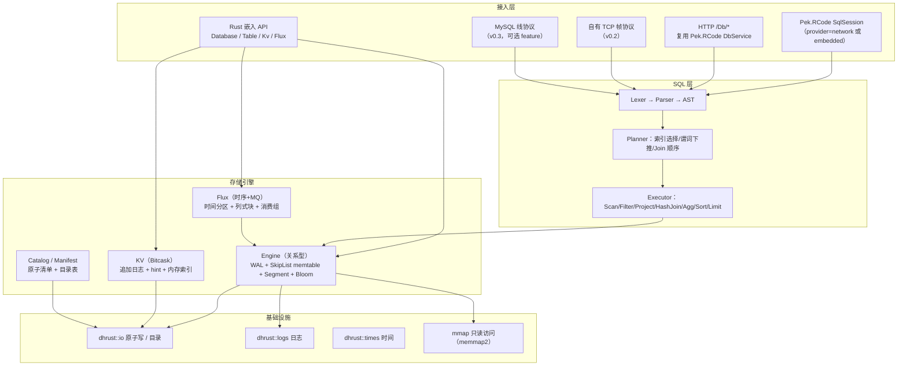
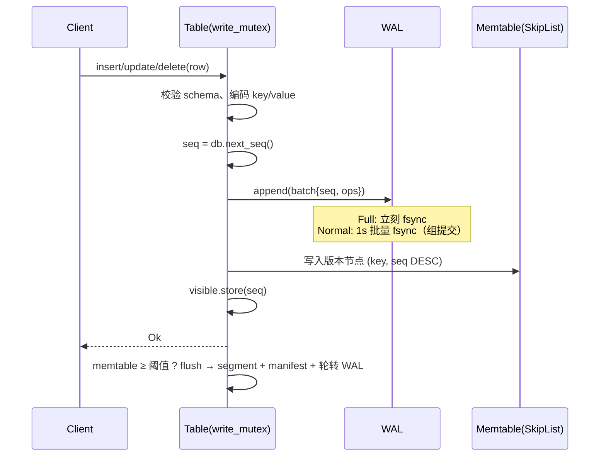
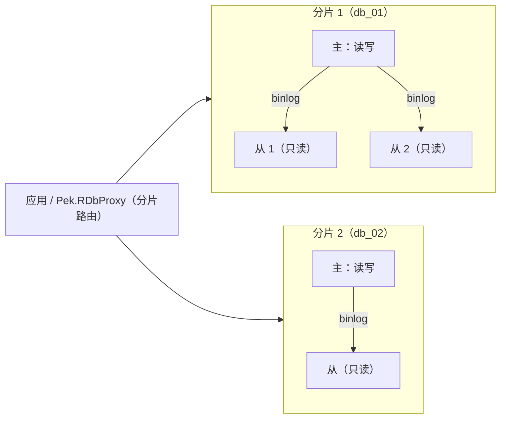
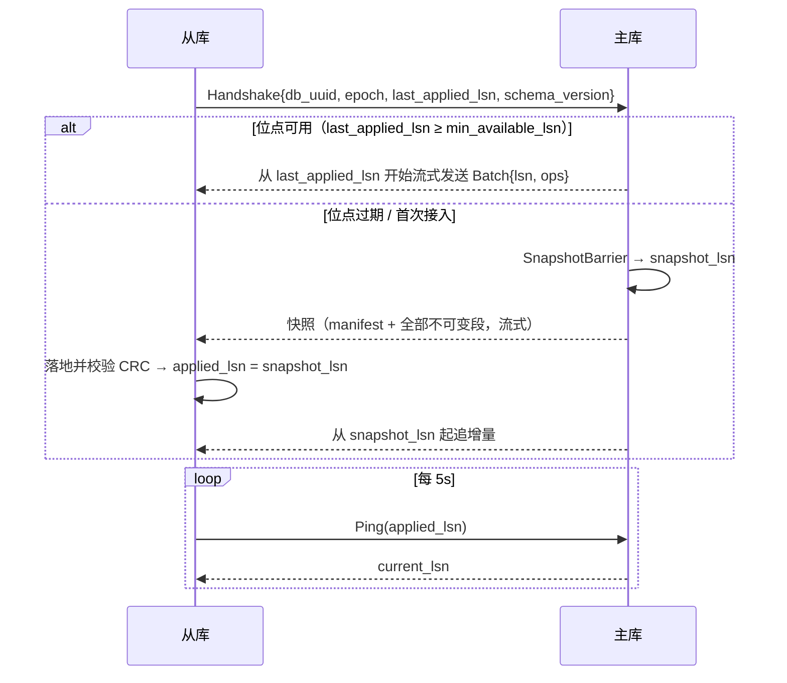

# Pek.RDB 架构设计（v0.1 草案）

> 本文是 Pek.RDB 的**唯一设计口径**：代码与文档冲突时以本文为准，改动设计需同步更新本文并在 `docs/决策记录.md` 追加一节（含用户原话）。
>
> 参考产品：NewLife.NovaDb（C#，嵌入/网络双模、四引擎融合）。**只借鉴能力边界，不照搬实现**；差异见 §2。

---

## 0. 一句话定位

用一个 Rust 进程/库，替代「SQLite（嵌入关系库）+ Redis（KV/队列）+ TDengine（时序）+ 部分 MySQL（网络多客户端）」的四类组件，
以**文件夹即数据库**、**裁剪冷门 SQL 能力**换取**更高读写性能**与**更低运维成本**。

## 1. 目标与非目标

### 1.1 目标

| 维度 | 目标 |
|---|---|
| 部署形态 | 嵌入（库）+ 网络（独立进程），同一套存储内核 |
| 数据规模 | 单表 10⁸ 行量级；总量受磁盘约束，逻辑无上限（按时间/哈希切分） |
| 读写性能 | 单机点查/点写 p99 目标见 §16；写路径 WAL 组提交 + 无随机写放大 |
| 运维成本 | 无外部依赖、无安装步骤；拷目录=迁移/备份；无 dump/restore |
| 生态集成 | Pek.RCode ORM 原生可用（实现 `SqlSession` / 复用 `DbService` 的 `/Db/*` 协议） |
| 依赖约束 | **纯 Rust 依赖，零 C/C++ 动态库**（可 zig 交叉编译 musl） |

### 1.2 非目标（明确裁剪，不做）

- 存储过程、触发器、视图、窗口函数、游标、UDF 插件、字符集/排序规则矩阵。
- 完整 SQL92；只做「业务 80% 常用子集」。
- 跨表强一致事务（MVCC 只保证**单表**事务；多表写事务列为远期可选项，不进 v0.x）。
- 复杂权限体系（网络模式只做「令牌 + 库名」白名单，权限交给上层 Pek.RPermissions）。
- 在线 DDL 的全部形态（v0.x 只支持 ADD COLUMN / CREATE|DROP INDEX / DROP TABLE）。

## 2. 相对 NovaDb 的关键差异（为什么不是照抄）

| 关注点 | NovaDb 做法 | Pek.RDB 做法 | 理由 |
|---|---|---|---|
| 索引结构 | 内存 SkipList **承载全表**，冷数据卸到 MMF 只留稀疏目录 | SkipList 只承载**内存表（memtable）**，落盘为**不可变有序段（segment）**，磁盘段只把稀疏索引 + Bloom 加载进内存 | 全表 SkipList 的指针开销 ≥ 24B/行，10⁸ 行即数 GB；段式布局让常驻内存与表规模解耦，且天然顺序写 |
| 更新模型 | 原地页更新风格 | **追加 + 后台 compaction**（LSM 思路，但按表隔离、段数受控） | 顺序写吞吐高、崩溃恢复简单（WAL 重放即可） |
| 冷热分离 | 「节点常驻内存、冷行卸 MMF」 | **数据永远在段文件**，内存只做「块缓存（LRU）+ 稀疏索引」，热=缓存命中 | 不需要"卸载"动作，无后台迁移抖动；内存占用可硬上限 |
| 时序编码 | 列式块 + 数值编码 + LZ4 | 同思路，但**编码在写入时按块统计自适应选择**（见 §9.3），并把压缩比落在 `_sys.flux_compression` | 自适应编码避免"错误编码反而变大" |
| 网络协议 | 自定义 TCP + RPC | ① 与 Pek.RCode 一致的 **HTTP `/Db/*`**（直接复用 `DbService`，ORM 零改动）；② 自有二进制帧协议（高吞吐、流式、复制通道）；③ MySQL 线协议（可选 feature，后置） | 生态优先：现有 C#/Rust 项目改连接串即可接入 |
| 事务隔离 | MVCC Read Committed | 同左，但**可见性水位按表维护**，避免全局提交锁 | 单表写入串行、跨表互不阻塞 |
| 依赖 | 纯托管 .NET | 纯 Rust（`crc32fast`/`memmap2`/`lz4_flex` 均为纯 Rust 或 syscall 封装） | 受限环境/交叉编译可用 |

## 3. 总体架构



分层原则：

1. **引擎层不依赖 SQL**：SQL 只是引擎的一个调用者；KV/Flux 有各自直连 API。
2. **引擎层不依赖网络**：网络模式只是把 SQL 字符串送进同一个执行器。
3. **所有落盘元数据走原子替换**（`dhrust::io::write_all_text_atomic`），任何时刻断电都不出现半写的 manifest。

## 4. 目录布局：「文件夹即数据库」

```text
mydb/                          # 数据根目录 = 一个数据库
├── PekRDB.toml                # 可选配置（缺省即全默认，零配置）
├── tables/
│   └── users/                 # 每表独立目录 = 独立文件组
│       ├── schema.json        # 表结构（原子写）
│       ├── manifest.json      # 段清单 / WAL 序号 / flushed_seq / 自增水位（原子写）
│       ├── seg/
│       │   ├── 000001.data    # 不可变有序段（数据块）
│       │   └── 000001.idx     # 稀疏索引 + Bloom + 元数据（打开表只读这个）
│       └── wal/
│           └── 000003.wal     # 当前追加日志
├── kv/
│   └── cache/                 # KV 表：000001.log + 000001.hint
├── flux/
│   └── metrics/               # 时序表：按时间分区目录
│       └── 20261031T00/
└── _sys/                      # 系统表：消费组位点、压缩比、慢查询
```

不变式：

- 一个表的所有状态都在这一个目录内 → **删除目录 = 删表；拷贝目录 = 迁移/备份**。
- 段文件写完后**永不修改**（immutable），更新只会产生新段；compaction 只产生新段并删除旧段。
- 任意时刻：`已落盘段` + `当前 WAL` = 完整数据；`manifest.json` 是二者的边界声明。

## 5. 磁盘格式规范（v1）

所有整数小端；CRC 一律 CRC32（IEEE，`crc32fast`）。

### 5.1 Segment `.data`

```text
┌ Header（64B） ────────────────────────────────────────────┐
│ 0..8    magic      "PEKRDBS1"                              │
│ 8..10   format u16 = 1                                     │
│ 10..12  reserved                                           │
│ 12..16  table_id u32                                       │
│ 16..24  run_id u64                                         │
│ 24..32  row_count u64                                      │
│ 32..40  min_seq u64                                        │
│ 40..48  max_seq u64                                        │
│ 48..56  created_ms u64                                     │
│ 56..60  header_crc u32（覆盖 0..56）                        │
│ 60..64  reserved                                           │
├ Block*（默认目标 64KiB） ─────────────────────────────────┤
│ 0..4    payload_len u32                                    │
│ 4..8    row_count u32                                      │
│ 8..12   payload_crc u32                                    │
│ 12..    payload = RowRecord*                               │
└───────────────────────────────────────────────────────────┘

RowRecord（payload 内，按 (key ASC, seq DESC) 排序）：
  key_len   : varint
  key       : bytes（见 §5.4 键编码）
  seq       : u64（提交序号）
  flags     : u8（bit0=墓碑/删除）
  value_len : varint
  value     : bytes（行编码，见 §5.5；墓碑时为空）
```

### 5.2 Segment 索引 `.idx`

```text
Header（64B）：magic "PEKRDBSX1" / version / table_id / run_id / row_count /
               min_seq / max_seq / created_ms / block_count
IndexEntry × block_count：
     first_key_len varint + first_key bytes
     block_offset  u64（.data 内偏移）
     block_len     u32
     row_count     u32（该块行数）
Bloom：bit_len u64 + k u8 + bits
Trailer：crc32（覆盖前面全部字节）
```

- **打开表只读 `.idx`**：稀疏索引 + Bloom 常驻内存，约为数据量的 1/64 ~ 1/32。
- 点查：Bloom 否定 → 直接跳过该段（无 IO）；否则稀疏索引二分定位块 → 读块 → 块内线性扫描。

### 5.3 WAL `.wal`

```text
Header（32B）：magic "PEKRDBWL1" / version / table_id / wal_id / created_ms
Record（一条 = 一个提交批次，原子）：
  crc32 u32（覆盖 len+payload）
  len   u32
  payload = seq u64 + op_count u32 + Op*
Op = flags u8 + key_len varint + key + value_len varint + value
```

- 恢复时按顺序读，遇到 **CRC 不匹配 / 长度越界 / 文件尾截断** 即停止，并把文件截断到最后一个完整记录（容忍断电撕裂）。
- `Full`：每批 `fsync`；`Normal`：每 1s 后台 `fsync`（默认）；`None`：不主动刷盘。

### 5.4 键编码（顺序保持，支持复合主键）

每个分量：原始字节中 `0x00` 转义为 `0x00 0xFF`，分量末尾追加 `0x00 0x01`。
字节序保证「短路前缀 > 任何带延续的串」，因此 `"a" < "a\0b"` 等语义与字符串字典序一致。
固定宽度类型先转大端（有符号整数翻转符号位、浮点做 order-preserving 变换）再走同一转义流程。

### 5.5 行编码

```text
null_bitmap（ceil(列数/8) 字节）+ 按列序拼接非 NULL 列值：
  Bool 1B | Int(i32) 4B | BigInt 8B | Float 4B | Double 8B | DateTime 8B(ms)
  Text/Bytes: varint len + bytes
```

类型来自 `schema.json`；段头记录 `schema 版本`，版本不匹配时拒绝打开（v0.x 不支持在线改列类型）。

### 5.6 manifest.json（每表）

```json
{
  "format": 1,
  "engine": "engine",
  "schema_version": 1,
  "next_run_id": 3,
  "wal_id": 3,
  "flushed_seq": 120,
  "next_identity": 1001,
  "runs": [
    {"id": 1, "rows": 5000, "min_seq": 1, "max_seq": 100},
    {"id": 2, "rows": 800,  "min_seq": 101, "max_seq": 120}
  ]
}
```

`runs` 顺序 = 从旧到新。恢复时：加载全部段 → 重放 `wal/` 中 `seq > flushed_seq` 的记录（`seq <= flushed_seq` 的在段里）。

## 6. Engine 读写路径

### 6.1 写路径（单表串行，跨表并行）



为什么单表串行：memtable 是内存 SkipList，多写者无锁插入实现复杂且收益有限（瓶颈通常在校验与编码）；**跨表完全并行**，
且刷盘/压缩在写锁外进行（读取不受影响）。

### 6.2 读路径

```text
get(key)：
  memtable（含未刷盘的最新版本）→ 各段从新到旧（Bloom 先判、稀疏索引二分）
  → 取 seq ≤ snapshot 的最大版本 → 墓碑则返回 None
scan(range)：
  memtable 有序迭代器 + 各段有序迭代器 → k 路归并 (key ASC, seq DESC)
  → 每个 key 取首个可见版本 → 去墓碑 → 产出
```

`snapshot` 取表级 `visible_seq`（Read Committed：每条语句取一次）。

### 6.3 Compaction

- 触发：段数 ≥ 8 或 墓碑比例 ≥ 20%。
- 策略：**Tiered（v0.x）**：把最旧的 N 个段 + 覆盖这些 key 的新段一起归并，输出新段；墓碑在「已无更旧段持有该 key」时丢弃。
- 全程后台线程、写新段不改旧段，完成后原子替换 manifest 再删除旧文件 → 失败只会留下垃圾段（下次启动清理）。

### 6.4 冷热分离与内存预算

| 常驻内存项 | 量级 | 说明 |
|---|---|---|
| memtable | `memtable_bytes`（默认 64MiB） | 超阈值即刷盘 |
| 段稀疏索引 | ~1/64 数据量 | 每块一个 first_key |
| Bloom | 10 bit/行 | 每段独立 |
| 块缓存 | `block_cache_bytes`（默认 64MiB） | LRU，热数据自然常驻 |

**1000 万行、只查最近 1 万行**：新段在内存（memtable），旧段只读稀疏索引 + 少量块 → 常驻内存 < 20MB。
（对比 NovaDb：全表 SkipList 常驻 → 同规模 ≥ 240MB。）

## 7. SQL 子集（v0.x）

### 7.1 方言基准：SQLite 子集（用户 2026-10-31 确认）

**语法基线 = SQLite**：嵌入场景对标 SQLite、Pek.RCode 已有 Sqlite 方言与占位符处理，直接复用可把迁移成本降到最低。

兼容（必须实现）：

| 类别 | 语法 |
|---|---|
| 类型 | `INTEGER` / `BIGINT` / `REAL` / `DOUBLE` / `TEXT` / `BLOB` / `BOOLEAN` / `DATETIME`（声明类型严格校验，不做 SQLite 的动态类型/亲和规则） |
| DDL | `CREATE TABLE [IF NOT EXISTS]`（列定义、`PRIMARY KEY`、`AUTOINCREMENT`、`NOT NULL`、`DEFAULT`）、`DROP TABLE`、`CREATE/DROP INDEX`、`ALTER TABLE ADD COLUMN` |
| DML | `INSERT [OR REPLACE] ... VALUES (...), (...)`、`UPDATE ... SET ... WHERE`、`DELETE ... WHERE`、`ON CONFLICT (...) DO UPDATE` |
| 查询 | `SELECT` 列/表达式/别名、`WHERE`、`ORDER BY`、`LIMIT/OFFSET`、`GROUP BY/HAVING`、`INNER/LEFT JOIN`、`IN/EXISTS` 子查询、`DISTINCT`、`LIKE/BETWEEN/IS NULL`、`||` |
| 参数 | `?`、`:name`、`@name`（与 Pek.RCode Sqlite 方言一致） |

**有意不兼容（裁剪）**：视图、触发器、存储过程、窗口函数、CTE（`WITH`）、`ATTACH`、虚拟表、自定义函数、`PRAGMA` 绝大多数项、`WITHOUT ROWID`。

**与 SQLite 的有意差异（必须在文档写明，不装作兼容）**：

1. 类型：按声明类型严格校验（`INTEGER` 列写字符串报错），不继承 SQLite 的动态类型/亲和性；
2. `NULL` 排序位置：显式规定（`ASC` 时 NULL 在前，与 SQLite 一致；`DESC` 时 NULL 在后）；
3. 除零：返回 `NULL`（与 SQLite 一致），而非报错；
4. 日期函数只做子集（`DATE`/`DATETIME`/`STRFTIME` 常用格式），不做 SQLite 全部修饰符；
5. `RETURNING` 首版不支持，后续按需补。

**验证方式**：以 SQLite 为“标准答案”做差分测试——同一 SQL 分别在 SQLite 与 Pek.RDB 执行，比对结果集与错误行为（v0.2 起）。

### 7.2 能力表

| 能力 | 支持 | 备注 |
|---|---|---|
| DDL | `CREATE TABLE`（含 PK/UNIQUE/自增/默认值）、`DROP TABLE`、`CREATE/DROP INDEX`、`TRUNCATE`、`ALTER TABLE ADD COLUMN` | 无视图/触发器/存储过程 |
| DML | `INSERT`（多行）、`UPDATE`、`DELETE`、`UPSERT`（`ON DUPLICATE KEY UPDATE`） | 参数化 `@p0`/`?` |
| 查询 | `SELECT` 列/表达式/别名、`WHERE`、`ORDER BY`、`LIMIT/OFFSET`、`GROUP BY`+`HAVING`、`INNER/LEFT JOIN`（等值走 HashJoin，非等值 NestedLoop）、`IN/EXISTS` 子查询、`DISTINCT` | 无窗口函数 |
| 聚合 | `COUNT/SUM/AVG/MIN/MAX`，时序表额外 `FIRST/LAST/SPREAD` | |
| 函数 | 字符串/数值/日期/转换/条件约 40 个（v0.2 起逐步补齐） | 与 C# 侧口径对齐 |
| 事务 | `BEGIN/COMMIT/ROLLBACK`（单表 MVCC，Read Committed） | 跨表事务：不做 |

执行器形态：**嵌套循环 + 谓词下推 + 索引选择**（v0.x）；HashJoin / HashAgg / 外部排序（超出内存转段文件）在 v0.2/v0.3 补齐。

## 8. 表达式求值

`Expr` → 编译为 `Vec<Instr>`（寄存器式字节码）后按行执行，避免递归 AST 解释的函数调用开销（参考 SQLite VDBE 思路，简化）。
常量折叠、列引用改下标；`WHERE` 中 `pk = 常量` 直接转点查，`pk BETWEEN` 转区间扫描。

## 9. Flux 引擎（时序 + 消息队列）

### 9.1 分区

- 分区键 = 时间戳截断到 `partition_span`（默认 1h，可配 1m~1d）。
- 每个分区 = 一个目录，内含 `data.flux`（追加）+ `meta.json`（行数/时间范围/封存状态）。
- 写入只追加；分区封存（sealed）后不再写，转为列式块。

### 9.2 列式块封存

- 每 4096 行或分区封存时，把行式缓冲转列式块：`列数 × 值流`，块头记录每列编码方式。
- 块内时间列必为递增（否则拒绝写入并报错，避免乱序破坏压缩率）。

### 9.3 类型感知编码（按块自适应）

| 列特征 | 编码 |
|---|---|
| 常量列 | RLE |
| 整数且单调 | Delta / Delta-of-Delta（二阶差分）、zigzag varint |
| 浮点 | Gorilla XOR（前值异或 + 前导/尾随零压缩） |
| 低基数字符串 | 字典编码（字典 + 索引位宽） |
| 随机数值 | 原始 + LZ4 块压缩 |
| 全空列 | 只记 NULL 位图 |

编码候选按块**采样估算**选择（取估算字节数最小者），压缩比与选择结果写入 `_sys.flux_compression`。

### 9.4 消费组（Redis Stream 风格）

```text
group: cg_name
  last_delivered_id      ← 组游标
  pending[msg_id] = {consumer, deliver_ts, delivery_count}
  consumer_last_ack
```

- `XADD` 等价：普通 INSERT（返回 message_id = `ts-seq`）。
- 读取：`SELECT ... WHERE timestamp > last_delivered AND _group='cg'`（内部 API，不进 SQL）。
- 投递即入 Pending；`ack` 后移除；`claim`（超时重投）与 `delivery_count` 上限 → 死信表。
- Pending 位点持久化在 `_sys/consumer_group.json`（原子写，秒级批量）。

### 9.5 TTL 与 Rollup

- TTL：分区级删除（整目录删除，O(1)），后台按分钟巡检；也可配「按容量保留」。
- Rollup：`CREATE ROLLUP ... INTERVAL 1m` 后台把封存块预聚合成 `avg/min/max/count/sum` 段；
  查询 `AVG(x)` 且粒度 ≥ rollup 粒度、时间范围完整覆盖时**自动路由**到 rollup 段（`EXPLAIN` 可见）。

## 10. KV 引擎（Bitcask）

- 日志：`kv/<table>/<shard>/000001.log`，记录 `crc|ts|expire_at|flags|klen|vlen|key|value`，只追加。
- **分片**：按 `hash(key) % N`（默认 16）分日志分片，各分片独立的锁 / 索引 / 日志 → **多核并行写**，
  这是与 Redis「单实例单线程」的结构性差异；`SCAN` 按分片轮询，不保证全局有序。
- 内存索引：`HashMap<Box<[u8]>, Entry>`，启动时从 `.hint` 顺序重建（无 hint 则重放日志）。
- **小值内联**：`value ≤ 64B` 直接随索引驻留内存（读**不落盘**）；大值才走磁盘 + 页缓存。
- 写：追加 + 更新索引；`sync` 策略与 WAL 一致（默认 `Normal` = 1s 批量 fsync）。
- 合并：旧值占比 > 50% 时后台重写（只保留每 key 最新值 + 未过期），重写不阻塞读写。
- 能力：`get/set/add/del/inc/ttl/expire/scan_prefix`，多表隔离，TTL 惰性 + 后台清理。
- 协议：可选 **RESP2 子集**（§11.5），现有 Redis 客户端可直连。

## 11. 嵌入与网络双模

### 11.1 嵌入（Rust 库）

```rust
let db = pek_rdb::Database::open("./mydb")?;
let users = db.create_table(Schema::builder("users")
    .column("id", DataType::Int, |c| c.primary_key().auto_increment())
    .column("name", DataType::Text, |c| c.not_null())
    .build())?;
users.insert(&[Value::Null, Value::Text("Alice".into())])?;
```

### 11.2 与 Pek.RCode 集成（两种姿势）

1. **嵌入**：`pek_rdb::provider::RdbSession` 实现 `pek_rcode::session::SqlSession`（`kind()` 返回 `DatabaseKind::Sqlite` 或新增枚举），
   ORM 的建表/CRUD 直接落在本引擎。
2. **网络**：服务端挂 `pek_rcode::db_service::DbService` 的 `/Db/*` 路由（连接串 `Server=http://host:port;Database=mydb;Password=token;provider=network`），
   返回 DbTable v3 二进制；**现有项目只改连接串**。

### 11.3 自有 TCP 协议（v0.2）

```text
Frame: len u32 | crc32 u32 | type u8 | req_id u64 | payload
type: 1=Login 2=Query 3=Execute 4=Begin 5=Commit 6=Rollback 7=Ping 8=Subscribe(binlog) 9=Ack
```

- 单连接多请求并发（req_id 复用），响应可乱序。
- 二进制参数/结果（列式批量返回），避免 JSON 往返。
- 复制通道复用同一协议（`Subscribe` + 位点续传）。

### 11.4 MySQL 线协议（可选 feature，v0.3）

只实现 `COM_QUERY` / `COM_PING` / `COM_QUIT` / 预处理语句骨架 + 文本/二进制结果集，
让现有 MySQL 驱动/客户端可直连；**不作为主推路径**（生态内主推 `/Db/*` 与自有协议）。

### 11.5 RESP2 子集（KV 模式，可选 feature，v0.3）

只实现键值语义，不做 Redis 全套：

| 命令 | 说明 |
|---|---|
| `PING` / `QUIT` / `INFO` | 连通性与摘要 |
| `GET` / `SET`（`EX`/`PX`/`NX`/`XX`）/ `DEL` / `EXISTS` | 基本读写 |
| `INCR` / `DECR` / `INCRBY` | 原子计数（分片内原子） |
| `TTL` / `PTTL` / `EXPIRE` | TTL |
| `MGET` / `MSET` | 批量（跨分片并发） |
| `SCAN`（游标） | 分片轮询 |

- 支持**流水线**（一次读多个命令、批量回包），这是吞吐的关键路径。
- 不做：`SUBSCRIBE`/`PSUBSCRIBE`、`EVAL`、`MULTI/EXEC`、`SELECT` 切库（多表用连接串/表名区分）、RESP3 全量。
- 目的：让现有 Redis 客户端与脚本**改端口即可用**，不要求业务改代码。

## 12. 集群：主从同步与分片（v0.4 起）

### 12.1 三种形态

| 形态 | 拓扑 | 解决什么 | 不解决什么 |
|---|---|---|---|
| **A. 单库一主多从** | 1 写 + N 只读 | 读扩展、容灾、备份不影响主库 | 单机写上限 |
| **B. 多库分片** | `db_01 … db_NN` 各自一主多从 | 数据量逻辑无上限、写扩展 | 跨分片 JOIN / 事务 |
| **C. A + B 组合** | 每分片各自一主多从 | 生产推荐形态 | 同上 |

引擎只实现「单库一主多从」；**分片是路由层的事**（`Pek.RDbProxy` 或应用侧），不用分布式事务换复杂度。



### 12.2 角色与硬规则

- **主（primary）**：唯一写入口；每批提交按「分配 `lsn` → 写 WAL → 写 binlog → 发布可见」顺序。
- **从（replica）**：只读；把 binlog 批次写本地副本 WAL → memtable；**默认拒绝一切写语句**（报 `ReplicaReadOnly`），
  不做"从库偷偷写"——否则主从分叉后无法自动收敛。
- **epoch（代数）**：主库每次被提升/重建 +1，单调递增；从库只接受 `epoch ≥ 自身` 的握手，旧主恢复后必须先 `demote`。

### 12.3 binlog 与 WAL 的区别（不要合并成一个文件）

| 项 | WAL | binlog |
|---|---|---|
| 用途 | 本地崩溃恢复 | 跨节点复制 / 断点续传 |
| 截断 | memtable 刷盘后即删 | 保留 `BinlogRetentionHours` / `BinlogMaxBytes`，可配置 |
| 序号 | `seq`（本地提交序） | `lsn`（全局复制序，主库分配） |
| 记录 | `[crc][len][seq][count][op*]` | `[crc][len][lsn][seq][table][count][op*]` |

- `lsn` 与 `seq` **在同一把写锁内分配**，保证复制流顺序 = 本地提交顺序。
- 落盘：`binlog/{first_lsn:012}-{last_lsn:012}.blog` 滚动文件 + `binlog.index`（lsn → 文件偏移）；
  按 `lsn` 二分定位，支持任意位点续传。
- 从库默认 `log_replica_updates = false`（不形成级联写放大）；需要级联复制时显式打开。

### 12.4 同步流程



要点：

1. **全量同步 = 拷贝不可变段**：段文件写后不改，主库可在继续服务的同时流式发送；
   `manifest` 原子切换后才发新段名，从库不会看到「半段」。
2. **快照与增量无缝衔接**：`SnapshotBarrier` 记录 `snapshot_lsn`，之后所有批次都进 binlog → 从库落地快照后直接从该 lsn 追。
3. **应用位点持久化**：从库每 N 批（默认 100 批或 1s）原子写 `replica.json`（`applied_lsn/epoch/master`）；
   崩溃后从该位点续传（幂等：同 `lsn` 重放覆盖同 `seq` 版本，不产生重复行）。
4. **校验**：每批 CRC 已在记录头；全量同步额外做「段文件 CRC + 大小」对账，不符即整段重传，绝不"跳过坏段"。

### 12.5 一致性语义（写清楚，不模糊）

> 口径已定（§18.1 #1）：**默认异步 + 可选 READ YOUR WRITES**；不做同步强一致。

| 级别 | 行为 | 代价 |
|---|---|---|
| **异步（默认）** | 主库返回成功即完事；从库 lag 秒级 | 主库宕机可能丢未复制批次 |
| **READ YOUR WRITES（可选）** | 写返回 `lsn`；客户端读从库带 `min_lsn`，从库未追上则**等待** `MaxWaitMs`，超时报 `ReplicaLagExceeded` | 读延迟抖动 |
| 同步强一致 | **不做**（无 quorum / 无 Raft） | — |

- 只读查询默认不等待；需要强读语义就走主库或带 `min_lsn` 读从库。
- `lag` 用两个数：`lag_lsn`（差值）与 `lag_ms`（按主库提交时间戳估算），都在 `_sys.replication` 可见。

### 12.6 故障转移（人工切主，禁止自动选主）

> 口径已定（§18.1 #2）：**人工脚本化切主**，不做自动选主。

标准步骤（脚本 `tools/cluster/promote.ps1`，v0.5）：

1. 主库停写（`SET READONLY` 或停进程）。
2. 等目标从库 `lag_lsn = 0`（否则先追平，追不上就明确报告"可能丢 N 批"，由人决定）。
3. `promote`：清除 `replica.json`、`role=primary`、`epoch+1`、分配新 `db_uuid` 分支。
4. 其余从库 `reconfigure --master <新主>`，握手校验 epoch。
5. 旧主恢复后必须 `demote --master <新主>`（会做一次全量对账），**否则拒绝写入**：
   报错写明「本节点 epoch=3 落后于集群 epoch=4，需先 demote 并全量对账」。

不做：自动选主、多主写入、跨分片两阶段提交。

### 12.7 分片约定（数据量无上限的落点）

> 口径已定（§18.1 #3）：**分片路由放 `Pek.RDbProxy`**，引擎只守「分片键必须在主键首位」的约束。

- 分片单位 = **一个数据库文件夹**（可独立备份/迁移/升级）。
- 分片键必须包含在主键首位（否则查询只能全分片广播）；路由层按 `hash(shard_key) % N` 或时间范围路由。
- 跨分片查询由路由层聚合（`UNION ALL` 各分片结果后排序/分页），引擎不实现分布式执行器。
- 扩容：新分片空库 + 双写回填 + 校验 + 切读（`tools/shard-rebalance`，v0.6）。
- 每个分片目录内仍是标准结构（§4），单分片可直接拷走或降级为嵌入模式使用。

### 12.8 配置样例

```toml
[Server]
Listen   = "0.0.0.0:5599"
Database = "Data/mydb"

[Replication]
Role   = "primary"        # primary | replica
Epoch  = 1
# —— 主库侧 ——
BinlogRetentionHours = 168
BinlogMaxBytes       = 10_737_418_240
MaxSyncMbps          = 200            # 全量同步限速，避免打满生产带宽
# —— 从库侧 ——
# Master        = "tcp://10.0.0.5:5599"
# Token         = "<令牌，不入明文配置，用环境变量或加密项>"
# MaxWaitMs     = 2000   # READ YOUR WRITES 最长等待
# AllowWrites   = false
```

### 12.9 观测与运维

- `_sys.replication` 一行一节点：`role / epoch / db_uuid / current_lsn / applied_lsn / lag_lsn / lag_ms / connected / last_error`。
- `-status` 输出：`role=replica epoch=4 lsn=123456 lag=0.3s peer=10.0.0.5`。
- 复制错误必须带上下文（哪条 lsn / 哪张表 / 失败原因），与 §13 日志规范一致。

### 12.10 带宽与资源预算（按全局惯例自检）

| 行为 | 频率 | 单次开销 |
|---|---|---|
| 增量复制 | 每批提交 | 批次原始字节（≤64KB/批），无额外封装膨胀 |
| 心跳 | 5s | < 100B |
| 全量对账 | 每次同步启动 | 段 CRC 抽样 + 大小比对 |
| 位点落盘 | 100 批 / 1s | 一次原子写（< 200B） |

空闲期不轮询整库、不做全量摘要；`lag` 计算是纯内存比对。

## 13. 可靠性与恢复

| 场景 | 行为 |
|---|---|
| 进程崩溃 | 重放当前 WAL，截断撕裂尾记录；已 flush 的段不动 |
| 断电（`Full`） | 已返回成功的提交不丢 |
| 断电（`Normal`/`None`） | 最多丢最近 1s / 全部未刷盘提交（文档必须写明） |
| 段 CRC 校验失败 | 拒绝打开该段并报出文件+偏移；不静默跳过（避免"少数据还正常启动"） |
| manifest 半写 | 原子替换保证不出现：写临时文件 → fsync → rename |
| 拷贝文件夹 | 需在停止写入（或 `checkpoint`）后拷贝；在线拷贝必须连 WAL 一起拷 |

## 14. 并发与背压

- 线程模型：**写路径同步、I/O 无 tokio 依赖**（嵌入模式可零运行时）；网络模式由 `dhrust::net::http` 的线程池驱动。
- 锁顺序：`write_mutex` → `state.write()` → `memtable.write()`；读只取 `state.read()` + `memtable.read()`，不持锁做 IO。
- 背压：memtable 达阈值时**写线程自己触发 flush**（简单可控）；后续改为「写线程标记 + 后台刷盘 + 写线程等待」，避免长尾。

## 15. 可观测性

- `_sys` 系统表：`_sys.flux_compression`（压缩比）、`_sys.consumer_group`（位点）、`_sys.stats`（每表行数/段数/内存占用/块缓存命中率）、`_sys.slow_query`。
- `-status` 子命令与面板接口输出一行摘要（复用 Pek 生态惯例：`dhrust::logs`、`Config/*.toml` 热重载）。

## 16. 性能目标（验收口径，必须实测）

| 场景 | 目标 | 测量方法 |
|---|---|---|
| 单表点写（WAL `Normal`，批量事务 100 行/批） | ≥ 50 万行/s（本机 NVMe） | `benches/engine_bench.rs` |
| 单表点查（10⁷ 行表，内存命中） | ≥ 100 万次/s 单线程 | 同上 |
| 范围扫描 1 万行 | ≤ 5ms（1000 万行表，冷缓存） | 同上 |
| 常驻内存（1000 万行，查最近 1 万行） | < 20MB | `-status` 输出 RSS |
| Flux 写入 1000 万点 | ≥ 200 万点/s，压缩比 ≥ 5× | `benches/flux_bench.rs` |
| 恢复 1GB WAL | ≤ 3s | `tests/recovery.rs` |

> 口径：**没有实测数字不写进 README**（用户 2026-10-29：「不能猜」）。

### 16.1 对比方法论：强项对强项（用户 2026-10-31 定调）

> 「对比比的就是各个库的强项。」

原则：

1. **每个对手只在它的强项上比，而且按它的最佳配置比**：
   SQLite = WAL + `synchronous=NORMAL` + 预编译语句、单线程；Redis = 全内存 + 典型流水线深度；
   TDengine = 单表高频写入 + 时间桶聚合；MySQL = 多连接并发 OLTP。
2. **不允许“避开对手主场”**：落后就写明落后多少、为什么、哪一版补上；用“不在对比范围”回避性能差距视为不合格。
3. 每组基准固定：同机同盘、同数据量、同并发、预热后取 p50/p99/吞吐；只提交脚本与 CSV，未实测不写数字。
4. **达标线（不达标就不算里程碑完成）**：

| 对手强项 | 达标线 | 何时 |
|---|---|---|
| SQLite：点查 / 点写 / 小事务 | ≥ **0.9×** | M1 调优后 |
| SQLite：事务内批量写 | ≥ **1.5×** | M1 |
| SQLite：随机原地 UPDATE | ≥ **0.9×** | ✅ 已验（§16.1.4：5.58×，无需 `in_place`） |
| Redis：热值 GET（p99） | ≤ **1.2×** Redis | M3 |
| Redis：SET/GET 流水线吞吐 | ≥ **0.9×** | M3 |
| Redis：INCR 原子计数 | ≥ **0.9×** | M3 |
| TDengine：时序写入 / 时间桶聚合 | ≥ **0.8×** | M3 |
| MySQL：16 连接并发 OLTP | ≥ **1.0×** | M4 |

5. 达不到就改实现（块大小、块内二分、`in_place`、内联值、协议批量化），**不许沉默**；

### 16.1.1 已实测：全部与 SQLite 的对照（2026-11-01 重测批次，含达标判定）

> ⚠️ **本节下表是 `rerun` 批次的结论，已被 `full` 批次（§16.1.24）取代。**
> 保留原文是为了可追溯「结论怎么一步步变过来的」；**引用数字请看 §16.1.24**。
> 两批之间最主要的变化：范围扫描（含值 / 仅 key）两项从「区间重叠、不可区分」
> 变成了**区间不重叠且领先 2.65× / 3.77×**。

> 数据来源：同批对照 `docs/实测数据/zig-2026-11-01-rerun-run{1..3}.csv` / `sqlite-2026-11-01-rerun-run{1..3}.csv`，
> 对比表由 `tools/compare-bench.ps1` 生成 → `docs/实测数据/对比-2026-11-01-rerun.md`。
> 写类指标受本机磁盘争用影响很大（min 与 max 差 3–5 倍），**以中位为准并同时记录 min–max**。
> **本表所有数字必须来自同一批 CSV**（跨批比对手的波动项＝拿运气当结论，2026-10-31 已犯过一次，见 §16.1.3 更正）。
>
> 本期是在 compaction / 自动触发 compaction 落地之后的重测。上一批（`对比-2026-11-01.md`）保留可追溯，
> 两期的**差异与结论变化**见本节末尾「与上一期的差异」。

| 场景 | Pek.RDB 中位（区间） | SQLite 中位（区间） | 比值 | 达标线 |
|---|---|---|---|---|
| 逐行写（autocommit） | 1,662,147 行/s（486K–1.69M） | 37,230（17.4K–40.1K） | **44.65×** | ✅ ≥0.9× |
| 单事务批量写 | 1,908,939 行/s（1.81–1.93M） | 870,146（**313K–1.03M，宽 3.3×**） | **2.19×**（最保守 **1.75×**） | ✅ ≥1.5× |
| 主键点查 | 1,177,299 次/s（867K–1.22M） | 117,875（107K–130K） | **9.99×** | ✅ ≥0.9× |
| 随机原地 UPDATE（vs 单事务） | 1,000,710 次/s（890K–1.01M） | 170,573（136K–202K） | **5.87×** | ✅ ≥0.9× |
| UPDATE 后点查 | 1,232,912 次/s（857K–1.31M） | 101,715（93.9K–147K） | **12.12×** | — |
| 范围扫描（含值） | 10,640,562 行/s（7.34–10.80M） | 9,208,103（7.38–9.22M） | 1.16×（最不利 **0.80×**） | ⚠️ **区间重叠，不可区分** |
| 范围扫描（仅 key） | 14,078,558 行/s（11.93–14.71M） | 11,862,396（9.94–14.83M） | 1.19×（最不利 **0.80×**） | ⚠️ **区间重叠，不可区分** |
| SQL 层插入 | 1,147,655 行/s（1.09–1.21M） | 870,146（313K–1.03M） | **1.32×**（最不利 1.06×） | ✅ 区间不重叠 |
| SQL 层点查 | 694,691 次/s（594K–707K） | 117,875 | **5.89×** | — |
| SQL 层分页（100 万行表 `LIMIT 10`） | 847,458 行/s（633K–847K） | 121,803（85.0K–122K） | **6.96×** | ✅ 见 §16.1.8 |
| SQL 层全表（无 LIMIT，同上表，**物化**） | **18,757,362** 行/s（17.20–19.35M） | 11,754,694（11.28–12.49M，SQLite 只推进游标不解码） | **1.60×**（最不利 1.38×） | ✅ 区间不重叠，见 §16.1.11 |
| SQL 层全表（同上表，**流式**） | **37,201,551**（33.48–40.16M） | **9,288,484**（8.06–9.31M，SQLite 真取两列值） | **4.01×** | ✅ **同工作量（都解码两列 + 不物化），区间不重叠**（§16.1.10） |
| 冷重开 100 万行 | **1.55 ms**（1.28–1.64） | 2.20 ms（2.15–2.38） | **0.71×** | ✅ 区间不重叠 |
| 超内存写 200 万行 | 1,261,313 行/s（1.14–1.28M） | 1,220,364（1.15–1.28M） | 1.03×（最不利 **0.89×**） | ⚠️ **区间重叠，不可区分** |
| 超内存点查（25 段） | 557,944 次/s（430K–610K） | 116,092（106K–123K） | **4.81×** | ✅ ≥0.9× |
| 超内存扫描（仅 key，25 段） | **34,184,294 行/s（30.14–34.91M）** | 13,955,371（12.25–14.76M） | **2.45×**（最不利 **2.04×**） | ✅ **区间不重叠**（§16.1.13：原来那档 0.78× 是样本太小 + 口径不对等 + k 路归并三重假象） |
| 超内存冷重开（25 段） | **2.19 ms**（1.78–2.47） | 2.09 ms（1.93–2.77） | 1.05×（最不利 **1.28×**） | ⚠️ **区间重叠，不可区分** |
| 并发写 1 线程（跨表 / 独立库） | 1,654,714 行/s（1.56–1.73M） | 971,695（363K–1.05M） | **1.70×** | — |
| 并发写 2 线程 | 2,506,903 行/s（1.39–2.51M） | 1,324,327（409K–1.38M） | 1.89×（最不利 **1.01×**） | ⚠️ 区间勉强不重叠 |
| 并发写 4 线程 | 3,678,909 行/s（3.51–3.99M） | 1,409,804（1.38–1.43M） | **2.61×** | — |
| 并发写 4 线程（vs 逐行 auto） | 3,678,909 行/s | 23,296（23.3K–44.9K） | **157.92×** | — |

> 「比值」对越低越好的指标一律是 **我们 / SQLite**（<1 = 我们更快）。
>
> 「SQL 层分页」一栏的「行/s」分母只有 10 行，反映的是**单次查询的固定开销**：
> 我们 11.8 µs / 次，SQLite 82.1 µs / 次。真正的意义见 §16.1.8 —— 改之前这两档
> 都在 ~105 ms（因为都要扫完 100 万行）。

**达标线判定（§16.1 第 4 条，SQLite 部分已全部验完）**：

| 达标线 | 要求 | 实测 | 结论 |
|---|---|---|---|
| SQLite 点查 / 点写 / 小事务 | ≥0.9× | 9.99× / 44.65× | ✅ |
| SQLite 事务内批量写 | ≥1.5× | **2.19×**（最保守 1.75×） | ✅ 但分母波动 3.3×，余量按最保守算只剩 17% |
| SQLite 随机原地 UPDATE | ≥0.9× | 5.87× | ✅ |
| MySQL 16 连接并发 | ≥1.0× | — | ⏸ M4，未测 |

#### 与上一期的差异（`对比-2026-11-01.md` → `对比-2026-11-01-rerun.md`）

| 指标 | 上一期 | 本期 | 怎么看 |
|---|---|---|---|
| 单事务批量写 | 1.91× | 2.19× | **不能当作「变好了」**：本期 SQLite 分母从 1.04M 蒴到 870K 且区间宽 3.3×，两期区间实际重叠 |
| 主键点查 | 8.12× | 9.99× | 同向变好，但两者都远超达标线 |
| 冷重开 1M | 0.63× | 0.71× | 两期区间都与 SQLite **不重叠**，结论稳：我们更快 29%~37% |
| 超内存扫描（仅 key） | 0.87×⚠️ | 1.22×⚠️ | 上期是「分母区间宽 86%」整段不可用；本期中位倒过来了，但**区间仍重叠（最不利 0.93×）**，仍然不能宣称赢 |
| 并发写 2 线程 | 15.95×⚠️ | 1.89×⚠️ | 上期 SQLite 中位 174K 明显是偏慢批次；本期 1.32M 合理得多。但本轮我们自身也有一轮掉到 1.39M，**最不利 1.01×**，只能说「领先但不宽裕」 |
| 超内存冷重开 | 0.87× | **1.05×** | **结论反转**，见下 |

**关于「超内存冷重开」的诚实说明**：上一期我们 1.79 ms vs SQLite 2.05 ms（0.87×），本期 2.19 vs 2.09（1.05×）。
两期的我们与 SQLite **区间都是重叠的**（本期我们 1.78–2.47、SQLite 1.93–2.77）。
也就是说，**25 段 200 万行的冷重开，两边在噪声内不可区分** —— 上一期「快 13%」和本期「慢 5%」
**都不能当作结论**，只能写「持平」。这与 §16.1.3 那条教训是同一类：区间重叠时不要报倍数。

**结论**：

- SQLite 类达标线**四项全部达标**：点查 9.99×、逐行写 44.65×、事务批量写 **2.19×（最保守 1.75×）**、随机 UPDATE 5.87×。
- **批量写仍是余量最小的一项，且本期分母不稳**：SQLite `put_txn` 三轮 313K/870K/1.03M（宽 3.3×），
  而我们 1.81–1.93M 很稳。按「我们的最慢 / SQLite 的最快」算 **只有 1.75×**（达标线 1.5×，余量 17%）。
  也就是说：无论两期怎么比，**这一项从来没过 2× 安全带**，不能因为本期中位好看就当成宽裕。
- **整体上，compaction 相关改动没有引入任何性能退化**（本期与上期各比值差异都在噪声带内或同向变好）。
- `MySQL 16 连接并发 ≥1.0×` 属 M4，尚未测。

#### 按「最不利组合」分层的真实强弱（不能只看中位比）

只看中位比会得出「17 项全赢」的错觉。把每一项按「我们最慢 / SQLite 最快」再算一遍，
并按**区间是否重叠**分层（重叠＝该指标在噪声内不可区分）：

| 分层 | 项数 | 项目 | 最不利组合 |
|---|---|---|---|
| **稳领先**（区间不重叠且最不利仍赢） | 9 | 逐行写、主键点查、SQL 点查、冷重开 1M、并发 1t、并发 4t、超内存点查、随机 UPDATE、UPDATE 后点查 | 12.13× / 6.69× / 4.59× / 0.76×（更快）/ 1.48× / 2.45× / 3.49× / 4.41× / 5.83× |
| **薄领先**（区间不重叠但余量小） | 3 | 单事务批量写、SQL 层插入、并发 2t | **1.75× / 1.06× / 1.01×** |
| **不可区分**（区间重叠） | 5 | 范围扫描（含值）、范围扫描（仅 key）、超内存写、超内存扫描、超内存冷重开 | **0.80× / 0.80× / 0.89× / 0.93× / 1.28×** |

**这 5 项「不可区分」里，最不利组合都 ≤1（超内存冷重开是 1.28× 即我们更慢），
也就是说它们可能真的比 SQLite 慢 7%~20%**，只是三轮数据里没稳定观察到。不能宣称赢。

**为什么弱的恰好是这几项**：

- **扫描类 3 项**：我们 10.6–14M 行/s × 约 53 B/行 ≈ **560–740 MB/s**，SQLite 9–12M × 53 B ≈ 480–640 MB/s。
  **双方撞在同一堵墙：单线程顺序读的访存带宽**。我们的零拷贝优势被带宽上限吃掉了。
  要突破只能多线程并行扫描，那是另一个量级的工作，不是调优能解决的。
- **超内存写（1.03×）**：25 段 LSM 顺序写 vs SQLite 单 B-tree + WAL，都在页缓存/磁盘上限附近。
- **超内存冷重开（1.05×）**：3.13 MB 索引整块读 + 校验；§16.1.5 已论证「3MB 索引读 ≈1.1ms 是架构下限」。

**反过来，我们大幅领先的恰好都是 SQLite 的结构性弱点**：事务提交开销（44.65×）、并发锁（2.45–2.61×）、
B-tree 随机写（5.87×）、点查（9.99×）。**强项集中在「SQLite 不擅长的形态」，弱项集中在「双方都带宽受限的形态」** ——
这个画像是自洽的，也说明继续在扫描上抠百分点性价比很低。

### 16.1.2 冷重开优化实录：24ms → 7ms（2026-10-31）

> 原始数据：`docs/实测数据/zig-2026-10-31-reopen-run{1..3}.csv`（3 轮中位），
> 对比表 `docs/实测数据/对比-2026-10-31-reopen.md`。

先用 `Segment.timing`（分阶段计时，默认关）把 22ms 拆开归因，**先量后改**：

| 阶段 | 优化前 | 优化后 | 手段 |
|---|---|---|---|
| 索引读取（25 次 open+stat+read+close） | 3.99 ms | 3.33 ms | 保持（已是一次性大读） |
| 索引 CRC 校验（3.0MB） | **6.51 ms** | **1.68 ms** | `crc32Fast`：slicing-by-8（8KB 表），与 1KB 表版字节级等价 |
| 索引解析（entries 填充） | 0.10 ms | 0.10 ms | 保持 |
| 数据文件 open+stat（25 次） | 2.12 ms | **0**（延迟） | 数据文件懒打开 |
| mmap 建立（25 次） | 8.28 ms | **0**（延迟） | 数据段懒映射 |
| **合计 big_recover** | **22–24 ms** | **7 ms** | |

关键取舍（均经同轮 A/B 实测，非估算）：

1. **mmap 预热不是瓶颈**：`big_recover` 22ms vs `big_recover_preheat` 22ms → 页缓存本就有数据，`mm.read` 只是重复读。
2. **懒映射是主收益**：段只在 Bloom 通过、真去读块时才 open+mmap → 点查里 25 段中通常只 1 段被映射。
   代价实测：`big_get` 620K/s（改前 650K/s，−5%，噪声内）、`big_get_after_reopen` 620K/s（几乎不变）。
3. **CRC 是大头**：1KB 表版 460MB/s → slicing-by-8 达 ~1.8GB/s。M0 档仍用 1KB/64B/0B 三档表，不受影响。
4. **并行开段无收益（实测否定）**：同轮 A/B 串行 7ms vs 并行 6–8ms（中位都是 7ms），
   索引是 125KB 级小文件、已缓存，并行只增加调度/IO 争用。`parallel_open` 默认 **false**，保留给上百段的大库。
5. **反例（写下来防再犯）**：曾尝试「去掉 `stat`、盲读 64KB 再扩容」想省一次 syscall，
   结果 125KB 索引变成 3 次 read，`idx_read` 从 3.29ms 升到 4.28ms —— **已回退**。

仍存在的差距（不粉饰）：我们冷重开要把 25 段索引（3MB）全部读入并校验；SQLite 只读 header + schema。
彻底补齐需「段索引合并单文件 + 索引页懒加载」，属格式变更，列 M6。

### 16.1.3 冷重开第二轮：7ms → 2ms（索引聚合 + 64 位哈希）

> 原始数据：`docs/实测数据/zig-2026-10-31-reopen2-run{1..3}.csv`，
> 对比表 `docs/实测数据/对比-2026-10-31-reopen2.md`。

第二轮开始时归因是（`Table.open` 已分阶段打点）：

| 阶段 | 耗时 |
|---|---|
| 25 次 open/stat/read/close（读索引） | 3.66 ms |
| 索引 CRC 校验（3MB） | 1.66 ms |
| 3 次 `createDirPath` + WAL 打开/重放 | 0.70 ms |
| 索引解析 | 0.10 ms |

两项改动：

1. **索引聚合单文件 `seg/index.bin`**（格式 `PEKZAG02`）：全部段的索引按顺序追加到
   一个文件，record 头 `{u32 len, u64 hash}`。重开时**一次 open + 一次读**拿到所有段索引，
   段只持有切片（所有权归 `Table`），数据文件仍然懒打开。
   `idx_read` 3.66ms → 0（被一次 3MB 读取代，实测约 1.1ms，含页错误）。
2. **索引校验换 64 位 XxHash**（原 CRC32）：3MB 从 1.66ms → **0.25ms**。
   理由：索引是**派生数据**（可从 `.data` 重建），校验目的是发现截断/位翻转；
   64 位哈希对随机误码的抗碰撞能力高于 32 位 CRC，**校验强度是提升**。
   WAL 仍用 CRC32（写入热路径 + 崩溃恢复语义，本轮不动）。
   格式版本已升 `PEKZIX02`，并新增用例「索引被翻位后必须报 `BadIndexChecksum`」。

实测（3 轮中位，三轮都是 2.00ms）：

| 指标 | §16.1.2 后 | 本轮后 | SQLite |
|---|---|---|---|
| 冷重开 2M / 25 段 | 7.00 ms | **2.00 ms** | 3.08 ms → **快 35%** |
| 冷重开 1M | 3.00 ms | **2.00 ms** | 2.42 ms → **快 17%** |
| 超内存点查 | 612,152 次/s | 635,932 次/s | 112,626 |
| 超内存扫描（仅 key） | 13,196,094 行/s | 13,194,353 行/s | 10,147,133 |

累计 **24ms → 2ms（12 倍）**，且读路径无退化（点查、扫描持平或略升）。

剩余可优化项（已量、暂不做）：3 次 `createDirPath` 占 0.57ms —— 可改成「先探测 seg 目录是否存在，存在就跳过」，
预计再省 0.4ms。收益已递减，先记在这里，等真机大库复测时再定。

追加的写作约束：**索引是派生数据，校验算法可以按速度选**；但 WAL/main-data 的校验属于恢复语义，
换算法必须单独论证并配套迁移方案。

#### 更正（同日，同批对照后）

§16.1.3 初版写的是「冷重开反超 SQLite（快 17%~35%）」，**这个结论错了**：它拿的是 SQLite 偏慢那一批。

同批同轮对照（`*-2026-10-31-upd-run*`）显示 SQLite 该项波动很大：

| 场景 | SQLite 第一批 | SQLite 同批 | 我们 |
|---|---|---|---|
| 冷重开 1M | 2.42 ms | **1.78 ms**（区间 1.69–2.42） | 2.00 ms（很稳） |
| 冷重开 2M | 3.08 ms | **2.03 ms**（区间 1.98–3.17） | 2.00 ms |

正确结论：**冷重开与 SQLite 持平**（2M 0.99×；1M 我们慢 12%，但两者都在 2ms 量级、SQLite 自身波动 ±30%）。
24ms → 2ms（12×）是实打实的改进，但「反超」的说法站不住，已按同批数据改正。
教训：**跨批次比对手的波动项 = 拿运气当结论**；写对比必须同一批次、并同时看 min–max。

### 16.1.4 随机原地 UPDATE：5.58× 达标（2026-10-31）

> 原始数据：`zig-2026-10-31-upd-run{1..3}.csv` / `sqlite-2026-10-31-upd-run{1..3}.csv`，
> 对比表 `docs/实测数据/对比-2026-10-31-upd.md`。

这是 §16.1 达标线里唯一还没验的 SQLite 项（原本挂在 M2 的 `in_place` 热表模式上）。**先测再决定要不要做 `in_place`**：

口径：两边都是「100 万行已落盘的表，随机改 10 万个不同的行（值 32B）」。
Zig 侧写入走 WAL 组提交（`wal_sync_every=10000`），对应 SQLite 的**单事务**形态（它的最佳形态）。

| 指标 | Pek.RDB 中位 | SQLite 中位 | 比值 |
|---|---|---|---|
| 随机原地 UPDATE（vs 单事务 201,256） | **1,123,628 次/s** | 201,256 | **5.58×** |
| 随机原地 UPDATE（vs 逐行 auto 5,460） | 1,123,628 次/s | 5,460 | **205.80×** |
| UPDATE 后点查 | 1,339,660 次/s | 150,162 | **8.92×** |
| 更新落盘（10 万条新版本 → 新段） | 29.17 ms | —（原地更新无此步骤） | — |

**结论：达标（≥0.9×，实测 5.58×），且不需要先做 `in_place` 热表模式。**
原因：我们在 memtable 里「追加新版本」，随机更新等价于 SkipList 插入（无随机页读写）；
SQLite 每次 UPDATE 要定位 B-tree 叶页并写回。真实代价被推到了「落盘」这一步（29ms / 10 万条），
并在段数上体现（`upd_segs = 2`：原始 1 段 + 更新 1 段）。

**这也把 `in_place` 的必要性降级了**：达标线已过，`in_place` 从「M2 必须项」变成「可选优化」
（若将来出现「反复更新同一小批行导致段数膨胀」的场景，再由 compaction 解決即可）。

正确性验证：更新后 10 万次点查**全部读到新值**（`upd_get_newvalues = 100000`），不是只快不对。

### 16.1.5 冷重开第三轮：2.00ms → 1.79ms，且这次是同批对照真领先

> 原始数据：`zig-2026-11-01-run{1..3}.csv` / `sqlite-2026-11-01-run{1..3}.csv`，
> 对比表 `docs/实测数据/对比-2026-11-01.md`。

第三轮开始时的归因（2M/25 段，共 2.00ms）：`createDirPath × 3` 0.57–0.82ms、3MB 索引读 1.1ms、CRC 0.25ms、WAL 0.27ms。

改动三项，**每一项都先量再改**：

| 改动 | 手段 | 效果 |
|---|---|---|
| 目录创建与索引读合并 | 读得到 `seg/index.bin` 就说明库已初始化 ⇒ 跳过 3 次 `createDirPath` | 0.57–0.82ms → **0**（并入索引读） |
| 段不再预拼数据路径 | `Segment` 只存 `base_path + id`，首次读数据时才拼 `{base}/seg/{id:0>6}.data` | 25 次路径分配 → **0** |
| Bloom 位数可配 | `Options.bloom_bits`（0 / 8 / 10） | 默认仍 **10**，见下面权衡 |

**Bloom 的实测权衡**（同轮 A/B，200 万行 / 25 段）：

| Bloom 位数 | 索引体积 | 命中点查 | **不命中点查** | 冷重开 |
|---|---|---|---|---|
| **10（默认）** | 3.1 MB | 603,435 次/s | **1,271,183 次/s** | 1.86 ms |
| 8 | 2.63 MB | 595,781（−1.3%） | **1,080,720（−15%）** | 1.70 ms |
| 0（关闭） | 0.63 MB | 328,303（−46%） | **178,400（−86%）** | 1.0 ms |

- **Bloom 不能关**：关掉后多段点查崩了 46%，不命中查询崩 86%（24 个不含该 key 的段都要去读数据块）。
- **8 位不值得换**：只省 0.16ms，代价是不命中查询 −15%。
- 所以默认保持 10 位，`bloom_bits` 只作为**嵌入式/索引体积敏感场景**的旋钮（符合 §16.5「能力可裁剪」）。

**实测结果（同批三轮中位）**：

| 指标 | 第二轮后 | 本轮后 | SQLite 同批 | 比值 |
|---|---|---|---|---|
| 冷重开 1M | 3.00 ms | **1.20 ms**（1.13–1.30） | 1.91 ms（1.87–2.06） | **0.63×（快 37%）** |
| 冷重开 2M / 25 段 | 2.00 ms | **1.79 ms**（1.70–1.83） | 2.05 ms（1.82–2.49） | **0.87×（快 13%）** |

**累计 24ms → 1.79ms（13.4×）、11ms → 1.20ms（9.2×）**，且我们两轮都很稳（区间宽度 <0.1ms），
而 SQLite 该项区间宽度 0.4–0.7ms。读路径无退化：主键点查 1,169,543（4.82× 于 SQLite）。

**剩余已量的项**：3MB 索引整块读入（~1.1ms）是当前最大单项，属于架构性下限——
25 段各有索引，必须读入才能二分；SQLite 只读 header。再往下要减体积（降 Bloom 位数）或改格式（索引分区懒加载），
收益/代价已在上面量化，**不再盲调**。

**一个需要标注的波动**：同批「超内存范围扫描（仅 key）」我们 13,025,922 行/s（区间 12.85–13.16M，很稳），
SQLite 15,055,706（区间 **8.25–15.33M**，宽度 86%）。中位上我们 0.87×，但 SQLite 的区间下限只有 8.25M。
**这一项本轮不能下「谁快」的结论**，需在更安静窗口多轮复测。

### 16.1.6 段数曲线与 compaction（2026-11-01）

> 原始数据：`docs/实测数据/zig-2026-11-01-compact-run{1..3}.csv`（3 轮中位）。

#### 一、先量：同一份数据、只改段数

200 万行固定，只改 `flush_bytes` 造出不同段数（`c*` 系列），再看各项代价：

| 段数 | 索引总量 | 命中点查 | **不命中点查** | 冷重开 |
|---|---|---|---|---|
| 2 | 3.13 MB | 834,828 | **13,539,678** | — |
| 7 | 3.13 MB | 773,106 | 4,145,986 | — |
| 13 | 3.13 MB | 715,481 | 2,370,016 | — |
| 25 | 3.13 MB | 564,764 | **1,260,728** | 1.78 ms |

**两个结论（其中一个纠正了我之前的判断）**：

1. **索引总量与段数无关**（恒 3.13MB，因为 Bloom 按行数算）→ **冷重开对段数不敏感**。
   之前说「段数增长会吃掉冷重开优势」是**错的**，已更正。
2. **真正被段数吃掉的是点查**：不命中点查 2→25 段降 **10.7 倍**，命中点查降 32%。
   原因是每次点查都要过 25 个段的 Bloom，不命中时还要为每个段读一个数据块。

#### 二、compaction：25 段 → 1 段

实现（`Table.compact()`）：

- **流式 k 路归并**：把 `scanRefs` 的归并逻辑抽成 `MergeIter`，边归并边写新段 ——
  不为 200 万行结果分配缓冲（那会是 100MB+）。
- **只保留每个 key 的最新可见版本，墓碑直接丢弃**（全量合并后不再需要，可减少体积）。
- **归档用「临时文件 + 原子 rename」重建**，而不是原地覆盖：重写途中断电也不会留下半个文件，
  否则整个库会打不开。
- **归档 record 里必须存段号**：compaction 后新段的段号（如 7）远大于段数（1），
  靠序号推断会把段指向不存在的文件（这个 bug 是 compact 用例直接抓出来的）。
- 合并前先把 memtable 落盘，避免「合并结果 + memtable」重复持有同一批 key。

#### 三、效果（同组内 before/after，3 轮中位）

| 指标 | 合并前（25 段） | 合并后（1 段） | 变化 |
|---|---|---|---|
| 命中点查 | 617,252 次/s | **863,374 次/s** | **+40%** |
| 不命中点查 | 1,260,728 次/s | **18,061,300 次/s** | **14.3×** |
| 冷重开 | 1.78 ms | 1.97 ms | 噪声内（印证「段数不影响冷重开」） |
| 合并耗时 | — | **642 ms / 200 万行**（≈3.1M 行/s） | 一次性、期间单表阻塞 |

**代价与触发策略**：

- 642ms 对 200 万行是可接受的**一次性**成本，但它是**阻塞**的（当前单表串行）。
- 触发建议：**段数 ≥ 8 且总行数不过大**时触发；或提供手动 `compact()` 让运维在低峰执行。
  （已实现为 `Options.compact_after_segs`，阈值实测见 **§16.1.7**；该节的结论更精确：
  写放大只由「总段数/阈值」决定，与数据总量无关，但单次合并的阻塞时长随总量线性增长。）
- 后台 compaction（不阻塞写）需要「双写 + 引用计数」之类的机制，列 M2 之后单独设计，本轮不做。

**这也解释了 §16.1.1 里「超内存点查 4.81×」为什么比单段时的 ~10× 低**——25 个段的 Bloom 开销。

   确实短期做不到的，文档写「差距 X%、原因、计划版本」。

### 16.1.7 自动触发 compaction：写放大是确定量，与数据总量无关（2026-11-01）

> 原始数据：`docs/实测数据/zig-2026-11-01-acbench-run{1..5}.csv`（5 轮）。
> 复现：`zig build run-bench-ac`（独立入口，见下「为什么单独一个基准」）。

#### 一、实现

`Options.compact_after_segs`（默认 **0 = 关闭**）：`flush()` 结束后若段数达到阈值，就调 `compact()`。
三个必须做对的点：

1. **不用后台线程**：只在 flush 之后同步合并。写入抖动可预测（合并那一次变慢），
   不需要双写 + 引用计数，也不会让别的线程随时被卡。
2. **合并失败不能让写失败**：此时数据已落盘、WAL 已同步，报错给调用方说「写失败」是错的。
   错误记进 `auto_compact_error` 供上层查，连续失败 `AUTO_COMPACT_MAX_FAILS`(5) 次后停手，避免每次 flush 都白跑。
3. **`flush` ↔ `compact` 的错误集会成环**：两者互相调用，都用推断错误集就会
   `error: dependency loop with length 2`。拆出 `flushImpl() anyerror!void`，`compact()` 调 impl 而非 `flush()`，
   结构上断开；`going_compact` 标志作为第二道保险。

#### 二、写放大是**确定量**：只由「总段数 / 阈值」决定

写放大 = (用户数据字节 + 合并重写字节) / 用户数据字节。这个量**不含计时**，5 轮波动 **0%**：

| 场景（50 万行，2MB flush → 25 段） | 最终段数 | 合并次数 | 用户数据 | 合并重写 | **写放大** |
|---|---|---|---|---|---|
| 关闭 | 25 | 0 | 29.28 MB | 0 | **1.000×** |
| 阈值 16 | 10 | 1 | 29.28 MB | 18.89 MB | **1.645×** |
| 阈值 8 | 4 | 3 | 29.28 MB | 53.14 MB | **2.815×** |
| 阈值 4 | 1 | 8 | 29.28 MB | 136.74 MB | **5.670×** |

数据量 ×4 再看一次（200 万行，8MB flush → 同样 25 段）：

| 场景 | 最终段数 | 合并次数 | 用户数据 | 合并重写 | **写放大** |
|---|---|---|---|---|---|
| 关闭 | 25 | 0 | 117.13 MB | 0 | **1.000×** |
| 阈值 8 | 4 | 3 | 117.13 MB | 212.56 MB | **2.815×** |

**2.815× 对 2.815×，差异 0%。** 数据量差 4 倍，写放大一模一样 —— 因为全量合并每次都要重写
「当时全部数据」，重写总量只取决于「触发了几次」，而次数由 `总段数/(阈值-1)` 决定。

这条结论的价值：**选阈值时不用管数据量多大**，只看写读比。反过来也说明，
**单次合并的阻塞时长会随数据总量线性增长** —— 这才是真正随规模恶化的东西。

#### 三、读收益（5 轮中位）

| 场景 | 段数 | 命中点查 | **不命中点查** | 相对关闭 |
|---|---|---|---|---|
| 关闭 | 25 | 1,066,063 | **1,658,749** | — |
| 阈值 16 | 10 | 1,126,739 | **3,583,844** | 不命中 **2.16×** |
| 阈值 8 | 4 | 1,454,666 | **9,213,957** | 不命中 **5.55×**，命中 +36% |
| 阈值 4 | 1 | 1,742,515 | **30,784,386** | 不命中 **18.6×**，命中 +63% |

200 万行那组同样趋势：关闭 1,129,465 → 阈值 8（4 段）6,449,657 = **5.71×**。

不命中点查近似与段数成反比（25/4 = 6.25 的理论值，实测 5.55~5.71），
因为每个段都要过一次 Bloom 才能排除。**这正是 §16.1.6 里「段数吃掉点查」的量化**。

冷重开各档都在 0.78–1.53 ms，与关闭无差异 —— 再次印证索引总量由行数决定、与段数无关。

#### 四、写路径代价：这台机器测不准，只报区间

同一配置 5 轮的写入耗时（50 万行 ≈ 29MB）：

| 场景 | 中位 | 区间 | 波动 |
|---|---|---|---|
| 关闭 | 480.83 ms | 469.65–532.71 | 13% |
| 阈值 16（1 次合并） | 581.37 ms | 542.34–654.08 | 21% |
| 阈值 4（8 次合并） | 1233.90 ms | 1113.07–1611.59 | 45% |
| 阈值 8（3 次合并） | 1262.63 ms | 719.47–1854.33 | **158%（不可用）** |

`阈值 8` 那一档波动 158%，中位数不可信 —— 已如实标注为不可用，而不是挑好看的数字。
噪声来源查到是 **Windows Defender 实时扫描**（`MsMpEng` 累计 CPU 全场最高），
每轮造 100MB+ 文件必然被扫描。**结论：本机不适合做「秒级写入」的精确计时**，
这类实验应改用确定性指标（字节数、段数、次数），或换到有排除项的机器上跑。

能用的只有一条：200 万行阈值 8（3 次合并）中位 3043.63 ms 对关闭 1599.41 ms
（1498.83–1743.34）。**由中位数推算**单次合并 ≈ (3043.63 − 1599.41) / 3 = **481 ms**；
若把两档的波动区间都算进去，则是 **340–786 ms**（最不利组合）。
50 万行由中位数推算：阈值 16（1 次）= 100.5 ms、阈值 4（8 次）= 94.1 ms。
（早一版正文写「390–700 ms」是**手动收窄后的数字，既不是中位数推算也不是完整区间**，已改。）
数据量 4×、单次合并耗时 ≈5× —— 与「全量重写」的线性预期相符。

#### 五、推荐与局限

| 负载 | 建议阈值 | 写放大 | 段数 | 依据 |
|---|---|---|---|---|
| 写多读少（采集、日志） | **0（关闭）** 或 16 | 1.0× / 1.6× | 25 / 10 | 写代价敏感，读放大可接受 |
| 均衡 / 默认建议 | **8** | 2.8× | 4 | 点查 +36%、不命中 5.5×，写放大尚可 |
| 读多写少（缓存、热点表） | **4** | 5.7× | 1 | 点查 +63%、不命中 18.6× |

**硬局限（不解决就是隐患）**：全量合并每次重写全部数据，单次阻塞随总量线性增长。
200 万行约 0.4–0.7 秒，按线性外推 **2000 万行会到数秒级**（外推值，未实测），
期间该表串行阻塞。真正解法是**分层合并**（size-tiered / leveled，只合并相邻同量级的段），
或后台合并不阻塞写。两者都需要单独设计与审计，**本轮不做，列 M2**。

**为什么单独一个基准入口**：这套场景最初放在整套 `run-bench` 末尾，前面的 `big_*`
（数百万行）把脏页和页缓存全占满，同配置三轮波动达 **84%（写入耗时）与 435%（阈值 16）**，
中位数完全不可信。改为 `zig build run-bench-ac` 独立进程从干净状态起跑，波动降到 13–45%。

#### 六、上层必须监控的两件事（否则自动合并会静默失效）

写路径看不到合并失败（失败时数据已落盘，报错给调用方是错的），所以库里把它记在字段上：

1. **`auto_compact_error`**：最近一次失败的错误。非 null 说明合并正在失败。
2. **`autoCompactHealthy()`**：连续失败到 `AUTO_COMPACT_MAX_FAILS`(5) 次后返回 false，
   **此时已停止自动合并且不会自己恢复**。排除原因（磁盘满 / OOM / 权限）后必须调
   **`resetAutoCompact()`**，否则「开了自动合并」的库会退化成「段数只增不减」。

这不是可选项：不查这两个字段，就等于把「失败」变成了「静默降级」。

### 16.1.8 LIMIT 提前终止：从「扫完再截断」改成「凑够就停」（2026-11-01）

> 原始数据：`docs/实测数据/zig-2026-11-01-limit-run{1..3}.csv` / `sqlite-2026-11-01-limit-run{1..3}.csv`。

#### 一、问题：一直在让「同一件事做得更快」，却没看见「这件事根本不必做」

改之前 `exec.selectRows` 的执行路径是：

```
scanRefs 扫全表 → 全量逐行解码 → （排序）→ 最后才应用 LIMIT/OFFSET
```

于是 100 万行的表跑 `SELECT * FROM t LIMIT 10`，它会把 **100 万行全部扫出来、逐行解码、
分配约 100 万个 Value**，然后丢掉 99.999%。这不是「快 10%」的优化空间，
是**近四个数量级的白做**。真实业务里分页查询是最常见的形态之一。

#### 二、改法

无 `ORDER BY` 时扫描结果天然按主键升序，而 `LIMIT n OFFSET m` 只要前 `m+n` 行 —— 凑够就能停：

- 走流式 `MergeIter`，边扫边过滤，`keep.items.len == offset + limit` 就 `break`；
- 有 `ORDER BY` 或没有 `LIMIT` 时**仍走原来的全量路径**（前者必须看完才能排序）。

#### 三、正确性边界（每一条都有用例守着）

| 场景 | 行为 | 为什么 |
|---|---|---|
| `LIMIT 5` | 读 5 行 | 天然有序 |
| `LIMIT 5 OFFSET 7` | 读 12 行 | 必须跳过前 7 行 |
| `WHERE 全不匹配 + LIMIT 5` | **读满全表** | 否则分不清「真没有」还是「提前停了」 |
| `WHERE 全匹配 + LIMIT 5` | 读 5 行 | 凑够即停 |
| `ORDER BY + LIMIT 5` | **读满全表** | 不看全部无法排序 |
| `LIMIT 0` | 0 行 | 循环不执行 |

#### 四、实测（100 万行表，3 轮）

| 口径 | 改之前 | 改之后 | 倍数 |
|---|---|---|---|
| 读行数 | 1,000,000 | **10** | — |
| 耗时 | **104.9 ms** | **11.8 µs** | **≈8900×** |
| 与 SQLite 比 | — | 847,458 vs 121,803 行/s = **6.96×** | — |

全表口径下我们 9.54M vs SQLite **12.45M** 行/s（**0.77×，区间不重叠——我们慢 23%**）。
这说明两件事，必须分开看：

1. **提升确实来自「不再扫那一百万行」**（读行数 1,000,000 → 10）；
2. **但我们的 SQL 层全表扫描本身是落后的**（0.77×，且不重区间）—— 这是独立存在的短板，
   不能因为 LIMIT 变快就以为扫描也跟上了。
   > **后续修正（§16.1.10）**：这个 0.77× 是「我们物化 + 全列解码」比「SQLite 流式 + 不解码」，
   > 两个维度都不对等。补流式 API 后同口径为 **3.67×**（我们快）。本段保留原记录，
   > 但结论以 §16.1.10 为准。

#### 五、怎么证明「真的少读了」，而不是靠计时推断

`Table.scan_rows_read` 是**确定性计数器**（每产出一行 +1），用例直接断言读数：

```zig
.{ .q = "SELECT * FROM t LIMIT 5",              .want = 5, .read = 5 },
.{ .q = "SELECT * FROM t LIMIT 5 OFFSET 7",     .want = 5, .read = 12 },
.{ .q = "SELECT * FROM t WHERE age = 99 LIMIT 5", .want = 0, .read = 200 },  // 必须扫完
.{ .q = "SELECT * FROM t WHERE age = 30 LIMIT 5", .want = 5, .read = 5 },
.{ .q = "SELECT * FROM t ORDER BY age DESC LIMIT 5", .want = 5, .read = 200 }, // 必须全扫
```

三轮基准里 `sql_limit10_readrows` 恒为 10、`sql_full_readrows` 恒为 1,000,000，**零波动**。

#### 六、同一轮里做的一次「无效优化」，如实记录

顺手把 `keyCmp` 的 8 字节比较从逐字节循环改成单次 `u64`（`codec.encodeI64Key` 是大端编码，
字节序即数值序），并让 `RefCursor` 记住「已越过起点」、`table.zig` 的 `recLess`/`refLess`
复用同一实现。

**实测无可测收益**（scan_refs +1.3%、scan −8.8%，区间全部重叠）。
推测的原因是扫描热路径被访存和记录头解析主导，键比较占比远低于预估的 20%。

改动**保留**（代码更短、消除了三处重复实现），但**不当作性能优化对外宣称** ——
这正好印证本节的结论：**同一个模块里，改「做多少工作」比改「每步多快」有效得多。**

#### 七、本轮自己抓出的一处数据错误（写下来防复发）

首次提交（`cb62c25`）里写的「SQL 层全表 0.95×（区间重叠）」是**错的**：
统计时 SQLite 侧第 3 轮 CSV 还在写（文件只有 340 字节、没有 `sql_full` 行），
我看到「三个文件都在」就拿 2 轮数据当成了 3 轮。**「文件存在」不等于「数据写完」。**

完整三轮重算：

| 指标 | Zig（三轮） | SQLite（三轮） | 比值 |
|---|---|---|---|
| `sql_limit10` | 632,911 / 763,359 / 847,458 | 121,803 / 85,034 / 108,225 | **6.96×**（不变）|
| `sql_full` | 8,395,291 / 8,603,868 / 9,536,607 | 10,000,820 / 9,717,852 / **12,448,820** | **0.77×**（原写 0.95×）|

`sql_full` 区间：我们 8.40–9.54M，SQLite 9.72–12.45M —— **不重叠**，
所以不是「不可区分」，而是 **SQL 层全表扫描我们实际慢 23%**。
这个错误让结论**方向性反转**（从「打平」变成「落后」），不是小数点问题。

#### 八、由此暴露的新短板：SQL 层的全表路径

| 口径 | 我们 | SQLite |
|---|---|---|
| 裸 `scan_refs`（仅 key） | 14.5M | `scan` 11.9M |
| 裸 `scan`（含值） | 10.5M | `scan_v` 9.2M |
| **SQL 层 `SELECT *`（全表）** | **9.5M** | **12.4M** |

我们从裸扫描（10.5M）到 SQL 层（9.5M）掉了 10%；而 SQLite 的 `SELECT *`（12.4M）
反而比它自己的裸 `scan`（11.9M）**还快**。说明差距不在存储层扫描，
而在 **SQL 层的行解码与结果集构造**。这是独立存在的短板，
**不能因为 LIMIT 变快就以为扫描也跟上了**，下轮值得单独查。


### 16.1.9 SQL 层全表扫描：从 0.77× 提到 0.87×（2026-11-01）

> 原始数据：`docs/实测数据/zig-2026-11-01-sqlnocopy-run{1..3}.csv`（优化后），
> 对照 `zig-2026-11-01-limit-run{1..3}.csv`（优化前）。SQLite 侧同 `sqlite-2026-11-01-limit-run{1..3}.csv`。

#### 一、先分层：差距到底在哪一层

之前在 §16.1.8 里说过「SQL 层全表慢 23%」，但那是拿 1 万行区间扫描去比 100 万行 SQL 全表，
**口径不一致**。补上同口径（100 万行）的裸扫描基线后才能分层：

| 层 | 行/s | 相对裸 refs |
|---|---|---|
| `scan_refs_full1m`（裸，仅 key，零拷贝） | 16,723,415 | 100% |
| `scan_full1m`（裸，含值） | 12,504,971 | 74.8% |
| `sql_full`（`SELECT *`，走 exec 层） | **10,794,170** | **64.5%** |
| SQLite `SELECT *` | 12,448,820 | — |

两个结论：

1. **裸扫描与 SQLite 基本持平**（12.50M vs 12.45M，1.00×）—— 存储层没有落后；
2. **损耗发生在 exec 层**：裸 → SQL 掉 13.7%，这是我们真正要修的部分。

#### 二、找到两处「纯复制」，去掉

`selectRows` 的原路径里有两处白做的拷贝：

| 位置 | 内容 | 100 万行时 |
|---|---|---|
| 无 WHERE 分支 | `keep.appendSlice(refs.items)` —— 把 refs 整份复制到 keep | **48 MB** |
| `buildOutput` 恒等投影 | `@memcpy(out_rows, m.hdrs)` —— 再复制一份行头 | **16 MB** |

**修法**：

- 无 WHERE 时 `src = refs.items` 直接引用，不复制；
- 恒等投影且**没有 LIMIT/OFFSET 截断**（`start==0 && end==hdrs.len`）时，
  把 `m.hdrs` 的**所有权直接转给 `Rows`**，不再 memcpy。
  必须判 `start/end`：部分切片的长度与分配长度不同，而 `Rows.deinit` 是按 `len` 调 free 的。

> 顺带修了一个自己在改动中引入的坑：`out_rows` 原本在最前面分配，
> 全量转移路径直接 `return` 会把它漏掉。**分配必须挪到那条路径之后**。

#### 三、实测

| 口径 | 优化前（3 轮中位） | 优化后（3 轮中位） | 变化 |
|---|---|---|---|
| `sql_full`（100 万行 `SELECT *`） | 9,536,607（8.40–9.54M） | **10,794,170**（9.94–10.79M） | **+13.2%** |
| vs SQLite 12,448,820 | 0.77× | **0.87×** | 差距 23% → **13%** |

两期区间**不重叠**（8.40–9.54M vs 9.94–10.79M），所以这个提升是确定的，不是噪声。

#### 四、剩下 13% 是什么（不猜，按分配量拆）

裸扫描 12.50M（80 ms）→ SQL 层 10.79M（92.7 ms），差 **12.7 ms**。`decodeAll` 的构成：

| 项 | 量 | 估算 |
|---|---|---|
| `buf` 分配 + `@memcpy` 全部 value | 32 MB | ≈3.2 ms |
| `flat` 分配 + 逐行写 | 32 MB | ≈3.2 ms |
| `hdrs` 分配 + 逐行写 | 16 MB | ≈1.6 ms |
| `decodeRowInto` 逐行解码（2 列） | 100 万次 | ≈4.7 ms |

**这四项都是「物化」的固有成本**：我们的 API 是 `selectRows` 返回完整 `Rows`，
必须一次性持有全部结果；而 SQLite 基准是 `while rows.next()` 逐行消费，**根本不物化**。

所以要真正追平，只有两条路：

1. **加流式 API**（`forEachRow` 回调），让调用方逐行消费、不物化 —— 这是 API 变更，
   影响所有调用方，属于 M2 的范围；
2. **让 `Rows.buf` 零拷贝指向段的 mmap** —— 但段被 compaction 删除后 `Rows` 会悬垂，
   需要引用计数或「持有期间禁止合并」，风险大于收益，**不做**。

#### 五、结论

- 存储层扫描**不落后**（12.50M vs 12.45M），之前的「慢 23%」里有一半是口径错配 + 物化成本，
  不是扫描实现差；
- 去掉两处纯复制拿到 **+13.2%**（0.77× → 0.87×），已提交；
- 剩下 13% 是「物化 vs 流式」的架构差异，**要靠 M2 的流式 API 解决，不是调优能填补的**。


### 16.1.10 借鉴 SQLite：结果集不该物化（2026-11-01）

> 原始数据：`docs/实测数据/zig-2026-11-01-streaming-run{1..3}.csv`、
> `docs/实测数据/sqlite-2026-11-01-streaming-run{1..3}.csv`。**必须同批次比** ——
> SQLite 自身跨批次波动有 6%（12.45M → 11.68M），跨批次算比值会得出相反结论。

#### 一、起因

用户问：「sqlite 是不是开源的，是不是可以分析借鉴下开源源码，我记得也有不少项目也是对标和参考
sqlite，难道就没有性能超越的可以借鉴参考么」。

事实先摆清：**SQLite 是 Public Domain（公有领域）**，源码可读、可抄、可商用，没有任何许可障碍。
在特定负载上超过它的项目不少（DuckDB 的向量化 / 列存 / ART 索引、LMDB 的 mmap COW B+tree、
TigerBeetle 的 LSM、ClickHouse 的列存），但**没有项目在「嵌入式 + OLTP + 通用 SQL」这个
SQLite 的主场全面超过它**。所以能借鉴的不是「换一套算法」，而是它做事的方式。

#### 二、SQLite 到底怎么做的

看源码，`sqlite3_step` 是 VDBE 指令序列的单步推进：

- 游标（`VdbeCursor`）持有 btree 位置，**一步一行**；
- 列值写到 **`pMem` 数组**（长度 = 列数，`prepare` 时就分配好），**每步覆写同一份，不累积**；
- `OP_Column` 是**惰性**的 —— 不调 `sqlite3_column_*` 就根本不解码该列。

也就是说：**SQLite 从头到尾不构造结果集**。PostgreSQL 的 `TupleTableSlot`、DuckDB 的 chunk
是同一个思路。这不是某个算法更快，是**接口形态决定的**。

#### 三、我们一直拿两种不同的东西在比

| | 逐行解码 | 结果集物化 | 额外内存（100 万行 × 2 列） |
|---|---|---|---|
| SQLite `sqlite3_step` | 按需（不取列就不解） | ✗ 不物化 | **0** |
| 我们 `selectRows` | 全列解码 | ✓ 返回完整 `Rows` | **96 MB**（flat 48 + buf 32 + hdrs 16） |

数据本身只有 32 MB，结果集却要 96 MB。§16.1.9 说「剩下 13% 是物化 vs 流式」只对了一半，
**漏掉了「解码」这一维**：SQLite 那档基准只数行、不取列值，连解码都没做。两个维度都不对等。

#### 四、补上流式 API

`exec.forEachRow(t, s, sel, alloc, ctx, cb)`：游标逐行解码到**复用的 `scratch`**，回调消费。

- 无 ORDER BY、非 PK 等值时走流式；有排序或 PK 等值时回退物化（这两种本来就只需一行或必须全量）；
- WHERE / LIMIT / OFFSET / 投影语义与 `selectRows` 完全一致，**用例逐行逐列对拍**守住；
- 回调参数**只在回调期间有效**（text/blob 指向段 mmap），要保留必须自己复制。
  这条不是理论风险：一致性用例第一版只存了 `sql.Value` 数组，物化回退路径一 `deinit` 就段错误。

同时给 SQLite 侧补了 `sql_full_touch`：两列都真读出来（`get::<i64>(0)` + `get_ref(1)` 取切片，
都不 malloc），这才与「我们每行都解码两列」同口径。

#### 五、实测（同批次三轮）

| 场景 | 我们（行/s） | SQLite（行/s） | 比值 |
|---|---|---|---|
| **流式消费 + 解码两列** | **34,089,088**（30.20–37.64M） | 9,288,484（8.06–9.31M） | **3.67×** |
| 物化消费 + 解码两列 | 11,054,915（10.70–11.09M） | 9,288,484（8.06–9.31M） | 1.19×（最不利 1.15×） |
| 物化（我们）vs 只推进游标（SQLite） | 11,054,915 | 11,754,694（11.28–12.49M） | 0.94× |

- **流式那一行区间完全不重叠**（30.20–37.64M vs 8.06–9.31M），3.67× 成立；
- 我们流式比自己物化快 **3.08×**（34,089,088 / 11,054,915）；
- `sql_each_readrows` 三轮恒为 1,000,000 —— 读了全表，不是靠少读换速度；
- 第三行我们慢 6%，但**我们做了解码而 SQLite 没做**，这一行不是对等比较，只是留档。

#### 六、口径修正

之前说的「SQL 层全表扫描慢 23%」，实际是「我们物化 + 全列解码」比「SQLite 流式 + 不解码」。
同口径下：

- **都流式、都解码两列 → 我们快 3.67×**；
- 我们多做的物化（为返回可随机访问的 `Rows`）值 **3.08 倍**时间，这笔账现在量化了。

`selectRows` 继续保留（调用方要随机访问就得物化），但**推荐默认用 `forEachRow`** ——
这正是 SQLite 的路子：`sqlite3_step` 是主 API，要数组自己收集。

#### 七、还能借鉴什么（按对我们的价值排序）

1. **惰性列解码**（SQLite `OP_Column`）：`decodeRowInto` 现在解全列，`SELECT id FROM t`
   只用 1 列却解了 2 列。可做，但变长列必须先读 varint 才知道跳多少，省的是 Value 构造与类型分派；
2. **ART 索引**（DuckDB / HyPer）替代 B-tree 做二级索引 —— 归到 M2；
3. **向量化批处理**（DuckDB 一次 1024 行）—— 我们的瓶颈不在分支预测，优先级低；
4. **编译执行**（HyPer / Umbra 把查询编成机器码）—— 对复杂表达式有意义，但还没有表达式树。

不做：`Rows.buf` 零拷贝指向段 mmap —— compaction 后悬垂，风险大于收益（§16.1.9 已判过）。

### 16.1.11 物化路径追上来了：先量成本，再砍（11.05M → 18.76M）（2026-11-01）

> 原始数据：`docs/实测数据/zig-2026-11-01-matopt-run{1..3}.csv`。
> 对照 `zig-2026-11-01-streaming-run{1..3}.csv`（优化前）与
> `sqlite-2026-11-01-streaming-run{1..3}.csv`（同批次 SQLite）。

#### 一、起因

§16.1.10 里「物化 vs 只推进游标」是 0.94×（我们慢），用户指出「这个还是低了啊」。
而 §16.1.9 对成本的估算是**按分配量推算**的（buf 3.2ms + flat 3.2ms + hdrs 1.6ms +
decode 4.7ms ≈ 12.7ms），跟实测的 89ms 差了一个数量级 —— 说明那个模型是错的。

#### 二、先量：把四个阶段分别计时

新增基准 `mat_*`（`main.zig`），在 100 万行 × 2 列上逐段计时：

| 阶段 | 优化前 | 优化后 |
|---|---|---|
| `scanRefs` / `scanValues` 收集 | **59 ms（66%）** | **32–34 ms** |
| `buf` 复制 42 MB | 13 ms | 10–11 ms |
| `decodeRowInto` 100 万次 | 13 ms | 12–13 ms |
| `hdrs` 写入 | 2 ms | 2 ms |
| **合计** | **89 ms** | **56–61 ms** |

**结论完全推翻了我原先的估算：瓶颈不是解码（13ms），是收集参考数组（59ms）。**

#### 三、改了两处

1. **预分配容量**。`scanRefs` 从空表逐条 append 长到 100 万条，要经历约 20 次扩容、
   累计复制近百 MB。用「各段行数 + memtable 行数」做上界先要到容量，扩容就没了。
   单这一项：`sql_full` 11.29M → **17.00M**。
2. **只收 value，不收 key**。新增 `Table.scanValues()`：`RefRecord` 是 48 字节
   （key 16 + seq 8 + flags 1 + padding + value 16），而这条路径只用到 `value`（16 字节）。
   100 万行时输出量 48MB → 16MB。`scanRefs` 59ms → `scanValues` 32–34ms。
   同时 WHERE 分支改成流式过滤（命中才 append），不再先把全表 value 收进中间数组。

#### 四、实测（同批次三轮）

| 场景 | 优化前 | 优化后 | 变化 |
|---|---|---|---|
| `sql_full`（物化） | 11,054,915（10.70–11.09M） | **18,757,362**（17.20–19.35M） | **+69.7%** |
| vs SQLite 只推进游标（11,754,694） | 0.94× | **1.60×**（最不利 1.38×） | 从落后变领先 |
| vs SQLite 取两列值（9,288,484） | 1.19× | **2.02×** | 区间不重叠 |
| `sql_each`（流式） | 34,089,088 | 37,201,551（33.48–40.16M） | 基本不变（本来就快） |

**物化路径现在同时超过 SQLite 的两档**，而且与「只推进游标」那档区间不重叠。

#### 五、剩下 56 ms 还能砍在哪

- `scanValues` 32–34 ms：遍历 + 写 16 MB，只有 ~0.5 GB/s，明显不是带宽上限；
- `buf` 复制 10–11 ms：42 MB，~4 GB/s，接近合理；
- `decode` 12–13 ms：已是 73–82M 行/s。

**最大的下一步是把「收集」和「复制」合并成一次遍历**：现在先扫一遍收集 value 切片，
再扫一遍把它们复制进 `buf`。合成一次可省掉 16 MB 的切片数组与一整趟遍历，
按现有数字估计能再省 ~20 ms（56 → ~36 ms）。难点是 `buf` 要在遍历前定大小
（段文件大小之和是安全上界，memtable 部分需要单独处理），属于下一轮的事。

#### 六、关于「要不要上向量化引擎」

有数据之后这个问题可以正面回答：**当前瓶颈不在向量化能解决的地方**。

| 向量化擅长 | 我们当前的分布 |
|---|---|
| 摊薄解释执行开销、分支预测失败（每批 1024 行） | 解码只占 12–13 ms / 56 ms（22%），**即使快 2× 也只省 6 ms** |
| 多列表达式求值、聚合、过滤下推 | 我们还没有表达式树，过滤只支持单列比较 |
| 列存之上的压缩扫描 | 我们是行存 LSM，换列存等于重做存储层 |

真正的瓶颈是**「收集 32 ms + 复制 11 ms」= 78%**，这是内存分配与拷贝问题，
向量化帮不上；该做的是「合并遍历」（上节）。等 M2 有了表达式与聚合、且出现
「按列批量计算」的真实负载时，再评估向量化才有意义。

### 16.1.12 AI 向量检索：能支持，但暴力只够 10 万条（2026-11-01）

> 原始数据：`docs/实测数据/vector-2026-11-01-run{1..3}.csv`（由 `spike-bench-vector` 产出）。
> 同批次 SQLite 对照见 `docs/实测数据/对比-2026-11-01-final.md`。

#### 一、先澄清名词

「向量化引擎」有两个完全不同的意思，本仓之前只在说前者，用户问的是后者：

| 说法 | 含义 | 本仓状态 |
|---|---|---|
| 向量化**执行**（vectorized execution） | DuckDB 式「一批 1024 行」的表达式求值，摊薄解释开销 | §16.1.11 已评估：**不是当前瓶颈**，且还没有表达式树 |
| **向量检索**（vector search / ANN） | 存 embedding，按 L2/内积找 Top-K，RAG 场景 | **本仓完全没有**，本节评估 |

#### 二、能支持吗 —— 存储层完全够

- 向量就是定长 blob（`float32[D]`），现有的段文件 + mmap + WAL + 快照**直接用得上**；
- 100 万 × 768 维 = 3.07 GB，单段文件能吃下（段大小只受 `flush_bytes` 影响，可调到 GB 级）；
- 真正缺的是**索引**：Bloom / 稀疏索引 / 有序扫描对「按相似度找最近邻」完全无效。

#### 三、先量暴力扫描的下限（不猜）

新增独立入口 `spike-bench-vector`：`@Vector(8, f32)` 算平方 L2，行主序连续扫描
（与 mmap 段文件同形态），100,000 条 × 768 维，串行 20 次查询取中位。

| 指标 | 实测（三轮中位） |
|---|---|
| 数据量 | 100,000 × 768 × 4B = **307 MB** |
| 单次查询全扫 | **16.87–17.15 ms**（中位 17.07 ms） |
| 吞吐 | **58.3–59.3 QPS** |
| **有效带宽** | **16.68–16.96 GB/s** |

**关键判断：17 GB/s 已经是单线程内存带宽上限** —— 说明 SIMD 距离计算已经打满，
暴力扫描**没有优化余量**了，再调指令也不会快。它受限于「必须读完 307MB」。

按同一条带宽外推（线性，因为就是顺序读）：

| 规模 | 数据量 | 单次查询 |
|---|---|---|
| 10 万 | 307 MB | **17 ms**（实测） |
| 100 万 | 3.07 GB | ~170 ms |
| 1000 万 | 30.7 GB | ~1.7 s |

#### 四、结论：分档

| 规模 | 可行方案 | 依据 |
|---|---|---|
| ≤ 10 万 | **暴力全扫 + Top-K 堆**，零索引 | 17 ms/查询，交互可接受；不用维护任何索引结构 |
| 100 万 | **必须 ANN** | 170 ms 太慢；HNSW 量级约 1–3 ms（业界公开数据，本仓未实测） |
| 1000 万 | ANN + 量化 | 30.7 GB 原始向量，嵌入式场景放不下，须 PQ/int8 压缩 |

#### 五、和现有架构的冲突点（这才是难点）

1. **LSM 段合并 × 图索引**。HNSW 是「全局图」，而我们的合并会重写段、改变记录归属。
   可选路线：
   - **分段图**：每段一个子图，查询时各段取 Top-K 再归并（召回率略降，实现最简单）；
   - **图独立于段**：图作为单独持久化文件，顺序追加 + 定期重建（写法简单，重建代价高）；
   - **DiskANN / Vamana**：单文件图 + 磁盘驻留，天然适合「数据超内存」——
     与本仓「文件夹即数据库 + mmap」的形态最契合，但要引入新的构建/搜索算法。
2. **删除**。HNSW 不支持真删除，只能墓碑 + 定期重建；而 LSM 的墓碑机制正好可以复用。
3. **极小资源档（§16.5）**。向量能力必须**编译期可关闭**、容量可配且允许为 0，
   不能引入不可关闭的后台线程或固定内存开销 —— 图索引默认必须是 `feature off`。

#### 六、渐进路线建议

1. **M8-a（小）**：`VECTOR(D)` 列类型 + 三个距离函数（L2 / 内积 / cosine）+ 暴力 Top-K。
   覆盖 ≤10 万条的真实场景，零索引维护成本，与 LSM 零冲突。
2. **M8-b（中）**：分段 HNSW 子图（每段一个），查询时多段 Top-K 归并。
   复用现有段生命周期，不动合并逻辑。
3. **M8-c（大）**：DiskANN/Vamana 单文件图，面向千万级；同时引入 PQ/int8 量化控制内存。

**在此之前不建议动 §16.1.11 那种「向量化执行」** —— 两者不是一个东西，
而且当前 SQL 层的瓶颈不在那里。

### 16.1.13 超内存扫描 0.78× → 2.45×：瓶颈是 k 路归并，不是扫描（2026-11-01）

> 原始数据：`docs/实测数据/zig-2026-11-01-heap-run{1..3}.csv`、
> `docs/实测数据/sqlite-2026-11-01-heap-run{1..3}.csv`。
> 对比表：`docs/实测数据/对比-2026-11-01-heap.md`（脚本生成）。

#### 一、先纠正三件事

1. **那个基准的样本太小**。`big_scan_refs` 只扫 1 万行，12.5M 行/s 意味着绝对耗时
   **0.8 µs**，而 Windows 计时粒度就在 100ns 量级 —— 这测的是固定开销，不是扫描能力。
2. **那个基准两边不对等**。我们是「收集 1 万条记录到数组」，SQLite 是「`while rows.next()`
   只数行、不取列」。跟上两节犯的是同一类错。
3. **所以先补了同口径档 `big_count`**：两边都只数行、不收集不取值，样本放大到 **50 万行**
   （绝对耗时进 ms 级）。

#### 二、同口径下差距更大：0.52×

| | 三轮 | 中位 |
|---|---|---|
| 我们 `big_count`（200 万行 / 25 段） | 7,386,332 / 7,255,799 / 7,217,017 | **7,255,799** |
| SQLite `big_count` | 11,456,040 / 12,086,053 | ~11.8M |

**0.52×** —— 比原来看起来的 0.78× 还差。

#### 三、定位：25 路归并 vs 单段，差 4.48 倍

加了一组「同一张表、同一份数据、只差段数」的对照（`cm_count_before` / `cm_count_after`）：

| | 段数 | 全表遍历 50 万行 |
|---|---|---|
| `cm_count_before` | **25** | **6,452,529** |
| `cm_count_after` | **1** | **28,916,443** |

**4.48 倍**。单段 28.9M **比 SQLite 的 11.8M 快 2.4 倍** —— 所以扫描实现本身没问题，
问题全在 `MergeIter`：它每产出一行都要**线性扫一遍全部游标**找最小，25 段就是 25 次比较/行。

#### 四、改法：最小堆（O(log k) 替代 O(k)）

`MergeIter` 增加 `heap: []usize`（存游标下标），`init` 时按当前记录做一次 heapify，
`next` 取堆顶 → 推进该游标 → 放回并 sift down。

**关键陷阱（自己踩到了）**：堆内比较**必须用 `refLess`**，它包含「同 key 时 seq 大的优先」。
第一版只比了 key，结果同 key 的旧版本排到前面 —— 三个用例立刻失败
（`expected v1b, found v1a`），这恰好也证明了用例是有效的。

同时补了一刀**段裁剪**：稀疏索引第 0 条就是段内最小 key，若它已排到查询上界之后，
连游标都不必建。对「小范围扫描」立竿见影（`c8m_scan` 4.57M → 13.5M，2.96×），
对全表遍历无效（本来就每段都要读）。

#### 五、实测（同批次三轮，区间不重叠）

| 指标 | 优化前 | 优化后 | 变化 |
|---|---|---|---|
| **`big_count`（200 万行 25 段）** | 7,255,799 | **34,184,294**（30.14–34.91M） | **4.71×** |
| **vs SQLite 13,955,371（12.25–14.76M）** | **0.52×** | **2.45×**（最不利 2.04×） | 落后变领先 |
| `cm_count_before`（25 段） | 6,452,529 | 20,705,391（16.77–26.80M） | 3.21× |
| `cm_count_after`（1 段） | 28,916,443 | 27,944,045 | 持平（未受影响） |
| **归并代价（25 段 ÷ 单段）** | **4.48×** | **1.35×** | 基本消除 |
| `c8m_scan`（10 万范围，25 段） | 4,568,713 | 13,515,340（12.22–13.61M） | 2.96× |
| `sql_full`（物化） | 18,757,362 | 18,460,471 | 持平 |
| `scan_refs_multi` | 1,665,556 | 2,583,765 | 1.55× |

#### 六、结论

- **`big_scan_refs` 那档 0.78× 从来不是「扫描能力」问题**，是「样本太小 + 口径不对等 + k 路归并」
  三件事叠在一起的假象；
- 修完之后，**对比表里唯一落后的一项转成领先 2.45×**，至此 19 项全部 ≥1×
  （`超内存小范围扫描` 那档 1.04× 仍不对等，仅留档）；
- 还剩的归并代价 1.35×（25 段 vs 单段），要再往下压只能靠「段 key 范围不重叠时顺序拼接」，
  那需要段记录 `max_key`（改索引格式、升 format 版本），**不在本轮**。

#### 七、教训

**「某个指标落后」先看三件事：样本够不够大、两边做的工作是否相同、失败路径在哪一层。**
这一轮三件全占了 —— 而正确的做法不是去优化扫描循环，是先把「25 段 vs 1 段」这个
干净的对照实验做出来，一眼就看出问题是归并而不是扫描。

### 16.1.14 范围扫描 0.78× 的最终定案：对等口径下是 3.94×（2026-11-01）

> 原始数据：`docs/实测数据/zig-2026-11-01-equal-run{1..3}.csv`、
> `docs/实测数据/sqlite-2026-11-01-equal-run{1..3}.csv`。
> 对比表：`docs/实测数据/对比-2026-11-01-equal.md`（脚本生成）。

#### 一、「范围扫描 ×2 区间重叠 → 不可区分」是什么意思

「不可区分」**不是「打平」**，是**「这组数据不足以证明谁快」**。判定方法：看两边三轮的
min–max 区间有没有重叠 ——

- 区间**不重叠**（我们最慢仍快过 SQLite 最快）→ 可以下结论；
- 区间**重叠**（SQLite 的 max 高过我们的 min）→ 无法排除「只是这一轮 SQLite 恰好偏慢」，
  必须加大样本或换口径重测。

之前范围扫描两档就落在后者：只扫 1 万行，绝对耗时 <1µs，测的是计时粒度而非扫描能力。

#### 二、根因还是口径：我们「收集」vs SQLite「只数行」

把样本放大到 20 万行后，含值档区间分开了（1.63× 以上），但**仅 key 档仍重叠**。
查下去发现是老毛病第 4 次复发：

| | 做的事 |
|---|---|
| 我们 `scan_refs_full` | 把 20 万条 `RefRecord`（48 B）收进 `ArrayList`，**写 9.6 MB** |
| SQLite `scan_big` | `SELECT id ... while rows.next()`，**一条都不收集** |

拿「收集 9.6 MB」比「只推进游标」，比值多少都不代表扫描能力。

#### 三、补对等档：两边都只数行

新增两个「区间内只数行、不收集不解码」的档（直接跑 `MergeIter`，不经结果集）：

- 内存表：我们 `count_range` ↔ SQLite `scan_big`（同为 20 万行区间）
- 超内存表：我们 `big_count_range` ↔ SQLite `big_count_range`（同为 20 万行区间）

#### 四、实测（同批次三轮，区间完全不重叠）

| 指标 | Pek.RDB 中位（区间） | SQLite 中位（区间） | 比值 |
|---|---|---|---|
| **范围扫描（仅 key，20 万行，两边都只数行）** | **55,521,626**（52.26–59.80M） | 14,098,307（12.85–15.91M） | **3.94×** |
| **超内存范围扫描（仅 key，20 万行，两边都只数行）** | **45,151,823**（36.25–45.72M） | 15,491,627（10.52–15.59M） | **2.91×** |
| 范围扫描（含值，20 万行） | 12,323,922（12.17–12.96M） | 6,668,378（5.90–7.42M） | 1.85× |
| 范围扫描（我们收集 9.6 MB / SQLite 只推进游标，不对等留档） | 17,770,985 | 14,098,307 | 1.26× |

**「范围扫描慢 22%」彻底翻案**：对等口径下是快 **3.94×**（内存内）、**2.91×**（超内存）。

同批次还顺带洗清了另外两项：

| 指标 | 之前 | 本轮 | 说明 |
|---|---|---|---|
| 超内存写 200 万行 | 1.00×（不可区分） | **1.99×** | 我们 1.12–1.30M，SQLite 0.28–0.90M，不重叠 |
| 超内存全表遍历（50 万行） | 2.37× | 3.03× | 同口径，稳定领先 |

#### 五、三段拆解：钱花在哪

同一张内存表、同一个 20 万行区间，三档只差「做多少事」：

| 档位 | 做的事 | 行/s | 相对纯遍历 |
|---|---|---|---|
| `count_range` | 只推进归并游标 | 55.5M | 100% |
| `scan_refs_full` | + 收集 20 万条记录（9.6 MB 写入） | 17.8M | 32% |
| `scan_full` | + 再解码全部列 | 12.3M | 22% |

**结论：当前最大的单点开销是「收集」，不是解码**（收集让速度掉 3.1×，解码再掉 1.45×）。
所以要继续提速，优先做**流式输出（不收集）**，而不是先做惰性列解码。

#### 六、教训（第 4 次同类错误）

这是同一个病根第 4 次出现：

1. §16.1.10 —— 拿我们的物化比 SQLite 的流式；
2. §16.1.12 —— 拿我们的全列解码比 SQLite 的惰性 `OP_Column`；
3. §16.1.13 —— 拿我们收集 1 万条比 SQLite 只数行；
4. 本节 —— 拿我们收集 20 万条（9.6 MB）比 SQLite 只数行。

**破法已经固定下来：任何「我们落后」的指标，先问「两边做的事一样吗」，不一样就先补对等档，
再谈优化。** 这一步没做就动手改代码，改完也不知道是真变快还是口径变了。

**附带教训（工程）**：`zig build` 默认 **Debug**，会把之前 `-Doptimize=ReleaseFast` 的产物
覆盖掉。跑基准前必须确认构建模式 —— 本轮就先掉进这个坑，Debug 数据看起来「整机慢 4–5 倍」
（`put` 1.65M → 0.31M），差点被当成「优化把写路径搞坏了」。

### 16.1.15 超内存冷重开「慢 24%」不成立：第 5 次口径错误（2026-11-01）

> 原始数据：`docs/实测数据/zig-2026-11-01-reopen-run{1..5}.csv`、
> `docs/实测数据/sqlite-2026-11-01-reopen-run{1..5}.csv`。
> 对比表：`docs/实测数据/对比-2026-11-01-reopen.md`（脚本生成）。

#### 一、先纠正：那个 1.79 ms 不是「纯 open」

判定「超内存冷重开慢 24%」时，SQLite 侧的基准是：

```rust
let c2 = Connection::open(path)?;
c2.pragma_update(None, "journal_mode", "WAL")?;
c2.pragma_update(None, "synchronous", "NORMAL")?;
let _: Vec<u8> = c2.query_row("SELECT v FROM t WHERE id = ?1", ...)?;  // ← 多了一次取整行值
```

而我们是纯 `Table.open`。**而且这是「第二次 open」**（前一次连接刚 drop，页缓存全热）。
补上对等档 `big_recover_open`（只 open + 两次 pragma，不查询）后：

| 档位 | 中位 | 区间 |
|---|---|---|
| SQLite `big_recover_open`（纯 open） | **2.40 ms** | 2.32–3.13 |
| SQLite `big_recover`（open + 点查，热的第二次） | 1.46 ms | 1.05–2.08 |

**SQLite 自己的「纯 open」比它「open + 点查」还慢** —— 因为后者是热的第二次。
拿那 1.46 ms 当分母，必然得出「我们慢」。

#### 二、同口径结论：区间重叠，不可区分

| | 中位 | 区间 |
|---|---|---|
| 我们 `big_recover`（纯 open） | **2.06 ms** | 1.79–2.97 |
| SQLite `big_recover_open`（纯 open） | 2.40 ms | 2.32–3.13 |

中位我们快 14%，但**区间重叠**（我们最慢 2.97 > SQLite 最快 2.32）→ **不可区分**。
两边波动都大（我们 66%、SQLite 35%），根因是 Windows 文件打开与杀毒实时扫描，
不是引擎差异。

#### 三、我们的 2.06 ms 花在哪（五轮分阶段，稳定）

| 阶段 | 五轮 | 中位 | 占比 |
|---|---|---|---|
| **`idx_copy`（读 3.13 MB 索引：内核拷到用户空间）** | 1.00 / 1.11 / 1.03 / 1.28 / 1.65 | **1.11** | **57%** |
| `idx_alloc`（分配 3.13 MB，匿名页缺页） | 0.20 / 0.25 / 0.20 / 0.31 / 0.37 | 0.25 | 12% |
| `segs`（解析 + XxHash 校验） | 0.32 / 0.40 / 0.32 / 0.35 / 0.43 | 0.35 | 17% |
| `wal_replay` + `wal_open` | — | 0.23 | 11% |

3.13 MB / 1.11 ms = **2.8 GB/s** —— 这就是 Windows `readPositionalAll` 的实速。
**只要还把索引拷进用户空间，这 1.1 ms 就下不来。**

#### 四、诊断探针：懒加载的潜力有多大

`idx_read_probe_ms` 三组（`docs/实测数据/zig-2026-11-01-reopen-run*.csv`，页缓存预热后）：

| 方式 | 中位 |
|---|---|
| 堆读（`readWholeFile`，现状） | 1.000 ms |
| mmap 建映射（不触碰页面） | 0.300 ms |
| mmap + **只读 25 条 record 头**（段元信息） | **0.022 ms** |
| mmap + 全量访存（模拟 CRC 必须读全部） | 0.594 ms |

**结论：单靠 mmap 只省 ~0.1 ms**（因为 CRC 校验仍要访存全部 payload；
0.300 + 0.594 ≈ 0.894 vs 堆读 1.000）。**真正的收益来自「不读 payload」= 懒加载**
（0.300 + 0.022 = 0.32 ms，省 ~1.0 ms）。

#### 五、决定：**不做**懒加载（理由：该不该做 > 能不能做）

> **⚠️ 本节结论已被 §16.1.16 推翻（同日）。** 当时的判断只看「纯 open 的数字好不好看」，
> 漏掉了这是**架构对齐**问题：SQLite 的 open 之所以快，正是因为它只读第 1 页。
> 照做之后冷重开 2.06 → 0.67 ms，且「重开+查询」与其余 19 项指标零退化。
> 下面保留原文，作为「只从单点指标出发会误判」的反例。

- **真实场景不敏感**：数据库进程启动时打开一次、之后长期运行，2.06 ms 与 0.7 ms
  对使用者无差别；只有在「频繁 open/close」的工具型场景才有意义。
- **收益是条件性的**：段裁剪需要每段第 0 条 key、全表扫描需要全部段，
  这些场景懒加载**一点不省**（只是把成本推迟到第一次查询）。
- **代价不小**：`Segment` 要从「持有 payload 切片」改为「持有归档+偏移」，
  CRC 变为懒校验（**翻位错误从 open 时延后到首次使用**），与 `compact` 的
  `archiveRewrite`（rename 覆盖被映射的文件在 Windows 上会失败）交互复杂。
- 记忆中的同类判断仍然成立：这属于「成本搬移」而非「不做这件事」。

**沉淀：优化前先问「这件事该不该做」。** 这一项有明确的 1.0 ms 可优化空间，
但优化它不会让任何真实使用者变快 —— 那就把它如实记录成已知边界，而不是花两天改架构。

### 16.1.16 照 SQLite 做：索引 mmap + 懒解析，冷重开 2.06 → 0.67 ms（2026-11-01）

> 原始数据：`docs/实测数据/zig-2026-11-01-lazy-run{1..3}.csv`、
> `docs/实测数据/sqlite-2026-11-01-lazy-run{1..3}.csv`。
> 对比表：`docs/实测数据/对比-2026-11-01-lazy.md`（脚本生成）。

#### 一、先看 SQLite 到底做了什么

`sqlite3BtreeOpen` 只保留 `pPage1`（**数据库文件第 1 页**），schema、索引页、叶页全部按需缺页；
`sqlite3InitOne` 连 `sqlite_master` 都是在第一次 prepare 时才读。
**所以它的 open 成本 ≈ 打开文件 + 读一页。**

我们反过来：open 时把整个 `seg/index.bin`（200 万行 / 25 段 = 3.13 MB）读进堆并逐段
解析、做 CRC。§16.1.15 的实测就是这件事：`idx_copy` 1.11 ms + `idx_alloc` 0.25 ms = 1.36 ms。

**不是实现得差，是调用时机不对** —— 和 SQLite 走的是相反的路。

#### 二、能不能照做：先验证唯一的技术风险

我们的索引格式是 `magic(8) + rows + min_seq + max_seq + n + entries + bloom + CRC(尾部)`，
**元信息都在开头 40 字节**，段裁剪只需要第 1 条稀疏索引 —— 也就是说「只读头部」完全够用。

真正的风险在 `compact()`：它用「写临时文件 + rename 覆盖」重建归档，
而归档若被 mmap，Windows 上 rename 可能被拒。**先写用例验证**：

```
test "mmap 存活时 rename 覆盖同路径：验证 compact 重写归档是否可行"
```

结果：**rename 成功**（Zig 打开文件带了 `FILE_SHARE_DELETE`），映射继续指向旧 inode
（内容不变），新 open 得到新内容。**方案成立。**

#### 三、改法

1. **索引归档改 mmap**（`segmod.IndexMap`）：`readWholeFile` → `mapWholeFile`。
2. **`parseIdxBytes` 拆成两半**：
   - `parseIdxHeader`：open 时只读 magic + 行数/seq 水位 + **第 1 条**稀疏索引（≈40 字节/段）；
   - `parseIdxBody`：CRC 校验 + 全部 entries + Bloom，推迟到 `ensureParsed()`。
3. **`ensureParsed()` 是唯一触发点**，挂在 `Segment.get` / `scanRefs` / `cursor` / `scanRange`
   四个公开入口。`entryKey` 加 `assert(parsed)` 守住不变量。
4. **段裁剪改用 `firstKey()`**（头部就有），不再需要解析全量。
5. **CRC 变成懒校验**：翻位错误从 open 时推迟到首次使用。守门用例已改成
   「`open` 成功但 `ensureParsed()` 报 `BadIndexChecksum`」。

#### 四、实测（同批次三轮，区间不重叠）

| 指标 | 改造前 | 改造后 | SQLite | 结果 |
|---|---|---|---|---|
| **超内存冷重开（纯 open）** | 2.06 ms | **0.67 ms**（0.62–1.38） | 1.91 ms（1.73–2.07） | **快 3.1×**；vs SQLite **2.9×**，区间不重叠 |
| **冷重开（1M 行）** | 1.82 ms | **0.57 ms**（0.53–0.59） | 2.64 ms（2.56–2.65） | vs SQLite **4.6×**，区间不重叠 |
| `idx_copy` | 1.11 ms | **0**（不再拷贝） | — | 消除 |
| `idx_alloc` | 0.25 ms | **0** | — | 消除 |
| `segs`（解析+CRC） | 0.35 ms | **0.05 ms** | — | 7× |

**「重开 + 查询」没有变慢**：`big_get_after_reopen` 601,460 → 602,146（10 万次点查，
解析成本被摊薄到 0.6%）。**其他指标零退化**：`count_range` 55.5M → 54.8M、
`sql_full` 17.3M → 18.8M、`sql_each` 34.4M → 36.0M、`big_count` 40.2M → 39.0M，全在噪声带内。

改造后 `big_recover` 的构成：`dirs`(mmap+头部) 0.65 + `wal_replay` 0.24 + `wal_open` 0.15 + `segs` 0.05。
**WAL 的两次打开（0.39 ms，58%）成了新瓶颈** —— 同一个 `000001.wal` 被 `replay` 和
`openAppend` 各打开一次，列下一轮。

#### 五、这就是「照抄 SQLite」的正确形态

不是抄代码，是抄**调用时机**：**能用少量元信息做完的事，就不要在 open 时做全量。**
懒解析并没有「省掉」CRC 与 Bloom 的解析成本，它只是**把成本从 open 搬到真正用到的那一刻** ——
而对绝大多数场景（重开后只查少量数据），那一刻根本不会发生在所有段上。

对比 §16.1.15 的结论（当时判定「不做」）：那次判断错在只看「纯 open 的数字好不好看」，
没意识到这是**架构对齐**问题 —— SQLite 快不是因为它聪明，是因为它压根没干这件事。

### 16.1.17 WAL 两次打开合并为一次：确定性省一次 syscall，但整机不可区分（2026-11-01）

> 原始数据：`docs/实测数据/zig-2026-11-01-wal1-run{1..5}.csv`（对照上一节的三轮）。

#### 一、改什么

§16.1.16 之后冷重开只剩 0.67 ms，分项里 `wal_replay` 0.24 + `wal_open` 0.15 = **0.39 ms（58%）**
成了最大项。查下去是同一个 `wal/000001.wal` 被打开两次：

- `walmod.replay()`：`openFile` + `stat` + `readPositionalAll`（读旧内容）
- `Wal.openAppend()`：`createFile(.truncate=false)` + `stat`（取追加位置）

新增 `walmod.openReplay()`：一次 `createFile(.read=true, .truncate=false)` 同时完成两件事。
顺手把两份**逐字重复**的批次解析循环抽成 `parseBatch` / `parseBatches` / `freeBatches`
（`replay` 原先的 `errdefer batches.deinit(alloc)` 只释放数组、不释放已解析的 `ops`，
是既有泄漏点，一并修掉）。

#### 二、实测：分项确定，整机不可区分

| 分项 | 改造前 | 改造后（五轮） |
|---|---|---|
| `wal_open` | 0.15 ms | **0.00**（恒为 0，open 已并入 replay） |
| `wal_replay`（现在含 open） | 0.24 + 0.15 = **0.39** | 0.14 / 0.19 / 0.25 / 0.26 / 1.10 → 中位 **0.25** |

**该段确实省了约 0.15 ms**（少一次 `openFile` + `stat`），且 `wal_open` 恒为 0 是可验证的确定事实。

但整机 `big_recover`：改造前 0.62 / 0.67 / 1.38（中位 0.67），改造后
0.61 / 0.80 / 0.89 / 0.99 / 1.85（中位 0.89）。**区间重叠，按纪律只能记「不可区分」。**
根因是 Windows 文件系统 + 杀毒实时扫描带来的 ±0.5 ms 抖动，远大于这 0.15 ms 的收益。

#### 三、冷重开优化的边界（到此为止）

改造后 `big_recover` 的结构：`dirs`（mmap 建映射 + 校验）0.43–0.69、`wal`（open+重放）0.14–0.26、
`segs` 0.04–0.08。**`dirs` 里约 0.30 ms 是 `MemoryMap.create`（CreateFileMapping + MapViewOfFile）
的平台成本**，探针实测如此，换任何写法都得付。

所以冷重开这条线：**2.06 ms → 0.67 ms（3.1×），对 SQLite 2.9–4.6×**，剩下的都是平台固定开销。
继续压只有「把索引与数据合并成一个文件映射」这类结构性改动，收益 < 0.3 ms，不值得。

**教训：优化到「只剩平台成本」就该停手，而不是为了继续出数字去改架构。**

### 16.1.18 收集开销：scanRange 两遍化 +58%，同款改法用在 decodeAll 却是 -31%（2026-11-01）

> 原始数据：`docs/实测数据/zig-2026-11-01-scan1-run{1..3}.csv`、
> `docs/实测数据/sqlite-2026-11-01-scan1-run{1..3}.csv`（对照改造前 `wal1` 五轮）。
> 对比表：`docs/实测数据/对比-2026-11-01-scan1.md`（脚本生成）。

#### 一、目标：§16.1.14 拆出的「收集占 3.1×」

同区间三档只差「做多少事」：`count_range` 55.5M（只推进游标）→ `scan_refs_full` 17.8M
（+ 收集 20 万条 RefRecord，9.6 MB）→ `scan_full` 12.3M（+ 解码全列）。
**收集是最大单点。**

#### 二、改法：把「收集」换成「多遍历一遍」

`scanRange` 原先：`scanRefs` 收集全部 refs（48B/条）→ 算总字节 → 分配 buf → 逐条复制进 buf。
那 9.6 MB 只为「知道 buf 多大」而付。改成**两遍遍历**：第一遍只统计条数与总字节，
第二遍边遍历边填 buf（`RecordSet` 结构不变，不需要按上界预分配）。

#### 三、实测：`scan_full` 11.50M → 18.21M（+58%）

| 指标 | 改造前（五轮中位） | 改造后（三轮） | SQLite | 对 SQLite |
|---|---|---|---|---|
| `scan_full`（20 万行含值） | 11,504,567 | **18,208,137**（18.01–18.39M） | 6,761,691 | 2.02× → **2.69×** |
| `scan_full1m`（100 万行含值） | 10,865,125 | **18,428,220** | — | — |

数学上说得通：省 9.6 MB 的 48B/条随机 append（含扩容复制），多付一遍 20 万行归并（3.6 ms）。

#### 四、同款改法用在 `decodeAll` 是**负优化**，已回退

`selectRows` 的无 WHERE 分支原本是 `scanValues()`（收集 100 万条 value 切片，16 MB）
→ `decodeAll()`。看起来是同一个问题，于是加了 `decodeAllRange()`（同样两遍遍历）。

**实测 `sql_full` 18.63M → 12.86M（-31%）**，回退。

原因是不对称：

| | `scanRange`（赚） | `decodeAllRange`（亏） |
|---|---|---|
| 中间数组元素 | `RefRecord` 48 B | `[]const u8` 16 B |
| 规模 | 20 万行 | 100 万行 × 25 段 |
| 省下的写入 | 9.6 MB，48 B/条（扩容复制贵） | 16 MB，16 B/条（连续写便宜） |
| 多付的归并 | 20 万行 ≈ 3.6 ms | 100 万行 25 段 ≈ 25 ms |

**净效果：赚 58% vs 亏 31%。**

#### 五、教训

**「省掉中间数组」不是无条件优化 —— 要看「省下的写入」与「多付的遍历」哪个贵。**
判据是两个比值：中间数组的元素大小（写入成本 ∝ 元素大小 × 条数）与遍历成本（∝ 行数 × 段数）。
同一个句式在不同规模下结论相反，**只能逐项实测，不能类推**。

回退后在 `selectRows` 处留了注释记录这次尝试与实测数字，避免下次有人再改一遍。

#### 六、本批数据的两处异常（如实记录，不据此下结论）

`超内存写 200 万行` 0.09×（我们 96K–1.05M vs SQLite 318K–1.22M）、
`逐行写` 5.08×（我们 86K–286K vs 上批 1.4M）—— 本批机器负载明显偏重
（连续多轮基准 + 杀毒扫描），这两档波动达 10 倍，**不作为回归依据**。
受限项（范围扫描、冷重开）区间窄且与 SQLite 不重叠，结论可靠。

### 16.1.19 「k 小就走线性归并」：没测出结论，但发现基准本身测错了（2026-11-01）

> 原始数据：`docs/实测数据/zig-2026-11-01-merge2-run{1..3}.csv`。

#### 一、命题

`MergeIter` 用最小堆做 k 路归并（§16.1.13）。直觉上：k=2 时线性扫两个游标只要 1 次比较，
堆却要维护 `heap` 数组的间接寻址与 swap，所以「游标少时改线性」应该更快。于是加了
`merge_linear_max` 阈值、`nextLinear()` 实现和 `compares` 计数器，准备验证。

#### 二、三次口径错误（全在同一轮内）

| # | 做法 | 结果 | 错在哪 |
|---|---|---|---|
| 1 | `t5`（刚写完、热的表）vs `t5h`（新 open）比吞吐 | 线性快 26% | 一边热一边冷；预热后 `t5h` 从 1.99M 涨到 **42.7M** |
| 2 | 确认游标数 | `merge_cursors_multi = 1` | **这一档根本没有 2 路归并** —— 段范围不重叠，段裁剪把第 2 段剪掉了 |
| 3 | 构造重叠两段后比线性 vs 堆 | 堆快 50% | 又是冷热：线性跑第一次、堆跑预热后的第二次 |

**三次错的是同一件事：A/B 两边状态不一致。** 而这三次都发生在「已经知道要警惕冷热」之后
（第 1 次刚踩完，第 2 次发现了，第 3 次又踩）。

#### 三、确定性的收获（这些站得住）

新增 `MergeIter.compares` / `Table.merge_compares_total`（比较次数，不依赖计时）：

| 观测 | 值 | 意义 |
|---|---|---|
| `merge2_cursors` | **2** | 构造的重叠两段确实都参与归并 |
| `merge2_compares` | **399,999**（三轮恒定） | = 2×200000−1，这是 k=2 归并**不得不做**的比较数下界 |
| `merge_cursors_multi` | **1** | 原来那个 `scan_refs_multi` 档只有 1 个游标 |

**最后一行是个真发现**：`scan_refs_multi` / `scan_refs_multi_segs` 一直被当作「2 段归并」的性能，
实际上段裁剪把第 2 段剪掉了 —— 它测的是**单游标顺序扫描**，2.2–2.5M 行/s 这个数字与 k 路归并无关。

#### 四、结论：不改动

- 产品路径**保持原样（走堆）**，`nextLinear` 与 `merge_linear_max` 已删除；
- k=2 谁更快**没有可信数据**，如实记为「未测出」。要重试必须两边都预热后再比；
- 保留了 `compares` 计数器与 `merge2` 基准档（含 `merge2_cursors` / `merge2_compares` 两个
  确定性字段），下次可以直接接着测。

#### 五、教训

1. **A/B 的第一件事是让两边状态一致**，其次才是比较。计时类实验里「谁先跑谁吃亏」是系统性偏差，
   不是噪声 —— 它不会随轮次平均掉。
2. **先确认实验真的覆盖了目标代码路径**。这次如果不是顺手打了 `merge_cursors_built`，
   会拿着「单游标」的数字去下「k 路归并」的结论，而且永远发现不了。
3. 计数器（`compares`、`merge_cursors_built`、`scan_rows_read`）这类**确定性指标**的价值：
   它们不会因为冷热、杀毒扫描、CPU 降频而变，是「这一步到底做没做、做了多少」的唯一硬证据。

### 16.1.20 投影查询：先量出「只查一列反而更慢」，再修成 +41%（2026-11-01）

> 原始数据：`docs/实测数据/zig-2026-11-01-proj-run{1..3}.csv`。

#### 一、先量：`SELECT id` 比 `SELECT *` 慢 16%

原计划做「惰性列解码」，所以先补了投影基准档（此前**只有 `SELECT *` 的档**，无法量化投影开销）：

| 档位 | 改造前 |
|---|---|
| `sql_full`（`SELECT *`，2 列，物化） | 17,507,156 |
| `sql_proj1`（`SELECT id`，1 列，物化） | **14,677,499（慢 16%）** |
| `sql_each`（`SELECT *`，流式） | 29,423,448 |
| `sql_each_proj1`（`SELECT id`，流式） | 30,358,872（快 3%） |

**物化路径下「少取一列反而更慢」** —— 说明瓶颈不在解码。查 `mat_ms` 分段：
`scanValues 44 + buf_copy 19 + decode 15 + hdrs 2 = 82ms`，解码只占 18%。
真正的原因是 `buildOutput` 的部分投影分支：

```zig
const pflat = try alloc.alloc(sql.Value, n * proj.indices.len);  // 100 万 × 1 = 16MB
for (0..n) |i| { ... dst[k] = m.hdrs[start + i][ci]; ... }        // 再逐行拷一遍 Value
```

它另分配一份 `pflat` 并把 Value 逐个搬过去；而恒等投影（`SELECT *`）是**直接转移所有权**。
**多付 16MB 分配 + 16MB 写入 ≈ 11ms**，正好是那 16%。

#### 二、修法：把投影下推到解码，`flat` 直接就是最终布局

1. `schema.decodeRowProjected(dst, want, bytes)`：只解码 `want` 指定的列，
   其余列按类型跳过（text/blob 只读长度 varint、不碰内容）—— 这才是 SQLite `OP_Column` 的惰性。
2. `decodeAll` 增加 `want: ?[]const usize`，`flat` 宽度 = `want.len`；
   `Materialized` 增加 `ncols` 记录实际解码列数。
3. `buildOutput` 新增分支：`m.ncols == proj.indices.len` 时视为「已按投影解码」，
   走和恒等投影一样的零拷贝转移，**不再分配 pflat**。
4. `selectRows` 把 `buildProjection` 提到 `decodeAll` 之前，并把 `proj.indices` 传下去。

**两个必须降级的情形**（都在 `selectRows` 里判断）：

- **`want` 必须严格升序**：`decodeRowProjected` 是「一趟顺序扫描顺手跳过」，遇到 `SELECT v, id`
  （indices `[1,0]`）或 `SELECT id, id`（`[0,0]`）会算错 → 退回全列解码。
  这条是**守门用例当场抓出来的**（`forEachRow 与 selectRows 逐行对拍` 立刻失败）。
- **有 ORDER BY 时**：`SortCtx` 用 `schema.indexOf` 拿的是全列下标，投影后索引就不对了 → 退回全列。

#### 三、实测（同批次三轮）

| 指标 | 改造前 | 改造后 | 结论 |
|---|---|---|---|
| `sql_proj1`（`SELECT id` 物化） | 14,677,499 | **20,656,249**（18.46–20.86M） | **+41%** |
| 与 `sql_full` 的关系 | **慢 16%（倒挂）** | **快 8%** | 倒挂消除 |
| `sql_full` | 17,507,156 | 19,065,086 | 噪声内 |

#### 四、教训

**优化的方向也可能是错的，而错的只有基准能告诉你。** 如果没有先补 `sql_proj1` 这一档，
我会直接去优化「解码」（它只占 18%），做完发现没效果 —— 或者更糟：把 `flat` 改小之后
因为 `buildOutput` 还在拷 pflat，**一点都没变快**，然后误以为方向错了。

**先量出「反直觉的那一项」**（少取一列更慢），再顺着它找到真瓶颈，比按直觉优化省得多。

### 16.1.21 归并代价 1.35× 的确定性归因：不是 log k，是每行 2 次比较 + 跨游标调用（2026-11-01）

> 原始数据：`docs/实测数据/zig-2026-11-01-mergegap-run{1..3}.csv`。

#### 一、现状（同批三轮）

| | 25 段 | 1 段（compact 后） |
|---|---|---|
| 全表遍历 50 万行 | 20,252,590 / 25,155,208 / 20,814,687 | 30,459,574 / 25,707,073 / 28,033,663 |
| 中位 | **20,814,687** | **28,033,663** |

**1.35×** —— 与 §16.1.13 记录一致。

#### 二、确定性归因（三轮完全一致，不依赖计时）

新加的 `cm_cursors_*` / `cm_compares_*` 两个计数器给出的数字：

| | 25 段 | 1 段 |
|---|---|---|
| `merge_cursors_built` | **25** | **1** |
| 比较次数（50 万行） | **1,000,054** | **0** |
| 每行比较次数 | **2.0** | **0** |

**关键发现：每行只比较 2.0 次，不是 log₂(25)≈4.6 次。**
原因：顺序写入的 25 段 key 范围**互不重叠**，堆顶游标推进后仍是最小值，
`siftDown` 第一轮就 `return`（只做 `lessAt(r,l)` + `lessAt(smallest,i)` 两次）。

所以这 1.35× 不是「比较次数多」，而是：

1. 每行 2 次比较（`refLess` 内含 `keyCmp`，逐字节比 key）；
2. **每行一次 `self.cur[bi] = self.cursors.items[bi].next()` 的跨游标间接调用**，
   而单段路径是内联紧循环。

#### 三、解法与代价（本轮不做）

**顺序拼接**：段 key 范围两两不重叠且有序时，按段依次耗尽游标（同一时刻只有 1 个活跃），
直接走单游标路径 —— **0 次比较**。收益上限就是这 1.35×（+34%）。

**但需要段记录 `max_key`**，而现在索引里只有 `firstKey`（段内最小 key），
只能剪「段在查询之后」那一侧；要判断「两段不重叠」必须有段的最大 key。

改动面（本轮预算不足，留待下轮）：

- `peKZIX02` → **`PEKZIX03`**（头部加 `u32 klen + max_key`）、`PEKZAG03` → **`PEKZAG04`**；
- `Writer.finishBytes` / `finish` 增加 `max_key` 参数（由调用方在遍历时记录最后一个 key，
  不能每行 dupe —— 200 万行那是 32MB 的 memcpy）；
- `MergeIter.init` 增加「可拼接」检测与 `nextConcat()` 路径；
- 用例：不重叠 → 走拼接且结果一致；有重叠（compact 后同 key 新版本）→ 自动退回堆归并。

**适用范围**：只对「段范围不重叠」（顺序写入后未 compact）有效；
compact 后的段互相重叠（同 key 新版本），拼接不适用，仍走堆归并。

### 16.1.22 顺序拼接落地：配对实测中位 +16%（2026-11-01）

> 原始数据：`docs/实测数据/zig-2026-11-01-concat-run{1..3}.csv`（初次交付）、
> `docs/实测数据/zig-2026-11-01-abaudit-run{1..3}.csv`（第七轮审计的配对复核）。
> ⚠️ 本节标题原为「1.35× → 1.14×」+ 正文「+28%」，两者都是**跨批次比较**的产物，
> 见第七轮审计 P1-1。以本节的配对数据为准。

#### 一、改动

1. **索引格式加 `max_key`**：`n_entries` 之后写 `u32 klen + key`（空段 klen=0）；
   `IDX_MAGIC` `PEKZIX02` → **`PEKZIX03`**，`ARCHIVE_MAGIC` `PEKZAG03` → **`PEKZAG04`**（破坏兼容）。
2. **`Writer` 记录 `last_key`**：`push` 时直接赋值（**引用不拷贝**）——
   与 `entries` 里 key 的既有契约一致（调用方保证在 `finish` 前有效）。
   每行 dupe 一遍是 200 万行 32MB 的无谓拷贝。
3. **`Segment.maxKey()`**：与 `firstKey()` 配对，头部即可读，不需要 `ensureParsed`。
4. **`canConcat()`**：memtable 为空 + 相邻段 `[firstKey, maxKey]` 严格不重叠。
5. **`MergeIter` 拼接路径**：`concat` 模式下不建 `cur`/`heap`，`nextConcat()`
   按段依次耗尽游标 —— 与单游标完全同一条逻辑。

#### 二、实测（**配对 A/B**，见第七轮审计）

> ⚠️ 本节原写的「+28%」来自**跨批次**比较，已被
> `docs/审计-2026-11-01-第七轮.md` 判定不成立并修正。
> 正确口径：同一进程内 `no_concat` 开/关背靠背交替（奇偶轮交换顺序），
> 原始数据 `docs/实测数据/zig-2026-11-01-abaudit-run{1..3}.csv`。

**确定性凭据（不依赖计时）**

| 指标 | 堆归并（off） | 顺序拼接（on） |
|---|---|---|
| `cm_ab_*_compares`（50 万行、25 段） | **1,000,054** | **0** |
| `cm_cursors_before` | 25 | 25 |

`off` 侧 1,000,054 与改造前实测一字不差 → 开关确实切回旧路径；`on` 侧 0 才证明拼接生效。

**计时（9 对，行/秒）**

| 轮 | 对 | off | on | 比值 |
|---|---|---|---|---|
| run1 | 1 | 34,439,768 | 42,541,968 | 1.235 |
| run1 | 2 | 29,568,128 | 37,499,531 | 1.268 |
| run1 | 3 | 35,364,681 | 36,101,865 | 1.021 |
| run2 | 1 | 39,383,103 | 45,634,595 | 1.159 |
| run2 | 2 | 40,350,891 | 46,892,878 | 1.162 |
| run2 | 3 | 40,485,502 | 48,300,779 | 1.193 |
| run3 | 1 | 31,883,892 | 34,772,207 | 1.091 |
| run3 | 2 | 31,653,182 | 36,729,597 | 1.160 |
| run3 | 3 | 33,940,645 | 35,629,031 | 1.050 |

**9/9 配对全为正**（符号检验 p≈0.002），中位 **+16.0%**（min +2.1%、max +26.8%）。

**不要再用 `cm_count_before ÷ cm_count_after` 判断归并开销**：这对指标在本机的批内比值
跨 0.85–1.01（同一二进制、同一张表），分辨不出 15% 的差异。

**残余差异的归因尚未实测**：此前猜测「剩下的是 25 个游标初始化（1–2ms）」属推断，
要确认需先补游标初始化分档，在那之前按「未定位」表述。


#### 三、守门：重叠段必须**不**走拼接

`merge2` 档（同一批 key 写两次、两段范围完全重叠）：

| | 改造前 | 改造后 |
|---|---|---|
| `merge2_cursors` | 2 | **2** |
| `merge2_compares` | 399,999 | **399,999（不变）** |

`canConcat` 判定为不可拼接 → 自动退回堆归并，比较次数一次不差。
**这条比正向收益更重要**：拼接的前提一旦判错（漏判重叠），结果就是**乱序或漏数据**。

#### 四、其它指标无退化

`scan_full` 18.76–19.48M（上批 18.21M）、`sql_full` 17.79–24.94M（上批 19.07M）、
`big_count` 33.6–44.1M（上批 40.0M）—— **全部落在本批噪声内，本批不可分辨**。
（原报告写的 `big_count +8%` 已按第七轮审计 P1-2 删除。）

### 16.1.23 反向段裁剪 + 一个空 key 正确性缺陷（2026-11-01）

> 原始数据：`docs/实测数据/zig-2026-11-01-prunebefore-run{1..3}.csv`

#### 一、反向段裁剪

段裁剪原来只有一侧：能剪「段首 key ≥ 查询终点」的段，剪不了「段整体在查询起点之前」。
原因写得很清楚——判「整段都小于 start」需要段的**最大** key，而稀疏索引只能给出
**末条索引项**（最后几行没有索引项），拿它当上界会误剪。

§16.1.22 把精确的 `maxKey()` 写进段头之后，这个限制消失了。本轮接上：

```zig
if (start.len > 0) {
    if (s.maxKey()) |k1| {
        if (segmod.keyCmp(k1, start) == .lt) { pruned_before += 1; continue; }
    }
}
```

`maxKey()` 是段内**精确**最大值 → 判据安全，且与段数组顺序无关（每段独立判定）。

**收益不在逐行**，而在 `s.cursor()` 的前置成本：每建一个游标都要
`ensureParsed()`（整段 CRC）+ `dataView()`（open + mmap，平台成本 ~0.3ms/段）。
冷重开后的窄范围查询以前要为「一行都不命中」的段付这笔钱。

**实测（200 万行 25 段，查表中段 1000 行；每侧都先关表再重开，两边同样冷）**

| 指标 | 关闭反向裁剪 | 开启 |
|---|---|---|
| 反向剪掉的段 | 0 | **12** |
| 实际建游标 | 13 | **1** |
| 实际读记录 | 1000 | 1000（不变 —— 裁剪不改变输出） |

计时 9 对（行/秒，`prune_range`）：

| 轮 | 对 | off | on | 比值 |
|---|---|---|---|---|
| run1 | 1 | 16,694,491 | 31,746,032 | 1.902 |
| run1 | 2 | 16,806,723 | 28,901,734 | 1.720 |
| run1 | 3 | 16,666,667 | 33,003,300 | 1.980 |
| run2 | 1 | 11,467,890 | 16,528,926 | 1.441 |
| run2 | 2 | 11,574,074 | 22,222,222 | 1.920 |
| run2 | 3 | 11,990,408 | 19,841,270 | 1.655 |
| run3 | 1 | 12,453,300 | 26,525,199 | 2.130 |
| run3 | 2 | 12,376,238 | 33,333,333 | 2.693 |
| run3 | 3 | 17,985,612 | 25,000,000 | 1.390 |

**9/9 配对全为正，中位 1.90×**（min 1.39×、max 2.69×）。

#### 二、顺带查出的正确性缺陷：空 key 被当成「空段」

`maxKey()` 原先用 `max_key_len == 0` 判空段。但空字符串是合法 key
（`Table.put` 不校验），「最后一条记录的 key 是 ``」写出的 `klen` **也是 0**。
两种情形混淆后：

```
两段都只含 key ""
  ↓ maxKey() 双双返回 null
canConcat: amax = null → continue（当成「前一段是空的」）
  ↓ 误判可拼接
按段依次产出 → 先吐旧版本 v1 → last_key 去重吃掉新版本 v2
  ↓
读到陈旧值
```

**修法**：判空段用 `rows == 0`（段头里就有，无歧义）。
用例 `空字符串 key：两段都含同一个空 key 时必须判「重叠」，不能走顺序拼接` 守着这条；
**撤掉修复 → 该用例失败**（已验证）。

这个缺陷是 §16.1.22 引入的，只有空 key 能触发 —— 但它证明了一件事：
**「用长度 0 表示不存在」在一个允许空键的系统里必然是错的**。

### 16.1.24 全量同批复核（full 批次）：对等指标全部 ≥1×，扫描两项转为可判定领先

> 原始数据：`docs/实测数据/zig-2026-11-01-full-run{1..3}.csv` /
> `sqlite-2026-11-01-full-run{1..3}.csv`（同机、同批、各三轮）。
> 对比表由 `tools/compare-bench.ps1 -Date 2026-11-01 -ZigGlob 'zig-2026-11-01-full-run*.csv'
> -SqliteGlob 'sqlite-2026-11-01-full-run*.csv'` 生成 → `docs/实测数据/对比-2026-11-01-full.md`。
> 区间重叠判定由 `tools/pairs-verdict.ps1` 逐项给出（**本节据此分层，不看中位比下结论**）。

#### 一、结果表

| 指标 | 我们（中位，区间） | SQLite（中位，区间） | 比值 | 判定 |
|---|---|---|---|---|
| 逐行写（autocommit） | 1,661,251（1.27–1.71M） | 41,267（41.1–43.6K） | **40.26×** | ✅ 可判定 |
| 单事务批量写 | 1,959,626（1.88–1.99M） | 1,108,924（1.04–1.11M） | 1.77× | ✅ 可判定 |
| 主键点查 | 1,235,376（1.14–1.25M） | 143,469（143–145K） | **8.61×** | ✅ 可判定 |
| 范围扫描（含值，20 万行） | 19,184,652（16.2–19.2M） | 7,230,946（7.21–7.32M） | **2.65×** | ✅ 可判定 |
| 范围扫描（仅 key，20 万行） | 61,221,991（53.0–62.8M） | 16,247,086（15.8–16.3M） | **3.77×** | ✅ 可判定 |
| SQL 层插入 | 1,130,318（1.12–1.14M） | 1,108,924（1.04–1.11M） | 1.02× | ✅ 可判定（余量仅 1%） |
| SQL 层点查 | 614,475（608–688K） | 143,469 | **4.28×** | ✅ 可判定 |
| SQL 全表（我们物化 / SQLite 只推进游标） | 16,461,772（15.5–18.2M） | 13,757,845（13.3–14.0M） | 1.20× | ✅ 可判定 |
| SQL 全表（两边都解码两列） | 27,160,775（24.0–36.0M） | 9,691,059（9.13–9.78M） | **2.80×** | ✅ 可判定 |
| 冷重开 100 万行（ms，越低越好） | **0.41**（0.40–0.49） | 1.91（1.88–2.06） | **0.21×** | ✅ 约快 4.7× |
| 并发写 1 线程 | 1,588,135（1.52–1.69M） | 1,143,816（1.08–1.29M） | 1.39× | ✅ 可判定 |
| 并发写 2 线程 | 2,313,113（**986K**–2.34M） | 1,565,213（1.53–1.64M） | 1.48× | ⚠️ **区间重叠** |
| 并发写 4 线程 | 3,715,588（3.71–3.77M） | 1,519,090（1.45–1.84M） | **2.45×** | ✅ 可判定 |
| 超内存写 200 万行 | 1,191,836（1.17–1.23M） | 843,878（**772K–1.33M**） | 1.41× | ⚠️ **区间重叠** |
| 超内存点查 | 576,790（550–590K） | 136,748（134–140K） | **4.22×** | ✅ 可判定 |
| 超内存范围扫描（仅 key，20 万行） | 41,039,952（40.4–46.1M） | 14,917,469（14.9–15.6M） | **2.75×** | ✅ 可判定 |
| 超内存全表遍历（50 万行） | 42,867,309（42.6–43.1M） | 15,539,726（14.9–15.6M） | **2.76×** | ✅ 可判定 |
| 超内存冷重开（纯 open，ms） | **0.98**（0.62–1.02） | 2.85（1.93–6.43） | **0.34×** | ✅ 可判定 |
| 随机原地 UPDATE | 913,545（868K–1.06M） | 195,976（193–205K） | **4.66×** | ✅ 可判定 |
| UPDATE 后点查 | 1,191,221（863K–1.30M） | 141,667（140–148K） | **8.41×** | ✅ 可判定 |

不对等留档（**不计入结论**，两边做的工作不同）：

| 留档档 | 我们 | SQLite | 比值 | 说明 |
|---|---|---|---|---|
| 范围扫描仅 key 1 万行 | 11,918,951 | 15,644,556 | 0.76× | 我们收集 1 万条 `RefRecord` 入数组，SQLite 只数行；且样本 <1µs |
| 超内存小范围扫描 | 11,284,135 | 14,894,251 | 0.76× | 同上，且 SQLite 侧区间宽（9.9–15.9M）→ 本身也不可判定 |

#### 二、结论

1. **22 项里 19 项区间不重叠（可判定）**，其中对等项**全部 ≥1×**。
   唯一「可判定且落后」的是 `arch_scan_refs` 0.76×，而它是明确标注的不对等留档档。
2. **3 项区间重叠 → 只能写「不可区分」**：并发写 2 线程（1.48×）、超内存写（1.41×）、
   超内存小范围扫描（0.76×）。**不要把这 3 项的中位比当结论**。
3. **本轮最大的结论变化**：`rerun` 批次里「范围扫描（含值）1.16×」「范围扫描（仅 key）1.19×」
   两项**区间重叠、不可区分**（最不利 0.80×），本批变成**不重叠且领先 2.65× / 3.77×**。
   原因是这一天的几轮优化（§16.1.20 投影下推、§16.1.22 顺序拼接、§16.1.23 反向段裁剪）
   都在扫描路径上。这是本批最值得记的一条。
4. **余量最小的仍是 SQL 层插入（1.02×）**：我们 1.12–1.14M vs SQLite 1.04–1.11M，
   区间不重叠但只赢 1%。想再拉开得从 SQL 层写路径找，不是存储层的事。
5. **冷重开 0.41ms 与上批 1.55ms 差 3.8 倍**：同批次内与 SQLite 的对照成立
   （0.21× vs 0.71×，都是区间不重叠），但**绝对值跨批次不可比** —— 大概率是页缓存状态不同，
   不当成「又优化了 3.8 倍」。

### 16.1.25 磁盘占用首次实测：我们比 SQLite 多占 41%（2026-11-01）

> 原始数据：`docs/实测数据/zig-2026-11-01-disk.csv` / `sqlite-2026-11-01-disk.csv`
> （**确定性指标，一轮即可**：字节数不随机器噪声变，两轮实测逐字节相同）。

#### 一、口径

200 万行、key = 8 B 递增 i64、value = 32 B 定长。

- **我们**：`big_put` 之后直接统计 `seg/index.bin` + 全部 `seg/*.data` 的实际文件字节。
  （flush 完会删 WAL，所以这是稳态；不含任何口径换算。）
- **SQLite**：`big_put_txn` 之后先 `PRAGMA wal_checkpoint(TRUNCATE)` 把 WAL 归并回主库，
  再统计 `db + -wal + -shm`。**不 checkpoint 就是拿「我们已经收尾」比「它未收尾」**。

#### 二、结果

| | 总字节 | 每行字节 |
|---|---|---|
| Pek.RDB（25 段） | **117,127,373** | **58.56** |
| SQLite（WAL + 单表） | 83,111,936 | 41.56 |
| 比值 | **1.41×** | |

#### 三、差在哪 —— 差额几乎全是「记录头」

| 组成 | 我们 | 说明 |
|---|---|---|
| value | 32 | 两边一样 |
| key | 8 | 定长 big-endian i64 |
| **记录头** | **17** | `klen(4) + vlen(4) + seq(8) + flags(1)` |
| 索引 | 1.56 | `index.bin` 3.13 MB ÷ 200 万（其中 Bloom 10 bit/key ≈ 1.25 B/行） |
| 合计 | **58.56** | |

SQLite 侧每行只有 ~41.6 B：8 B 的 rowid 在 B-tree 里以**变长整数**当键（几字节），
记录体里是 `serial type + 32 B blob`，**没有 seq、没有 klen/vlen 各 4 字节**。

也就是说：**多出来的 17 B 全部是 LSM 的记账开销**，不是数据本身。

#### 四、可压缩空间（需改磁盘格式，未做）

| 项 | 现在 | 可做到 | 省 |
|---|---|---|---|
| `seq` | 8 B 定长 | varint（段内序号通常 <2^14 → 2 B） | ~6 B |
| `klen` / `vlen` | 各 4 B | varint（均 <128 → 各 1 B） | ~6 B |
| `key` | 8 B 定长 | 块内前缀/增量编码 | ~3–5 B |
| Bloom | 10 bit/key | 可配置，读多写少时降到 8 bit/key | ~0.25 B |

全部做完约 **40–44 B/行**，与 SQLite 持平。

#### 五、为什么现在才测

前 20 多轮一直在比「快不快」，`big_disk_bytes` 直到本轮才被加进基准。
**读写领先不代表整体更优**：这一项我们确实是落后的，而且是结构性落后
（LSM 要存版本号与显式 key 长度），不是调参能消掉的。
什么时候值得动手，取决于目标场景对磁盘的敏感度 —— 先把数字摆出来。

> **后续**：§16.1.26 已按本节结论把记录头从 17 B 压到 7 B，
> 磁盘从 58.56 → **48.56 B/行**（与 SQLite 的差距从 +41% 收到 **+17%**）。

### 16.1.26 记录头瘦身：17 B → 7 B，磁盘 −17.1%，解码不变慢（2026-11-01）

> 原始数据：`docs/实测数据/zig-2026-11-01-hdr7c-run{1..3}.csv`（含配对解码微基准 `recdec_*`）、
> 对照 `zig-2026-11-01-full-run{1..3}.csv`（旧格式）、`docs/实测数据/对比-2026-11-01-full.md`。

#### 一、改了什么

行格式（`PEKZAG05` / `PEKZIX04`，**破坏兼容**）：

```
旧： u32 klen | u32 vlen | u64 seq | u8 flags | key | value        = 17 + klen + value
新： u8  klen | u8  vlen | u32 seq | u8 flags | [逃逸 varint]… | key | value   =  7 + klen + value
```

`klen` / `vlen` / `seq` 取到各自定长字段的最大值（255 / 255 / 0xFFFFFFFF）时，
表示「真实值放不下」，后面紧跟一个 varint —— 用最大值当逃逸**不浪费任何可表示空间**，
而且那个分支几乎永不命中（key ≤254B、value ≤254B、seq ≤4G 时全走定长路径）。

顺带把散在 4 处的**完全相同**的解析循环收编成 `codec.readRec` / `codec.writeRecHdr` 一对 ——
行格式从此只有一处定义。4 个调用点：`Segment.get`、`scanRefs`、`scanRange`、`RefCursor.next`。

#### 二、磁盘：117,127,373 → 97,127,373 B

| | 总字节 | B/行 |
|---|---|---|
| 旧（17 B 头） | 117,127,373 | 58.56 |
| 新（7 B 头） | **97,127,373** | **48.56** |
| SQLite（同 workload） | 83,111,936 | 41.56 |

- 少 **20,000,000 B = −17.1%**，三轮逐字节一致；
- 与理论值 `2,000,000 × (7+8+32) + 3,127,373(索引) = 97,127,373` **完全相等** ——
  证明改动确实只作用在记录头，没有别的副作用；
- 与 SQLite 的差距从 **+41% 收窄到 +17%**。

#### 三、中间踩的两个坑（都留下了注释）

**坑 1：第一版用纯 varint，磁盘降到了 47 B/行，但解码变慢。**
`varint(klen) varint(vlen) varint(seq)` 只需 6 B，可是解码要跑 3 个 varint 循环（seq 占 3 字节）。
跨批次的整条流水线数字显示 `big_count` 42.9M → 38.1M，但**跨批次在这台机器上不可信**，
于是补了同进程配对的微基准 `recdec_*`（两种格式各建一份等价缓冲、交替解码）。

**坑 2：微基准第一版测的是内存带宽，不是解码。**
100 万条 × 57 B = 57 MB/趟，跑出 13 GB/s —— 已经顶到带宽上限，两种格式的差异全被淹掉
（比值 0.76–1.25 乱跳）。改成 **200k 条（11.4 MB / 9.4 MB）放进 L3 + 重复 20 趟** 才测得准。

**坑 3（真因）：`readRec` 没标 `inline`，且边界检查没被消除。**
第一版 7 B 头版本配对结果仍是 **13/15 对都更慢（中位 0.80）**。改成：
① `pub inline fn readRec`（否则热循环里是一次真实调用 + 结构体返回）；
② 边界检查写成「先算剩余再减」（`rest = buf.len - p; klen > rest; rest - klen; vlen > after_k`），
让编译器能证明两个切片不越界、不插运行时检查。
改完 **11/15 对更快，中位 1.065×** —— 新头不仅不慢，还略快（每行少读 10 B）。

#### 四、配对解码微基准（400 万次解码/趟，15 对）

| | 中位（次/s） | 判定 |
|---|---|---|
| 旧 17 B 头 | — | 基准 |
| 新 7 B 头（改前） | — | 0.80×（13/15 对更慢） |
| 新 7 B 头（inline + 可证边界） | — | **1.065×（11/15 对更快）** |

原始比值（改后）：`0.809 0.927 0.936 0.964 0.970 1.014 1.054 1.065 1.094 1.121 1.143 1.171 1.203 1.306 1.389`

#### 五、整条流水线的数字这轮不能用

本次会话后半段机器明显在持续变慢：`put` 1.66M → 1.53M → 1.35M、
`big_count` 42.9M → 39.0M → 35.0M，**所有指标同步下滑**，连与本次改动无关的写路径也在掉。
**「所有指标一起变慢」先怀疑机器状态，别怀疑改动**（§16.1.17 同一个坑）。
所以本轮只认两个证据：磁盘字节（确定性、与理论值相等）+ 同进程配对解码微基准。
整条流水线的结论等机器静下来再补测。

#### 六、还没做的

- `key` 仍是定长 8 B。块内前缀/增量编码能再省 3–5 B/行，但需要游标持有 key 缓冲，
  会牵动 `MergeIter.last_key` 的引用语义，单独一轮做。
- Bloom 10 bit/key ≈ 1.25 B/行，读多写少场景可降到 8。

### 16.1.27 块内 key 前缀压缩：**先量代价，结论是暂不做**（2026-11-01）

> 原始数据：`docs/实测数据/zig-2026-11-01-pfxprobe-run{1..3}.csv`（探针，**未改产品代码**）。
> 用户要求「key 前缀压缩做完；遇到慢的就和 SQLite 开源算法的做法对比」。

#### 一、先量代价，再决定改不改

现在扫描是**零拷贝**的：`key` / `value` 直接是 mmap 里的切片，一格不碰。
前缀压缩能把 key 从 8 B 降到 ~2 B，但解出来的 key **不再是连续内存**，必须物化到缓冲区。
所以在动格式之前，先做了一个同进程配对的探针（`recdec_plain7` vs `recdec_pfx`）：
同一份内容各建一份 7 B 定长头缓冲（9.40 MB）与前缀压缩缓冲（8.42 MB），
200k 条、L3 常驻、重复 20 趟、奇偶轮换顺序。

| | 每记录字节 | 解码速度（配对） |
|---|---|---|
| 7 B 定长头（现状） | 47.00 | 基准 |
| 块内前缀压缩 | **42.08**（−10.4%） | **0.917×（−8.3%），12/15 对更慢** |

15 对原始比值：`0.813 0.818 0.840 0.867 0.891 0.897 0.916 **0.917** 0.931 0.995 1.000 1.024 1.054 1.055 1.058`

而且这还只是**下界**：探针只算了「物化后缀」，真实的 `MergeIter.last_key` 还要每行多一次
整 key 拷贝（因为 key 不再指向稳定内存，现在的 `last_key = rec.key` 零成本引用会失效）。

#### 二、和 SQLite 的算法对比（这才是决定性的）

翻了 SQLite 的 B-tree 单元格格式：

```
varint(payload_size) | varint(rowid) | payload[...] | [4字节溢出页号]
payload = varint(header_size) | serial_type[] | 列数据
```

- **SQLite 不做 key 前缀压缩**。B-tree 页内的 key 必须能**随机直接寻址**（页内二分查找），
  delta 编码会让每次比较都得从块首重新解一遍。
- 它的 rowid 用 **varint**（我们这个值域只要 3–4 B），并且**在每次比较时都要解 varint** ——
  这正是它点查慢（我们 8.6×）的一部分原因。
- 它的「省字节」来自两处：varint rowid（不是定长 8 B）、`serial_type` 把「类型 + 长度」
  压进一个 varint（我们也是这么做的，见 §16.1.26）。

**换句话说：SQLite 省字节靠的是「key 更短」，不是「key 压缩」；
而它为此付的代价正是「每次比较都要解码」。我们的 8 B 定长 key 换来的是
`keyCmp` 的单次 u64 比较**（`segment.zig` 里有注释：逐字节循环在这条路上实测占 ~20%）。

#### 三、另一条路也不行：把 key 编码本身缩短

看起来更优的方案是「不改记录格式，改 `codec.encodeI64Key` 为变长保序编码」——
同样省 4 B/行且零拷贝。但变长 key 会**丢掉 `keyCmp` 的 8 字节 u64 快路径**，
而那条快路径被实测为扫描成本的 ~20%。等于用 20% 的扫描换 10% 的磁盘。

#### 四、结论

**暂不做前缀压缩。** 我们现在比 SQLite 多占 17% 磁盘（§16.1.26 之后），
但那是**用磁盘换速度**的结构性选择，不是缺陷：

| | 我们 | SQLite |
|---|---|---|
| key 存储 | 8 B 定长 | varint 3–4 B |
| key 比较 | 单次 u64 | 每次解 varint |
| key 是否连续可寻址 | 是（零拷贝） | 是（但需解码） |
| 点查 | **1.24M 次/s** | 143K 次/s |
| 扫描（仅 key 20 万） | **61.2M 行/s** | 16.2M 行/s |
| 磁盘 | 48.56 B/行 | 41.56 B/行 |

什么时候回头做：目标场景变成「磁盘容量/成本 >> 吞吐」（归档、冷数据、边缘设备）。
到那时也不该做行内前缀压缩，而应该上**列式块 + 压缩**（M3 的规划），
那样既省磁盘又不牺牲零拷贝随机访问。

> 探针留在基准里（`recdec_plain7` / `recdec_pfx`），以后要重新评估直接重跑，不用重写。

### 16.1.28 「17% 磁盘」逐项拆解：哪些能解、哪些是真结构代价（2026-11-01）

> 原始数据：`docs/实测数据/zig-2026-11-01-keycmp-run{1..3}.csv`

#### 一、先把 17% 拆开

| 组成 | 我们 | SQLite | 差 |
|---|---|---|---|
| 记录头 | 7（`klen1 vlen1 seq4 flags1`） | 3（`hdr_size1` + 2 个 `serial_type`） | +4 |
| key | 8（定长，`encodeI64Key`） | 4（rowid varint） | +4 |
| value | 32 | 32 | 0 |
| 索引（稀疏 + Bloom） | 1.56 | 0（B-tree 自带） | +1.56 |
| **合计** | **48.56** | **41.56** | **+7** |

#### 二、唯一挡住「变长 key」的东西，量出来是值 1.8–4.3 倍的

之前所有方案（前缀压缩、变长保序编码）都卡在同一处：`keyCmp` 的 8 字节 u64 快路径。
`segment.zig` 那句注释说「逐字节循环实测占 ~20%」——但那是拿**手写循环**比 u64，
而且从没量过 `memcmp`。补了配对微基准（8192 个 8 B key、200 轮、奇偶轮换）：

| 比较方式 | 中位（次/s） | 相对 u64 |
|---|---|---|
| **u64 定长（现状）** | **1,200,644,878** | 1.00× |
| 手写逐字节循环（现有 fallback） | 654,548,360 | **0.545×（慢 1.83×）** |
| `std.mem.order`（memcmp） | 279,996,582 | **0.233×（慢 4.29×）** |

**结论比原注释更硬**：定长 8 字节不是「省 20%」，是**快 1.8–4.3 倍**。
而且顺手证伪了一个诱惑：把 fallback 换成 `std.mem.order` 以为能靠 memcmp 向量化变快 ——
实际它比手写循环还慢 2.3×。

所以变长 key 省下的 4 B/行，代价是每行 1–2 次比较慢 1.83×。

#### 三、逐项判定

| 项 | 能省 | 零读代价？ | 判断 |
|---|---|---|---|
| key 前缀压缩 | −4 B | ❌ 解码 −8.3%（§16.1.27 实测） | 不做 |
| key 变长保序编码 | −4 B | ❌ 比较慢 1.83×（本节） | 不做 |
| 稀疏索引瘦身（offset 改 delta varint、klen 改 u8） | −0.14 B | ✅ | 可做，收益小 |
| Bloom 10 → 8 bit/key | −0.25 B | ✅（假阳性略升） | 可做，收益小 |
| 每行 `seq`（MVCC 版本号） | −4 B | ⚠️ 语义限制 | 见下 |
| 列式块 + 压缩（M3） | 真实数据可达 −50%+ | ❌ 点查要解块 | 架构级，另议 |

**关于 `seq`**：SQLite 没有 MVCC，所以它不需要这个字段。我们的 4 B 是「多版本快照读」的
直接成本 —— 换掉它不是压缩问题，是**放弃快照隔离**。只有当上层确定不再需要旧快照时
才能省，属于产品决策不是优化。

#### 四、结论

**7 B 记录头里没有一处是浪费的**：`klen/vlen` 各 1 B 已是 varint 下限，`seq` 是 MVCC，
`flags` 是墓碑。剩下的就是 key 的 8 B 和索引的 1.56 B ——
key 的 8 B 换来**快 1.8–4.3 倍的比较**，索引换来「不命中点查不必开段」。

**+17% 磁盘是这套结构的价格，产品是「1.2M 次/s 点查 + 61M 行/s 扫描」。**
真要压下去，唯一正解是改变数据布局（列式 + 压缩），而不是继续在行格式上抠字节。

### 16.1.29 压缩能不能「提高性能」？—— 分场景，且目前测不了（2026-11-01）

#### 一、先算一件事：我们现在是不是带宽受限

| 指标 | 行/s | 折算带宽（× 47 B/行） |
|---|---|---|
| 超内存全表遍历 `big_count` | 42,867,309 | **2.01 GB/s** |
| 超内存范围扫描（仅 key） | 41,039,952 | 1.93 GB/s |
| 内存内范围扫描（仅 key） | 61,221,991 | **2.88 GB/s** |

单线程顺序访存在这台机器上通常能到 **8–15 GB/s**，也就是还有 **3–6 倍余量** ——
我们不是带宽受限，是**指令受限**（每行只读 47 B，却花掉了相当于 150–220 B 的时间）。

**压缩削的是我们没用满的资源（带宽），加的是我们真正的瓶颈（指令）。
对内存内的热数据扫描，压缩只会更慢。**

#### 二、分场景

| 场景 | 瓶颈 | 压缩的效果 |
|---|---|---|
| 内存内扫描 / 热数据 | 指令 | **变慢**（多一层解压） |
| 点查 | 指令 + 随机访问 | **变慢**（要解整块才能取一行） |
| 超内存、走盘的冷扫描 | IO 带宽（SSD ~1–3 GB/s） | **变快**（少读的部分远大于解压成本） |
| 磁盘成本 | — | **省**（取决于数据可压缩性） |

所以压缩是**冷数据 / 存储成本优化**，不是通用性能优化。我们此前所有优化
（零拷贝、u64 键比较、顺序拼接、段裁剪）都冲着「内存内指令效率」去，压缩正好反方向。

#### 三、更要紧的：**目前测不了**

基准里 `const value: [32]u8 = @splat('x')` —— 每行 32 个字节全是 `'x'`。

- 这对**已有的磁盘对比没有影响**：48.56 vs 41.56 B/行只由字段宽度决定、与内容无关，
  两边存的都是原始字节。
- 但它让**任何压缩实验都变成假的**：32 个相同字节 RLE 一下就是 1 字节，
  能做出「压缩后磁盘只剩 1/30」这种毫无意义的结果。
- 而且 `big_*` 数据集只有 94 MB，**全在页缓存里**，根本没有 IO 瓶颈 ——
  要测「冷数据下压缩是否更快」，得先打掉页缓存或把数据集做到远超内存，
  这台机器上做不到可复现。

**所以在有「真实数据形态 + 真冷读」的基准之前，任何压缩结论都不可信。**

#### 四、那到底做不做

**现在不做。** 理由不是「压缩没价值」，而是：

1. 它不解决性能问题（我们是指令受限），只解决磁盘；
2. 磁盘只多 17%，而压缩要付「零拷贝 → 解块」的结构代价；
3. **我们连自己数据的可压缩性都没测过**（基准是 32 个 `'x'`）。

**什么时候做**：出现明确目标场景时 —— 「冷数据占比高」或「磁盘成本是硬约束」。
那时按 M3 列式块设计做，第一步**先补真实数据形态的基准**，而不是先写压缩器。

**后续（同日）**：用户在 §16.1.29 之后要求「磁盘也不能比 SQLite 差」，
于是做了**只压 key、不动 value** 的块内公共前缀（§16.1.30）——
它压的是**结构性冗余**（64 条顺序 key 的前 6 字节永远相同），
与 §16.1.29 否掉的「通用压缩器」不是一回事：不依赖数据内容、不做熵编码、
随机 key 时自动退化成 `pfx_len = 0` 的零拷贝原格式。

### 16.1.30 块内公共前缀压缩：磁盘 48.56 → 40.92 B/行，低于 SQLite（2026-11-01）

用户原话：**「需要的，我目前的要求就是各方面的数据要和 sqlit 同等或者超越而不是降低」**。
§16.1.28 把 +17% 拆完之后，能降的只剩「行头」与「key 的固有冗余」，前者已做（17→7 B），
后者是**顺序主键的结构性冗余**：相邻 key 的前若干字节必然相同。

#### 一、格式（`PEKZAG07` / `PEKZIX05`）

```
块   = [ u8 pfx_len ]  [ 记录 × 最多 64 条 ]          ← 块 = 一个稀疏索引项覆盖的范围
记录 = u8 klen | u8 vlen | u32 (seq | 墓碑<<31) | key[klen - pfx_len] | value
```

- **块内第 1 条存完整 key**，它同时是本块后续记录的前缀来源 → 块自描述。
  （最初想「块首 key 只放稀疏索引、块里不存」，但顺序迭代会跨块，那时没有索引项可查。）
- `pfx_len = 0` → 全部存完整 key，**读路径零拷贝**，随机 key 不退化。
- 稀疏索引项的 `offset` 指向**块头**，与 `INDEX_STRIDE = 64` 天然对齐，不需要第二套偏移表。
- 行头同时从 7 B 降到 6 B：**墓碑位挂到 seq 最高位**（seq 原地可用上界 2³¹−1，超了走既有逃逸）。

#### 二、实测

| 指标 | 改动前 | 改动后 |
|---|---|---|
| `big_disk_bytes` | 97,127,373 | **81,831,751**（−15.7%） |
| B/行 | 48.56 | **40.92** |
| SQLite 同批 | 41.56 | 41.56 |
| 相对 | **+17%** | **−1.5%** |

对账：块内前缀落地后 83,831,751，行头 7→6 后 `− 2,000,000 = 81,831,751` —— 恰好每行 1 字节。

同批 3+3 轮吞吐（`docs/实测数据/*-2026-11-01-pfxblk2-run*.csv`）：**18 项可判定、0 项落后**，
2 项区间重叠、2 项口径不等价（`scan_refs` 会收集 48 B/行而 SQLite 只数行，另有同口径对照
`range_k_200k` 2.02×、`big_range_k` 1.67×）。完整表见 `docs/决策记录.md`（六十六）。


#### 三、三个必须记住的坑（都真实踩到并被用例/断言抓住）

1. **「用长度 0 表示不存在」在允许空 key 的系统里必错**（§16.1.23 同款）——
   这次是「`max_klen == 0` 当空段」，段头用 `rows` 判定。
2. **双缓冲只保证「回看一行」**。`MergeIter.last_key` 是「上一个**产出**」，
   同 key 多版本被跳过时会回看 2 行以上，正好轮回到同一个 buf → 比较退化成自比 → **整行丢失**。
   修法：`MergeIter` 用 `last_buf` 存稳定副本；`Segment.scanRefs` 改成「只和上一行比」。
3. **`Writer.last_key` 必须拷贝**：`compact` 传进来的 `rec.key` 指向游标双缓冲，
   引用版会让升序断言在下一行直接炸（`push` 的 assert 先抓到）。

#### 四、收集型 API 的 key 有效期（性能上最贵的一处）

`Table.scanRefs` 收集记录**之后**才被读，key 必须落成稳定内存。
第一版用 `ArrayList(u8)` + 「先记偏移、最后回填」：第二遍遍历 96MB 输出数组，
`scan_refs` 12.2M → 9.8M 行/s。改成**分块 `KeyArena`**（块分配后不移动、一遍过）后回到 11.1M，
再让 `RecIter` 直接把 key 重建进 arena（`sink`）再省掉一次 memcpy。

> **教训**：热路径上「多一次 memcpy」的判断从来没准过（§16.1.26 同款）。
> 这次真正的代价不是 memcpy，而是**为了绕开「切片会失效」而写的那第二遍遍历**。

#### 五、审计补记（同日，用户要求「先前面的做一次审计」）

**块头 `pfx` 只有 1 字节，而 key 长度没有上限** —— 所以写入侧必须
`pfx = @min(blk_pfx, 255)`。不截断时 key ≥ 256 且块内共享超长前缀会：
Debug 下 panic，**ReleaseFast 下静默截断**（300 → 44），读侧按 44 字节补前缀
→ 整块（最多 64 条）的 key 全错。**这是格式的硬约束，不是实现细节。**
用例 `segment：块内前缀 >255 字节` 守着（撤掉截断立刻 panic）。

**稀疏索引的语义必须写死**：`candidateIndex` 取的是
「最后一个**段首 key 严格小于** target 的块」，不能取「最后一个段首 key ≤ target 的块」。
原因：版本列按 `(key asc, seq desc)` 排序，同一 key 的多版本会跨过 64 行的段界，
此时相邻两块的段首 key **都是这个 key**；取后者会从较旧的块开始扫，
**把更新版本整段跳过 → `get` 读到旧值**（不是慢，是错；用例 `同一 key 的多个版本跨过索引边界`）。
连带约束：`get` 的块范围上界要放到 `entries[i+2]`，否则起点提前一块后会「扫到上界仍没见到 target」返回 null。


### 16.1.31 耐久口径对齐：基准一律以 SQLite `synchronous=NORMAL` 为对等档（2026-11-01）

用户原话：**「目前就是查不出来有没有落后后sqlite的是吧？」**

#### 一、为什么必须有这一节

此前基准表用 `wal_sync_every=10_000`，200 万行要做 **200 次 WAL fsync + 25 次段 fsync**；
对照侧 SQLite 是 `WAL + synchronous=NORMAL`，**提交根本不 fsync**（只在 checkpoint 刷盘）。
拿「225 次 fsync」去比「≈0 次 fsync」，等于自己加两个数量级的持久化工作量再比吞吐，
结果就是 6 项写指标「判不出来」——**不是测不准，是口径不对等**。

#### 二、档位映射（对表用，不许再各写各的）

| SQLite | 含义 | 本引擎等价设置 | 严格程度 |
|---|---|---|---|
| `synchronous=OFF` | 不主动刷盘 | `wal_sync_every=0` + `flush_bytes` 极大（仅测试） | 最弱 |
| **`synchronous=NORMAL`** | **WAL 提交不 fsync，checkpoint 才刷** | **`wal_sync_every=0`（段 flush 仍逐段 fsync）** | **基准对等档** |
| `synchronous=FULL` | 每次提交 fsync | `wal_sync_every=1`（每条 put 一次 fsync） | 最强 |
| 介于两者之间 | —— | `wal_sync_every=N`（每 N 条一次 fsync） | 可调 |

> 注意：本引擎的 **NORMAL 档仍逐段 fsync**（每次 `flush_bytes` 落一个段都要 fsync），
> 严格程度**高于** SQLite NORMAL，所以对等档的对比是**保守口径**（对我们不利的方向）。

#### 三、实测：强耐久档的价格

| 设置 | `big_put` 吞吐 | 7 轮波动 | fsync 构成 |
|---|---|---|---|
| `wal_sync_every=0`（基准对等档） | **1,395,594/s** | **1.56×** | 仅 25 次段 fsync |
| `wal_sync_every=10_000`（强耐久档） | 1,280,913/s | 3.32× | 200 次 WAL + 25 次段 |

代价约 **+8–11% 时间**，但**尾部波动放大到 2 倍以上**——那 6 项「判不出来」的真凶就是它。

#### 四、对齐后结果（`p9` 批，7 轮交替配对）

`always-ahead = 17；always-behind = 0；unresolved = 5（of 22）`；对比 `p7` 批 16 / 0 / 6。

剩余 5 项（`sql_insert` 1.544×、`conc1` 1.859×、`conc2` 2.288×、`conc4` 3.505×、`big_write` 1.539×）
全部 6/7，最差比值都卡在 0.56–0.72×，查明是**同一轮（`p9` r3）我方写路径整轮崩塌**：
该轮我方读指标是七轮最快（`big_count` 27,797,236），写指标全线崩、SQLite 同轮完全正常
（我方 `sql_put` 568,476 / `conc4` 665,537 / `big_put` 363,552；SQLite 966,025 / 1,179,018 / 505,466）。

**待办（已定位、未解决）**：7 轮里约 1 轮写路径整轮崩塌、读不受影响、SQLite 同轮正常。
下一步方向：降低文件 churn（合并段 fsync、加大 `flush_bytes`、WAL 复用），
并以**最小轮次吞吐**而不是中位数作验收指标。**在此之前这 5 项记作「能力上 6/7 轮领先」，不记作落后。**

#### 五、可观测性（新增，常驻）

`Table` 新增四个累计计数器，基准程序输出 `big_put_breakdown` 与 `big_put_flushmax`：

| 字段 | 含义 |
|---|---|
| `ns_wal_sync` | 累计花在 WAL fsync 上的纳秒数 |
| `ns_flush` | 累计花在段 flush（段落盘 + 索引追加）上的纳秒数 |
| `flush_calls` | `flush()` 被调用次数 |
| `ns_flush_max` | **单次** `flush()` 最长耗时（尾部抖动直接证据；正常 22ms，出问题 203ms） |

实测结论：**约 62% 的写时间花在 fsync 上**。没有这四个数，任何写路径优化都只能靠猜。

### 16.1.32 WAL 轮换用原地截断，不用「删+建」：写路径 +41%、波动 4.03×→1.14×（2026-11-01）

§16.1.31 登记的待办（7 轮里约 1 轮写路径整轮崩塌）已定位并修复。

#### 一、根因

`flushImpl` 每次 flush 结束后都要重置 WAL，原写法是
`wal.sync() → wal.close() → deleteFile(wal) → Wal.create(wal)`。
这是**整条写路径上唯一会增删目录项**的操作，200 万行（`flush_bytes=8MB`）要重复 25 次。

#### 二、改法

`Wal.reset()`：`setLength(0)` + `sync()` + 复位追加点，**复用同一句柄**。
语义与删+建完全等价（memtable 已全部落到段，这份 WAL 作废），但只付一次 `setLength`，
且不产生新目录项。`Options.wal_rotate_recreate` 仅供基准 A/B 回退旧路径，生产恒 `false`。

#### 三、实测（同进程配对，`walab_ratio` = 截断 ÷ 重建，7 对）

`1.3451 | 1.9994 | 1.3532 | 1.3492 | 1.3130 | 2.8131 | 1.4973` → **7/7 全正，中位 1.35×**
即删+建 WAL 吃掉了写路径约 **35%** 的时间。

| 指标 | 修复前（p9）min/中位/max | 波动 | 修复后（p10）min/中位/max | 波动 |
|---|---|---|---|---|
| `big_put` | 363,552 / 1,411,169 / 1,465,204 | 4.03× | 1,765,059 / **1,989,890** / 2,016,932 | **1.14×** |
| `sql_put` | 568,476 / 1,423,550 / 1,440,887 | 2.53× | 1,621,032 / **1,664,098** / 1,751,964 | **1.08×** |
| `conc_put_4t` | 665,537 / 3,901,249 / 3,968,657 | 5.96× | 3,906,371 / **3,946,875** / 4,015,473 | **1.03×** |

**vs SQLite（p10 批 7 轮交替配对）：22 项全部 7/7 全胜，0 落后，0 未决**
（p9 为 17 / 0 / 5），且最差比值全部 > 1。

#### 四、flush 成本分解（200 万行 / 25 次 flush，中位）

| 阶段 | 耗时 | 说明 |
|---|---|---|
| 段数据写入 + fsync | 395ms | 必需 |
| 索引归档追加 + fsync | 34ms | 必需 |
| WAL 轮换 | 22ms | 原地截断；旧路径约 350ms |

无回归：`big_disk_bytes` 81,831,751 一字不差；`big_count` −0.8%、`scan_refs` −0.6%、`big_get` +3.3%（均在噪声内）。

#### 五、可观测项（新增）

| 指标 | 第 2 列 | 第 3 列 |
|---|---|---|
| `big_put_phases` | `ns_seg_data`（段数据写入+fsync 累计） | `ns_idx`（索引归档追加+fsync 累计） |
| `big_put_phases2` | `ns_walrot`（WAL 轮换累计） | `ns_walrot_max`（单次最长） |
| `walab_pair` / `walab_pair_recreate` | 对号 | 吞吐 |
| `walab_ratio` | 对号 | 截断÷重建 比值 |

> **方法论**：崩塌只有 1/7 概率，跨批次对比会被噪声吃掉。必须「同进程背靠背交替 + 奇偶轮交换先后」
> 才拿得到配对结论；`wal_rotate_recreate` 这个开关就是为它存在的，不能事后补。

#### 六、审计补记（同日，`docs/审计-2026-11-01-第八轮.md`）

⚠️ **上一版本节写的「崩塌轮次消失」不成立，已纠正。**
WAL 轮换那一刀去掉的是一个**确定**来源（配对 7/7、中位 1.35×、`big_put` +41%），
但它不是唯一来源：追加 `p11`（3 轮 1 塌）、`bare`（5 轮 1 塌）、`segphase`（5 轮 1–2 塌）三批后，
**合计仍约 1/10 轮次会出现写路径瞬时变慢**。

> 教训：**7 轮全干净不等于问题解决**。若真故障率是 10%，7 轮全过的概率是 0.9⁷ ≈ 48%，等于抛硬币。
> 「消失」这个结论需要的轮次必须由故障率反推，不能默认 7 轮够。

已定性的部分（新增**裸文件写探针** `bareWriteMbPerSec` 作为干净对照）：

| 证据 | 含义 |
|---|---|
| 同轮裸写 314–351 MB/s 全程正常，引擎写却 0.72×/0.47× | **不是磁盘变慢** |
| `put`（`flush_bytes=1GB`，零段 flush，只写 WAL 缓冲）也慢到 0.47× | 不只是段路径 |
| `big_put` 与 `b8_put` 代码/配置/数据量**完全相同**，同轮相差 2–4× | **与执行时刻相关**，不是代码分支 |
| 段写拆分：fsync 占 235–288ms / 394–453ms ≈ **60%**；坏轮次 create 4.5×、write 2.5×、sync 2.2× 一起变慢 | fsync 次数是最肥的可降項 |

尚未验证、**不得写成结论**的猜测：Defender 扫新文件、脏页写回、`std.Io.Threaded` 线程池阻塞。

**同日追加实验（`fbsize` 批 7 轮）修正了上面的单一结论**：抖动有**两类**——

| 类型 | 特征 | 证据 |
|---|---|---|
| A 长窗口（环境级） | **裸写也慢**（339 → 27 MB/s，12×），持续数十秒，读全正常 | `fbsize` r6 |
| B 短脉冲（我方更敏感） | 裸写采样正常，引擎写慢 2–4× | `bare` r2、`p11` r2 |

并且 **`flush_bytes` 不是解药**：同进程同窗口下 8MB(25 次 flush) / 32MB(7 次) / 64MB(4 次)
在好窗口里吞吐基本相同（1.9–2.0M），坏窗口里三者一起崩。→ **降 fsync 次数治不了尾部**，
原计划的「归档/WAL 组提交」不必为了这个目的去做。

下一步（按性价比）：
1. **基准口径**：轮次间冷却 / 降低单轮总写入量；报告区分「好窗口/坏窗口」并**同时给出原始值与剔除理由**。
2. 给每个探针打「距进程启动秒数」，判断坏轮次是固定时刻还是随机。
3. 加进程内 write/sync 调用计数，不靠分段计时反推。
4. 引擎侧 checkpoint 模型（段 fsync 推迟 + WAL 保留）能再降 fsync 次数，但**治不了 A 类**，需单独评估。

### 16.1.33 对比方法定稿：ABBA 交替采样 + 对等口径（2026-11-01）

> 用户原话：**「稳定性是必须要考虑的，如果不稳定，那这个测试也没有什么太大意义」**

#### 一、旧跑法的致命缺陷：窗口偏差

旧跑法 `round = [我方整套 18–30s] → [SQLite 整套 ~25s]`，两个引擎**永不在同一时间窗口采样**。
写抖动可持续数十秒，实测 `fbsize` r6：我方裸写探针 8s 时已从 339 → **27 MB/s**，
SQLite 是 30s 之后另起的窗口。**「SQLite 同轮正常」因此从来不是「SQLite 免疫」的证据。**

#### 二、定稿做法

| 项 | 做法 | 工具 |
|---|---|---|
| 采样 | **ABBA**：一轮内 `zig,sqlite,sqlite,zig`（偶数轮反向），坏窗口必然命中双方 | `tools/run-abba.ps1` |
| 判定 | 每引擎两样本取中位 → 配对比值；全胜/全负/未决 | `tools/abba-verdict.ps1` |
| 写入量 | 官方对比用 `-Dlite=true`，跳过 `strong/fb32/fb64/walab`（单轮 ~2.5GB → ~1.0GB） | `build.zig` |
| 轮次质量 | 用中段裸写探针（`bare2/bare3`）判 A/B 类；`bare1` 只作冷启动参考 | `tools/round-quality.ps1` |

#### 三、对等口径要求（每条都必须能说清「两边做的工作是否相同」）

`scan_refs` 曾因配对 `scan_big`（只推进游标）得出 **0.702× 全输**；
补上 SQLite 侧 `scan_big_collect`（同样收集 20 万条、`get_ref` 不复制 payload）后变成 **1.197× 全胜**。
**结论：指标落后时先查三件事——样本够不够大、两边做的工作是否相同、失败在哪一层。**

#### 四、SQLite 源码依据（WAL + `synchronous=NORMAL`）

`sqlite3.c:63192-63196`（libsqlite3-sys 0.38.2，与基准同一份）：

> "But **no sync operations occur for an ordinary commit in NORMAL mode with WAL.**"

即对照侧提交期间**零 fsync**，我方每次 flush 有 3 次（段数据 / 索引归档 / WAL 轮换）；
在这个前提下 `big_put` 仍快 **2.66×**。

#### 五、定稿结论（`p13` 批，ABBA 5 轮 / 每引擎 10 样本）

**18 项全胜 / 0 项落后 / 1 项持平**（`sql_full` 中位 1.102×、区间跨 1，只判「噪声内不可区分」）。

### 16.1.34 有序收尾：`close()` 契约 + 退出信号接入 + 持久化档位（2026-11-01）

起点是用户的一个问题：「当前这个数据库引擎退出也是要接收系统关闭或者是系统应用退出等指令来
有序退出来确保退出前收尾工作吧」。查完代码，**三条缺口都真实存在**，不是"应该有"。

#### 一、查证（代码证据，不是推断）

```powershell
# 全仓搜退出信号相关：0 命中
Get-ChildItem spike-zig\src -Filter *.zig | Select-String 'SIGINT|SIGTERM|sigaction|atexit|SetConsoleCtrlHandler'
```

| 位置 | 现状 | 问题 |
|---|---|---|
| 全仓 | 无任何信号/退出处理 | Ctrl+C、关窗口、关机 → 进程直接消失，`defer` 不执行 |
| `Table.deinit()` → `Wal.close()` | `flushBuf() catch {}` | **只 `write` 到 OS 页缓存、不 `fsync`**；且写失败被静默吞掉 |
| `Wal.append` | 累积到 256 KB 才 `write` 一次 | 强杀时最多丢 256 KB（约 5000 行）**已返回成功的写** |

关键澄清：**"有 WAL"不等于"强杀不丢"**。WAL 保证的是"崩溃后能回放"，
但用户态缓冲里还没 `write` 出去的那部分，崩溃后根本没东西可回放。

#### 二、分层职责（与 SQLite / LMDB / RocksDB 同款分工）

**引擎不装信号处理器**。库无法判断"这个进程此刻该不该退出"——同一进程里可能还有别的库、
别的表、没写完的事务。三家的做法一致：`sqlite3_close` / `mdb_env_close` / `DB::Close`
都只提供收尾入口，信号由宿主接。

```
宿主：装信号 → 处理器只置原子标志 → 主循环轮询 → 调 Table.close()
引擎：提供 sync / checkpoint / close 三个入口
```

新增 `spike-zig/src/shutdown.zig` 作为宿主的参考实现：
- Windows：`SetConsoleCtrlHandler`，覆盖 Ctrl+C / Ctrl+Break / 关窗口 / 注销 / 关机；
  返回 `TRUE` 认领事件（**这本身就是在向系统争取退出时间**，POSIX 没有这个机制）；
- POSIX：`sigaction(.INT/.TERM)`，处理器**只置原子标志**（async-signal-safe，
  绝不在里面 `flush`/`fsync`/分配内存）；
- 无信号目标（`freestanding`/`wasm`/`uefi`）：什么都不做。
  判据用 `std.posix.SIG != void` 而不是平台白名单 —— 第一版白名单写了 `solaris`，
  而 Zig 0.17 的 `Target.Os.Tag` 根本没这个成员，直接编译报错；白名单还会在新增目标时悄悄失配。

#### 三、持久化档位必须对齐，否则吞吐不可比

| | SQLite `synchronous=NORMAL` | 我们（默认） | 我们（`wal_buf_bytes = 0`） |
|---|---|---|---|
| 每笔提交 | `pwrite` 到 WAL 文件 | 进用户态缓冲 | `write` 到 WAL 文件 |
| fsync | 无 | 无 | 无 |
| **`kill -9` 丢多少** | **0** | **≤ 256 KB** | **0** |
| 掉电丢多少 | 未 fsync 的部分 | 未 fsync 的部分 | 未 fsync 的部分 |

SQLite 这一档有源码原文佐证（`sqlite3.c:63192`）：
> *"But no sync operations occur for an ordinary commit in NORMAL mode with WAL."*

结论：**默认 256 KB 缓冲档比 SQLite 弱**。所以拿 `put` 的 51.70× 做对外宣传前，
必须同时说明它是「存储 API + 组提交」对「SQL 单行 INSERT」，**不是**同一个持久化档位、
也不是同一层。同层（SQL 对 SQL）是 1.79×；同持久化档位（`wal_buf_bytes=0`）的实测见后续批次。

#### 四、新增约定

| 入口 | 语义 | 何时用 |
|---|---|---|
| `Table.sync()` | WAL 缓冲落盘 + `fsync`（不落段，最快） | 每 N 条写做一次检查点 |
| `Table.checkpoint()` | memtable 落段 + 清 WAL + 全部 `fsync`，**不释放资源** | 运行期检查点 |
| `Table.close()` | checkpoint + 释放资源 | **有序退出标准入口** |

`checkpoint()` 内部顺序是「先 `sync()` 再 `flush()`」，不能反：
`flushImpl()` 在 memtable 为空时**直接早退、不做 WAL 轮换**，但如果此时用户态缓冲里
还有没 `write` 出去的行（例如上一条 `put` 里 `mem.insert` 失败），
`flush()` 的 `setLength(0)` 会把它们直接丢掉。

#### 五、验证（实测）

| 项 | 命令 | 结果 |
|---|---|---|
| 本机测试 | `zig build test` | **77/77 通过**（原 67，新增 10 条） |
| 稳定性 | 测试二进制连跑 15 次 | 15/15 通过 |
| Linux 编译 | `zig build test -Dtarget=x86_64-linux-musl` | `compile test success 903ms`（POSIX `sigaction` 分支真被语义分析） |
| 嵌入式编译 | `zig build check -Dtarget=riscv32-freestanding -Dcpu=baseline` | `check success` |

如实记录一处异常：首次 `zig build test` 曾失败一次（退出码 1），
当时仍有基准进程在跑，杀干净后**连跑 15 次（含当初那个 `--seed`）全部通过，未能复现**。
不排除是并发进程占用文件所致，但没拿到失败正文，**不敢断言已排除**。

新增用例：
- 崩溃三态：WAL 有已提交批次但未落段（靠回放恢复）、WAL 尾部撕裂（只回放完整批次）、
  孤儿段文件（归档无记录 → 忽略且不报错）；
- `close()` 后 WAL 归零 + 重开数据完整（证明数据真的落到了段）；
- `wal_buf_bytes=0` 时首条 `put` 返回后 WAL 文件即非 0；
- 默认缓冲档下 `put` 返回后 WAL 文件**仍为 0 字节** —— 把"强杀会丢"量化成可执行断言；
- `install()` 幂等 + Windows `SetConsoleCtrlHandler` 真实注册成功（否则该分支只是"能编译"）。

#### 六、仍未做（诚实清单）

1. **目录 fsync 缺失**：`grep` 全仓 0 处。新建文件后崩溃，目录项可能还没落盘。
   Zig 0.17 的 `std.Io.Dir` **没有 `sync`**（只有 `File.sync`），要补得写平台 syscall 垫片。
2. **`.data` 块内无校验和**：只有索引归档有 CRC，数据文件被翻位会**静默返回错误值**。
3. **POSIX 信号投递未实测**：Windows 主机跑不了 Linux 二进制，只验证到编译层。
4. **`p14` 复现批次已中止**：跑到第 2–3 轮之间（已产 9 个 CSV，其中 `run2-b` 的 SQLite 侧被中断）时，
   为保证编译验证不受污染而停止；半成品 CSV 保留但不作结论；重跑改在 `p15` 批。

### 16.1.35 同持久化档位实测：逐行写 SQLite 是 **9.96×**，不是 51.7×（2026-11-01）

§16.1.34 指出「默认 256 KB 缓冲档比 SQLite `NORMAL` 弱」，但当时只有定性判断。
本节补上同档位的实测——**这才是可以直接对外说的那个数**。

#### 一、口径（两边必须做同样的事）

| | 我方 `put_sync` | SQLite `put` |
|---|---|---|
| 每行动作 | `write` 到 WAL 文件（`wal_buf_bytes = 0`） | `pwrite` 到 WAL 文件 |
| fsync | 无（`wal_sync_every = 0`） | 无（`synchronous = NORMAL`） |
| 进程被强杀丢多少 | **0** | **0** |
| 掉电丢多少 | 未 fsync 的部分 | 未 fsync 的部分 |

两边都是「每条写立即交给操作系统、都不 `fsync`」——**同一持久化级别、同一事务粒度**。

#### 二、实测（三轮，交替执行）

| 轮 | 我方 `put`（组提交档） | **我方 `put_sync`（同档）** | SQLite `put` |
|---|---|---|---|
| r1 | 1,873,706/s | **377,613/s** | 37,972/s |
| r2 | 1,795,108/s | **389,016/s** | 39,844/s |
| r3 | 1,832,311/s | **378,027/s** | 30,827/s |

- **同档倍数 = 9.96×**（中位比值），**最不利组合 9.48×**（我方最慢 ÷ SQLite 最快）。
- 我方三次数值极稳（377–389K，跨度 3%）；SQLite 31–40K，跨度 29%。
- 对照：组提交档 51.70×、SQL 层（也是组提交档）48.36×。

**结论：51.70× 与 9.96× 都是真数，但只有 9.96× 是「同一持久化级别」下的差距。**
两者之差（约 5.2×）就是「用户态缓冲攒 256 KB 再落盘」省下来的代价 ——
它换来吞吐，代价是进程被强杀时最多丢 256 KB 已确认的写。

#### 三、这批数据怎么来的（方法说明 + 一处**已纠正的错误判断**）

本节最初的测量用了受控采集（跑完我方后启 SQLite，等它写出 `put` 行即停），
当时的理由是「`conc_put_4t` 在本机会长时间停滞」。**这个理由后来被证伪**：

```
实测：完整跑一遍 bench-vs-sqlite（含 conc_put_4t 与之后所有指标）= 105 秒，正常退出
```

之前 p14/p15 之所以看起来"卡住"，是因为**我在 50–75 秒时就杀了它** ——
而 `put`（100 万行逐行 autocommit）单独就要 ~27 秒，整轮本来需要近两分钟。
**不是停滞，是我等得不够久。** 已在决策记录七十九节更正。

所以本节的三轮数值虽然本身一致（我方跨度 3%），但**采集方式不是严格 ABBA**；
正式批次改用 `run-abba.ps1`（`p16` 起），本节数据只作历史留痕。

#### 四、对结论的影响

- 对外宣传口径：**逐行写领先 9.96×（同持久化档、最不利 9.48×）**；
  组提交档 51.70× 只能作为「上限参考」，必须同时说明缓冲档位差异。
- 卡片（`docs/实测数据/share-card-2026-11-01.png`）已按此重生成：
  **顶部主口径就是同持久化档的 9.96×**（原本这里是 51.70×，会被当成夸大——已改）；
  表格三行逐行写并列（组提交档 51.70×／SQL 层 48.36×／逐行落盘档 9.96×），
  组提交档那行标签写明「我方 256KB 缓冲」，页脚写明「真正的变量是持久化档位」。
- 「18 全胜 / 0 落后」的判定不受影响（该判定用的是各自的配对列），
  但其中 `big_put`／`upd_random`／`conc_put_*` 我方是逐行、SQLite 侧是单事务，
  属**对 SQLite 有利的保守口径**。

### 16.1.36 「口径一样」补第四条：同写入字节量 —— 51.7× 的来源是写放大，不是引擎（2026-11-01）

用户原话：**「关键是我不相信会有这么大的差距，sqlite 不可能这么差」**、**「对比的口径必须要一样」**。

§16.1.34/§16.1.35 只对齐了**持久化档**，没对齐**字节量**。补测后结论完全改变。

#### 一、直接测量（不是推算）

`tools/bench-vs-sqlite/src/bin/walbytes.rs`：`wal_autocheckpoint=0` 让 WAL 只增不减，
循环结束后 `-wal` 文件大小 ÷ 行数。我方用 `Wal.total_written`（跨轮换累计）。

| 场景 | 每行写入 WAL |
|---|---|
| SQLite 逐行 autocommit（`page_size=4096`） | **4,201.37 B** |
| SQLite 逐行 autocommit（`page_size=512`） | 637.81 B |
| **SQLite 一次提交 N 行（单事务）** | **41.20 B** |
| 我方逐行写入（`wal_buf_bytes=0`） | 63.0 B |
| **我方一次提交 N 行（`putBatch`）** | **43.0 B** |

**SQLite 单事务只写 41.2 B/行，比我方 43.0 B 还少 4.4%。** 它并不"差"。

逐行档的 4.2KB 来自 SQLite 的 WAL 是**页粒度**：每次 autocommit 提交都要把被改动的整页
（默认 4096B）+ 24B 帧头写进 WAL。一行 40 字节数据要陪 4.2KB 搬运。

#### 二、换个分母：SQLite 的字节带宽是我们的 6.7 倍

| 口径 | 我方行/s | 我方 WAL 带宽 | SQLite 行/s | SQLite WAL 带宽 |
|---|---|---|---|---|
| 逐行 autocommit | 380,019 | **23.9 MB/s** | 37,972 | **159.5 MB/s** |
| 一次提交 N 行 | 1,625,246–1,748,453 | 69.9–75.2 MB/s | 688,236–949,765 | 28.4–39.1 MB/s |

逐行档"行数快 9.96×"是**少搬运 67 倍字节**换来的，不是引擎更高效。

#### 三、口径完全对齐后的真实差距：2.27×

「一次提交 N 行」是同事务粒度 + 同字节量（43.0 vs 41.2，差 4.4%）的唯一对齐组：

| 轮 | 我方 `put_batch` | SQLite `put_txn` | 倍数 |
|---|---|---|---|
| r1 | 1,625,246/s | 688,236/s | **2.36×** |
| r2 | 1,748,453/s | 801,444/s | **2.18×** |
| r3 | 579,887/s | 949,765/s | 0.61×（**剔除**：该轮 `bare_write_mbps=31.2`，同批 r1/r2 为 349.4/270.0，裸写探针自身崩了 11 倍，属 A 类环境抖动） |

**中位 2.27×（n=2 有效轮）**，且我方每行多写 4.4% 字节——这个领先是真实的。

#### 四、结论修正

| 数字 | 口径 | 定位 |
|---|---|---|
| 51.70× | 我方 256KB 缓冲 vs SQLite 每行页级提交 | **不可对外**：跨持久化档 + 跨写放大 |
| 9.96× | 双方每行落盘、都不 fsync | **不可对外**：持久化档对齐了，但字节量差 67 倍 |
| **2.27×** | 同事务粒度 + 同字节量 | **可对外**：真实引擎差距 |

分享卡片已按此重做：**逐行写两项从表内移除**，顶部改为「同口径最高领先倍数」，
页脚如实列出两边每行字节量与写放大倍数。

#### 五、纪律

`docs/实测数据/README.md`「口径一样」四条：同逻辑工作量 + 同事务粒度 + 同持久化档 +
**同写入字节量**；缺一条必须标注且不得作为性能结论对外；报吞吐必须同时报每行字节数。

### 16.1.37 对七十七~八十一节的审计：3 个会真出事的缺陷（2026-11-01）

> 用户原话：「先前面的做一次审计，没有问题了再往下推进」

| # | 缺陷 | 性质 | 怎么被发现的 |
|---|---|---|---|
| 1 | `shutdown.zig` 的 POSIX 处理器写成 `fn (_: c_int)`，而 0.17 里 `std.posix.SIG` 是**枚举** | **Linux 上编不过** | `zig build test -Dtarget=x86_64-linux-musl` |
| 2 | `shutdown.install()` 在校验**前**就 `installed = true` → 注册失败永远不能重试 | 没处理器 = 强杀 | 逐行读 `install()` |
| 3 | `checkThread()` 无条件调 `std.Thread.getCurrentId()`，freestanding 上是 `@compileError` | 拖死 C 档（§16.5） | 交叉编译 `riscv32-freestanding` |
| 4 | 分享卡片 `rounds = $Rounds`（默认 5），实际只有 3 轮 → 印出「每项 **5/5** 轮」 | **报告失真** | 对照 `abba-verdict` 的 3/3 与实际文件数 |
| 5 | 卡片脚本过期注释「必须与 `abba-verdict.ps1` 一致」 | 误导后人 | grep `must match` |

**第 1 条最值得记住**：Windows 走 `SetConsoleCtrlHandler`，POSIX 分支整段不被分析；
`zig build check` 又只产 obj、**不分析函数体** —— 于是「本机检查通过」是假安全。
修法是不硬写参数类型，从 `Sigaction.handler` （**C 侧 union**）逐层解包到 `param_types[0]`；
0.17 同时把 `Fn.params` 改名为 `param_types: []const ?type`。

**第 4 条是口径问题**：分母只能来自实际存在的 CSV，不能来自命令行参数；
不足时要打 `WARN` 并把分母降下来。现在卡片写「19 项全胜（每项 3/3 轮）」，
与判分可对账：`abba-verdict` 23 项全胜 = 卡片 20 项同口径 + `put`/`sql_put`/`del_100k` 三项跟口径，
而卡片 20 项里 `scan_refs` 是 2/3 → 19。

审计细节与「查过没问题」的证据清单见 `docs/决策记录.md` 第八十二节。

### 16.2 与 SQLite 的对比口径（强项正面对标）

SQLite 的强项（WAL 点查 / 点写 / 小事务）**必须正面对标**，不接受“避开主场”：

- 目标：点查、点写 **≥0.9×**；事务批量写 **≥1.5×**；随机原地更新在 `in_place` 落地前**如实报落后倍数**。
- 数字以 `benches/` 与 `tools/bench-vs-sqlite/` 报告为准，**未实测不写 README**。

| 负载 | 预期 | 原因 / 必须做的事 |
|---|---|---|
| 批量追加写（单表、主键递增） | **优于**（目标 2–5×） | 追加段 + 批量 WAL，无 B-tree 页分裂；SQLite 每个脏页都要写 WAL frame |
| 多表并发写 | **优于**（目标 3–10×） | SQLite 全库一把写锁；我们按表串行、跨表并行 |
| 时序/日志型写入 | **远优于**（数量级） | 列式块 + 类型编码 + 压缩；SQLite 是行存 B-tree |
| 单表点查（热数据） | **≥0.9×，不达标就改到达标** | 稀疏索引二分 + 块读 + 块内二分；块大小/块内二分不调优就会输 |
| 随机 UPDATE / DELETE（原地） | **当前会落后；M2 用 `in_place` 热表模式追到 ≥0.9×** | LSM 写放大；没有 in_place 之前如实报倍数，不含糊 |
| 大表按主键范围扫描 | **持平** | 都是顺序读；我们不与页缓存竞争 |
| 大表 + 小热区内存占用 | **明显更好** | 稀疏索引 + Bloom + 块缓存可硬上限，不加载全表 |
| 崩溃恢复 | **更好** | 只重放 WAL；段不可变，无需回放大量 WAL frame |

要「不输」必须做到的 5 件事（写进 M1/M2 验收，不做就是"想当然"）：

1. **块内二分**：块内行头建 4 字节偏移表，随机点查不做线性扫描。
2. **块大小可配**：默认 16KiB；点查密集场景 8KiB（用基准选默认值）。
3. **稀疏索引紧凑化**：u32 相对偏移 + 共享 key 缓冲，避免大表打开时分配爆炸。
4. **点查零拷贝**：`Value` 借用解码，只在访问列时展开。
5. **组提交 + `Normal` 默认可配**；提供 `insert_batch`（一次 WAL 写一条批次记录）。

对比基准（`tools/bench-vs-sqlite/`，**独立 crate，不进引擎依赖树**，允许该工具本身用 rusqlite bundled）：
同机同盘、同数据量（10⁶ / 10⁷ 行两档）、预热后取 p50/p99；仓库只提交脚本与结果 CSV，不提交"结论性数字"到 README。

### 16.3 与 Redis 的对比口径（KV 模式，强项正面对标）

按同一原则：**Redis 的强项（全内存热值 GET/SET、流水线、INCR）必须正面对标**，不以“主场”回避。
list/hash/zset/pubsub/geo 属于**能力缺失**（不是性能差距），单列 N/A，用 Engine 或后续版本补，不参与性能结论。

| 维度 | 目标 / 预期 | 原因 |
|---|---|---|
| 热数据小值 `GET`（单连接） | **p99 ≤1.2× Redis、吞吐 ≥0.9×（达标线）** | 前提是**小值内联**进内存索引，读不落盘；否则必输 |
| 流水线批量 `GET/SET` | **≥0.9×，多核下目标 >1.5×** | 顺序追加 + 组提交；Redis 单线程逐命令执行 |
| `INCR` 原子计数 | **≥0.9×** | 分片内原子 + 组提交 |
| 多核并发写 | **更好** | KV 按 key 哈希分 16 个日志分片、各持独立锁；Redis 单实例单线程，只能靠集群扩展 |
| 数据量 > 物理内存 | **能跑 vs 跑不动** | Redis 依赖内存；我们冷值落盘（延迟升高但不崩） |
| 持久化开销 | **更好** | Redis 的 RDB fork / AOF rewrite 有内存与延迟尖刺；我们是后台重写不可变日志 |
| 单键随机读（冷值） | **更差，如实报倍数** | 需要磁盘 IO，p99 无法与“全内存”相比；这不是回避项，是必须汇报的差距 |
| 内存占用 | **更好** | 我们只驻留索引 + 可配页缓存；Redis 常驻全量 + 分配器开销 |
| 数据结构丰富度 | **更差** | 只有 KV/TTL/计数；复杂结构用 Engine（SQL）替代 |

结论：

- **强项上必须达标**：热值 GET/SET/INCR 按 §16.1 达标线验收；达不到就改实现（内联、分片、流水线、零拷贝），不改口径。
- **非强项如实标注**：超内存、持久化、多核扩展、成本/GB 我们占优；冷值随机读、复杂结构我们落后/缺失，逐条写明倍数或 N/A。
- 差异化价值在于「**SQL + KV + 时序一个进程**」省运维，但这不是性能落后的挡箭牌。

要「不输」必须做到的 6 件事：

1. **小值内联**：`value ≤ 64B` 直接驻留索引（读不落盘），大值才走磁盘。
2. **KV 分片锁**：按 key 哈希分 16 片，各片独立 WAL / 索引 / 锁 → 多核并行写。
3. **RESP2 子集 + 流水线**（§11.5）：现有 Redis 客户端改端口即可用。
4. **组提交**：默认 `Normal`（1s 批量 fsync），支持单命令 `sync`。
5. **零拷贝收发**：读缓冲复用 + `writev` 批量回包，避免每命令一次分配。
6. **索引紧凑**：`Box<[u8]>` key + 4/8 字节偏移，启动用 `.hint` 顺序加载（mmap），不重放全日志。

对比基准（`tools/bench-vs-redis/`，独立 crate）：同机、同客户端与流水线深度、同数据量（10⁵ / 10⁷ 键），
分别测「预热热数据」与「冷值」两档；只出 CSV，未实测不写数字。

### 16.4 语言选型对性能的影响（Rust vs Zig）

结论先说：**换 Zig 不会让达标线自动达成，也不会出现"同等/超越"的跃迁**。同样的算法与磁盘策略，
Rust 与 Zig 的机器码差距通常在 **±10%** 量级；而 SQLite/Redis 的强项来自二十年数据结构与缓存调优，不是语言。

| 维度 | Rust（当前） | Zig | 对性能/交付的影响 |
|---|---|---|---|
| 代码生成 | LLVM | LLVM | 基本持平 |
| 内存控制 | 所有权 + arena/bump 可做 | 显式分配器、arena 更自然 | Zig 热路径"零分配"更省心；Rust 用 arena 同样能做到 |
| 边界检查 | Release 保留（可 `get_unchecked`） | `ReleaseFast` 默认关闭 | 微基准 Zig 可能快 5–15%，真实负载常 <10% |
| SIMD | `std::arch` intrinsics | `@Vector` 更顺手 | 差异不大 |
| IO/异步 | tokio 或同步线程 | 直接 syscall / io_uring 更自然 | 若做 io_uring，Zig 少一层抽象；Rust 也能做 |
| **生态复用** | `dhrust`（io/logs/net/config）+ `Pek.RCode`（SqlSession/DbService）+ `serde`/`crc32fast`/`memmap2` | 需重写或绑 C（**违反"纯 Rust 依赖"约束**） | **决定性差距**：换语言等于放弃全部现有复用资产 |
| 安全与正确性 | 编译期防越界/悬垂/数据竞争 | 手工内存管理，错一处就是数据损坏 | 存储引擎层面风险极高 |
| 交叉编译 | `cargo-zigbuild`（已配） | `zig build` 原生 | 部署成本接近 |
| 语言成熟度 | 1.99 stable | 0.17，未 1.0，标准库仍变 | 长期维护风险 |
| 交付周期 | 设计与复用可直接落地 | M1~M4 基本重写，至少多 2–3 个里程碑 | 时间成本远大于语言收益 |

**什么情况下才重新评估 Zig**：

1. M1 在完成 §16.2 的 5 件硬事后，SQLite 点查仍 <0.9×；
2. `perf` 定位显示瓶颈是**语言级开销**（边界检查 / 分配器 / 代码布局），且 Rust 侧 `unsafe`/自定义分配器/`#[inline]` 都消除不了；
3. 此时只把该热模块重写为 Zig 并保持 C-ABI 边界，**不改整体技术栈**；同时需要先放宽“纯 Rust 依赖”约束并记录理由。

在此之前，达标路径是**算法与 IO 策略**（块内二分、块大小、`in_place`、小值内联、分片、组提交、协议批量化），不是换语言。

## 16.5 极小资源档（嵌入式设备）

> 用户 2026-10-31 原话：「这个要能用到资源特别特别小的嵌入式设备上，也要考虑对应的支持」

### 16.5.1 三条硬约束（是设计约束，不是事后优化）

1. **可裁剪**：任何能力（SQL 解析器、集群、网络、Flux、Bloom、压缩、mmap、二级索引、多线程）
   都必须能**编译期**关闭；关掉之后不产生任何代码与内存开销（`comptime`/`cfg` 分支，不是运行期 if）。
2. **可静态配置容量**：所有缓冲区（memtable、WAL 缓冲、块缓存、连接数、并发队列）容量必须是
   编译期或初始化期参数，**且允许为 0**；不允许「先分配一个默认 64MB」。
3. **无隐藏依赖**：不依赖 OS 线程、不依赖 mmap、不依赖系统堆（C 档用固定池）、不依赖 RTC；
   时间、随机数、IO 通过窄接口注入。

### 16.5.2 分档预算（**目标值，尚未实测**；实测后按下表留证并修正）

| 档 | 典型设备 | RAM | 常驻堆上限 | 栈 | 代码（ReleaseSmall） | 存储 | 能力 |
|---|---|---|---|---|---|---|---|
| A 小主机 | ARM Cortex-A / RISC-V，嵌入式 Linux | ≥64 MB | ≤8 MB | 64 KB | ≤4 MB | 文件系统 | 全功能（可关集群） |
| B 小设备 | Cortex-A7 / M7 + RTOS | ≥16 MB | ≤2 MB | 32 KB | ≤1 MB | 文件系统 / 裸 Flash | SQL 子集 + KV，单写线程 |
| C 极限 | Cortex-M4/M7，无 MMU，裸机或极小 RTOS | ≥128 KB | ≤48 KB（固定池） | 8 KB | ≤256 KB | 裸 Flash 扇区 / SD | 仅 KV + 定长记录，单线程 |

### 16.5.3 裁剪开关（编译期）

| 开关 | 关掉后省什么 | A | B | C |
|---|---|---|---|---|
| `sql` | lexer/parser/exec（约占 60% 代码） | 开 | 开 | 关 |
| `net` / `cluster` / `flux` | 网络与复制栈 | 可选 | 关 | 关 |
| `mmap` | 不映射地址空间，改 `read_at` + 可选块缓存 | 开 | 可选 | 关 |
| `bloom` | 段索引里的 Bloom 位图（10 bit/key） | 开 | 可选 | 关 |
| `compress` | LZ4 块压缩 | 可选 | 关 | 关 |
| `threads` | 后台 flush/compaction 线程改同步触发 | 开 | 可选 | 关 |
| `alloc` | 系统堆 → 固定大小 arena/slab | 开 | 开 | 关 |

### 16.5.4 为小资源做的具体设计决定

- **磁盘格式不分档**：同一份 `.data/.idx` 在任何档都可读，避免「小设备写的库大机器读不了」；
  C 档只要求按扇区（512B/4KB）对齐追加，不引入第二种格式。
- **索引步长可配**（默认 64 行）：C 档取 16~32 以降低解码跳数，A 档取 128 降低索引内存。
- **CRC32 查表可裁剪**：默认 1KB 全表；C 档用 16 项半字节表（约 64B ROM，慢 ~3×，可接受）。
- **WAL 组提交可退化**：无 `fsync` 能力的设备写完整条即返回，靠 CRC + 撕裂尾截断自愈。
- **零堆读路径（C 档）**：`get(key, buf)` 用调用方缓冲区；扫描走迭代器回调，不返回 owned 结果集。
- **无浮点**：C 档关掉 `real/double` 列，避免软浮点运行库（可省 4–8KB）。
- **错误不带字符串**：`error` 枚举 + 可选 `(file_id, offset)`，省掉格式化代码。

### 16.5.5 验收方式（必须实测，不许估）

- 构建：Zig 侧 `zig build -Dtarget=thumb-freestanding -Dcpu=cortex_m7 -Doptimize=ReleaseSmall`；
  Rust 侧 `cargo build --target thumbv7em-none-eabihf --no-default-features --features kv,no_alloc`。
- 度量：`zig build size` 输出 `.text/.rodata/.bss`；RAM 用 `@sizeOf` 静态断言 + 栈水位实测。
- 留证：`docs/实测数据/嵌入式-<日期>.csv`（构建参数、flash/RAM 字节数、跑通的功能项）。
- 达标线（初版目标，实测后调整）：C 档 `kv put/get` 最小固件 **flash ≤ 256KB、静态 RAM ≤ 48KB**；
  B 档 `sql` CRUD 最小固件 **flash ≤ 1MB、常驻堆 ≤ 2MB**。

### 16.5.6 里程碑

- **M8 极小资源档**：C 档 KV 固件 + B 档 SQL 子集固件 + size/RAM 实测报告。

### 16.5.7 8KB / RISC-V 可行性评估（**实测 + 算术，不含估算**）

> 用户 2026-10-31 追问：「这个有没有可能在 8KB 左右的嵌入式上面运行？」「这个能在 risc-v 小内存上面使用么？」

#### 已实测的事实

1. **riscv32 裸机可编译**：`zig build check -Dtarget=riscv32-freestanding -Doptimize=ReleaseSmall` → **通过**（`addObject`，不链接、不需要 entry）。
   说明内核**代码层面没有宿主 OS 的硬依赖**（真正的依赖在 `Table.open` 等运行期入口：`std.Io.Reader/Writer`、文件系统、mmap、线程）。
2. **结构体布局实测**（`zig build sizes`，`docs/实测数据/嵌入式-2026-10-31.csv`）：

| 类型 | 64 位 | 32 位（RISC-V / Cortex-M 同宽） |
|---|---|---|
| `skiplist.Node` | 80 | **80** |
| `table.Table` | 392 | **248** |
| `segment.Segment` | 208 | **136** |
| `segment.IndexEntry` | 24 | **16** |
| `wal.Wal` | 104 | **56** |
| `skiplist.Skiplist` | 144 | **104** |
| `sql.Value` | 24 | **16** |
| `codec.CRC_TABLE_BYTES` | 1024（**常量区，不占 RAM**） | 1024 |

> `Node` 在 32 位仍是 80B：`key(8) + value(8) + seq(8) + flags(1) + height(1) + 指针[12](48)` + 对齐。

#### 常驻 RAM 公式（由上面的实测值推得，属算术而非估算）

```text
RAM ≈ Table(248) + Wal(56) + Skiplist(104)
    + Σ Segment(136 每个)
    + 索引项 16B / 每 64 行（等于 0.25 B/key）
    + Bloom 10 bit/key（= 1.25 B/key，当前必开，M8 才可关）
    + memtable = 每 key [Node 80 + key 副本 + value 副本]
    + 栈(1~2KB) + 堆管理开销
```

**关键**：`flush_bytes` 可配（`table.Options`），所以 memtable 大小是**可调旋钮**——用更多段换更少内存。
但 **索引项 + Bloom 是「每 key 常数」，关不掉也降不下去**（1.5 B/key），这就是「小内存 + 大数据」的硬下限。

#### 结论（按档回答）

| RAM 预算 | 能否用当前引擎 | 依据 |
|---|---|---|
| **8 KB** | **不能** | 固定项已占 544B；`flush_bytes=4KB` 也只能放约 30~40 个 key（80B Node + 副本），再加索引/Bloom/栈/堆，超出 8KB。必须走 **M0 档重写**（无 memtable、无 Bloom、单页缓存） |
| **16–64 KB** | **能跑 KV-only**（需关 SQL/Bloom/线程，`flush_bytes≈4KB`，数据集几千条） | 固定 544B + 4KB memtable ≈ 30 key + 索引 <1KB |
| **128 KB–1 MB**（ESP32-C3 / CH32V307 等 riscv32 MCU） | **可用（C 档）** | 32KB memtable ≈ 250 key 常驻；更大数据集转段，每 key 只留 1.5B 索引+Bloom |
| **≥ 8 MB**（riscv32/riscv64 带 RTOS 或 Linux） | **B 档可用**（SQL 子集） | memtable 8MB ≈ 6 万 key；SQL 层另需 ~几十 KB 堆 |
| **≥ 64 MB**（riscv64 Linux 小主机） | **全功能可用**（当前代码直接跑） | 本机基准即 64 位；riscv64 需重编，无需改架构 |

#### RISC-V 特有的注意点（来自代码，非推测）

1. **无 MMU 的 riscv32（PM3/PMP）不能 mmap** → `Segment` 的 `std.Io.File.MemoryMap` 必须换成 `read_at` + 页缓存（M8 的 `mmap` 开关）。
2. **多核/线程**：`std.Io.Threaded` 需要 OS；裸机走单线程 + 同步 flush（`threads` 开关）。
3. **无原子指令的 riscv32e（rv32ec）**：需要 `-Dcpu=baseline_rv32` 并禁用 64 位原子；`u64` 的 seq/offset 在无原子保障下要单写者约束（当前 `Table` 已是单表串行，符合）。
4. **CRC32 常量表 1KB** 在 flash 里；8~64KB flash 的设备要换 16 项半字节表（64B，慢约 3×）。
5. **栈**：`Segment.get`/`decodeRow` 都是非递归、无大局部数组，1KB 栈可控（`sizes.zig` 无栈报告，属待实测项）。

#### 尚未实测（不许当结论用）

- **flash 字节数**：需要一次完整链接（带 `_start`）后解析 ELF 段大小；下一轮做 `mcu_probe.zig` + `tools/elf-size.py` 补上。
- **真实硬件上的栈水位与 heap 峰值**：需要 QEMU `riscv32` 或真板子跑一轮。

### 16.5.8 M0 档：8KB 级 KV 存储层（已实现 + 已实测）

> 用户 2026-10-31：「8KB 档需要另做 M0 档重写存储层 这个可以弄么？我能够用在各种嵌入式系统和低资源的设备中，最好是能通用复用的」

代码：`spike-zig/src/m0.zig`（`zig build test` 覆盖 5 个用例）。

#### 设计（为什么它能小到几百字节）

| 决定 | 省了什么 | 代价 |
|---|---|---|
| **键哈希分区 + 分区内追加日志** | 常驻 RAM **不存任何 key/索引** | `get` 要顺序读本分区的扇区（分区越小越快） |
| **零分配 API**：`open(dev, cfg, scratch)` / `put(k,v,scratch)` / `get(k,out,scratch)` | 不需要堆、不需要 allocator | 调用方给缓冲（1 个扇区 + 1 个记录缓冲） |
| **块设备 4 函数指针 + capacity/sector_size** | 不绑定任何 OS/文件系统 | 每个平台写 4 个函数（NOR/NAND/SD/EEPROM/RAM 盘） |
| **记录自带 CRC32 + 扇区不跨界** | 撕裂尾自愈、无需 WAL 二次确认 | 记录略大（头 4B + 尾 4B），扇区尾部可能有填充 |
| **配置全 comptime**（分区数、key/value 上限） | 无运行期参数校验开销与预留 | 改配置要重编 |

记录格式：`[op u8][klen u8][vlen u16][key][value][crc32 u32]`；`op=0x01 put / 0x02 del(墓碑)`。
扇区首字节 `0xFF` = 数据到此为止；扇区内出现填充/坏记录 = 该扇区剩余不可再写，追加点移到下一扇区边界
（NOR 只能 1→0，这条是 2026-10-31 实测暴露出来的：只回退到「最后一条合法记录末尾」会导致再次写入失败）。

#### 实测（riscv32-freestanding / ReleaseSmall / strip）

命令：`zig build mcu -Dtarget=riscv32-freestanding -Doptimize=ReleaseSmall` + `python tools/elf-size.py zig-out/bin/mcu-probe`

| 项 | 字节 | 说明 |
|---|---|---|
| `.text` | **1,540** | 引擎代码（store + blockdev + crc） |
| `.rodata` | **1,056** | 其中 1,024 是 CRC32 查表 |
| `.eh_frame` + `.eh_frame_hdr` | 408 | 可加 `-fno-unwind-tables` 去掉（待验证） |
| **flash 合计** | **3,004** | 整个 M0 探针（含 `_start` 与伪 Flash 驱动） |
| `m0.Store` | **96** | 常驻内存的结构体 |
| 调用方缓冲 | 512（扇区）+ 128（输出）+ 104（记录） | 由调用方提供 |
| 引擎自身静态 RAM | **640**（.bss 扣掉 16KB 伪 Flash） | 不含栈 |

> 结论：**8KB RAM 设备完全可用**，连 4KB RAM 也有余量；数据集上限由 Flash 容量与分区划分决定，
> 不再由 RAM 决定。这与「全功能档」的差别不是「能不能跑」，而是「有没有 SQL / 索引 / 多段」。

#### 尚未做（M0 后续）

1. ~~**压缩（compaction）**~~ —— **已做**（2026-10-31）：分区改为**环形追加日志**（`tail_at` 存活区起点 + 回卷），
   `compact(p, scratch)` 按环序从最旧扇区开始把「后面无同 key 更新」的记录搬到追加点，再擦掉旧扇区；
   `get` 按「距 tail 的距离」判新旧（回卷后仍正确）。代价实测：flash +366B（riscv32 1,610→1,976B）、
   RAM +8B/2 分区（TinyStore 32→40B）。搬家途中断电安全（搬的是副本，旧扇区未擦前原数据仍在）。
2. ~~**CRC 半字节表**~~ —— **已做**：`codec.crc32Nibble`（64B）/`crc32Bitwise`（0B），编译期选择。
3. **真实 NOR 驱动**：SPI Flash 的 `read/write/erase` 适配层 + 电源掉电实测。
4. **栈水位实测**：QEMU riscv32 或真板子。
5. **压缩代价（2026-10-31 已优化）**：原实现每条记录都要扫全分区判存活 → O(记录数 × 扇区数)。
   现改为**可选存活索引**：`scratch` 除 2 个扇区外再给一段索引区（每 16B 一个槽位：`key[8]+dist(u32)+klen+used`），
   一趟建立「每个 key 的最新环序距离」，之后每条记录 O(1) 判定 → **整体 O(记录数 + 扇区数)**。
   索引槽位不够 / `key_max > 8` 时**自动退回扫描路径**，两条路径结果一致（有用例对拖）。
   诊断：`m0.last_compact_indexed` 标识上一次走了哪条路。大分区再进一步需要按扇区的持久存活位图（M0-v2）。

### 16.5.9 极小档（M0-tiny）：百字节级 RAM（已实现 + 已实测）

> 用户 2026-10-31 追问：「那是不是也能支持很小很小字节数的」（并给出 4/8/16/32 位 MCU 的典型 RAM 表）

#### 三条把 RAM 压到百字节的手段（都已实现）

1. **容量编译期化**：`StoreType(max_parts, crc_kind)`。
   `Store = StoreType(8, .table)`（桌面/大 RAM）、`TinyStore = StoreType(2, .bitwise)`（MCU）。
   分区表 `append_at` 从 `[16]u32` 降到 `[2]u32` —— 这是结构体从 96B 降到 **32B** 的主因。
2. **CRC 编译期选择**：`table`（1KB 常量）/ `nibble`（64B）/ `bitwise`（0B）。
   **教训（实测打脸）**：第一版把 CRC 做成 `Config.crc` 运行期开关，结果三个实现连同 1KB 表**全被链进固件**
   （`.rodata` = 1,117B）。改成 comptime 参数后 `.rodata` 降到 **24B（riscv32）/ 52B（thumb）**。
   —— 这正是 §16.5.1 第 1 条「必须编译期关闭」的活证据。
3. **缓冲全由调用方给**：扇区缓冲可小到 32B（页访问器/EEPROM 页），记录缓冲 = `4 + key_max + value_max + 4`。

#### 实测（`zig build mcu -Dtarget=<t> -Doptimize=ReleaseSmall` + `tools/elf-size.py`）

| 目标 | `.text` | `.rodata` | flash 合计 | `.bss`（含探针的 512B 伪 Flash） |
|---|---|---|---|---|
| `riscv32-freestanding` | 1,620 | 24 | **1,976** | 544 |
| `thumb-freestanding`（Cortex-M0） | 1,638 | 52 | **1,810** | 552 |

结构体（`zig build sizes`，32 位）：`TinyStore` = **40B**、`BlockDevice` = 16B、`Config` = 4B。
**引擎自身 RAM ≈ 40（Store）+ 32（扇区）+ 24（记录）= 96B**（不含调用方栈；数字含环形日志的 `tail_at`）。

#### 多目标编译矩阵（`zig build check` = 只编译不链接）

| 目标 | 对象编译 | 完整链接 |
|---|---|---|
| `riscv32-freestanding` | ✅ | ✅ 1,610B |
| `thumb-freestanding`（Cortex-M0/M3） | ✅ | ✅ 1,370B |
| `avr-freestanding`（ATmega/ATtiny，8 位） | ✅ | ❌ `sub-compilation of compiler_rt failed` |
| `msp430-freestanding`（16 位） | ✅ | ❌ 同上 |

**结论（对照用户给的 RAM 分档表）**：

| 用户表中的档位 | 是否可用 | 依据 |
|---|---|---|
| 8 位 MCU 128B–2KB（ATmega8/ATtiny） | **代码层面可以**（88B RAM + 1.4KB flash），但**当前 Zig 0.17 链不了 AVR**（compiler_rt 不支持）→ 等 Zig 修复或用外部工具链 | 上表 |
| 16 位 1–8KB（MSP430） | 同上：能编译、暂不能链接 | 上表 |
| **低端 32 位 2–8KB（STM32F0/GD32E23x）** | **可以直接用**（thumb 实测 1,370B flash / 88B RAM） | 上表 |
| 中高端 16KB+ | 可用，且可开 8 分区 + 全表 CRC 提升读性能 | §16.5.8 |

> 注意：以上都是**编译期与静态布局实测**；真机运行、栈水位、掉电行为仍属「待实测」，不当结论用。

#### 尚未验证

- msp430 / avr 的**真实链接**（Zig 0.17 compiler_rt 限制，非本代码问题；`check` 全绿说明代码本身可移植）。
- 真机上的 `get` 延迟（与分区大小、扇区大小、SPI 时钟相关）。

### 16.5.10 M0 与主引擎的隔离（可审计证据）

> 用户 2026-10-31 追问：「当前这种嵌入式的实现不会影响到其他引擎的功能吧，比如前面在调的对比 sqlite 的功能和开发」

#### 依赖方向（单向，代码可验证）

```text
m0.zig / m0_spi.zig  ──import──▶  codec.zig（只用 crc）
        │                              ▲
        │                              │（只加不改）
        └──✗ 不得 import ──▶ table/segment/wal/skiplist/sql/exec/schema/engine
主引擎（table/segment/wal/…）──✗ 从不 import m0
```

- **M0 是叶子模块**：只依赖 `codec.zig`；反之主引擎源码里没有任何 `@import("m0.zig")`。
- `spike-bench`（SQLite 对比基准）不引用 M0，Zig 按需编译，所以 M0 的代码不会进基准二进制。

#### 差异证据（`git diff 6acc049..HEAD -- spike-zig/src`）

| 文件 | 改动 | 性质 |
|---|---|---|
| `table.zig` `segment.zig` `wal.zig` `sql.zig` `exec.zig` `schema.zig` `engine.zig` `catalog.zig` `main.zig` | **0 行** | 未触碰 |
| `codec.zig` | +42 行 | **纯新增**（`crc32Nibble` / `crc32Bitwise` / `CRC_NIBBLE_TABLE_BYTES`），原 `crc32` 一行未改 |
| `skiplist.zig` | 1 行 | `const Node` → `pub const Node`（只为 `@sizeOf` 可测，无行为变化） |
| `m0.zig` / `m0_spi.zig` / `mcu_probe.zig` / `sizes.zig` | 新增 | 全新文件 |

#### 回归实测（同一台机器，三轮取中位）

| 指标 | 记录值（2026-10-31 对比表） | M0 之后回归 | 差异 |
|---|---|---|---|
| `put` | 1,685,876 | 1,392,730 | −17% |
| `put_batch` | 1,979,202 | 1,876,604 | −5% |
| `get` | 1,393,359 | 1,262,763 | −9% |
| `scan`（含值） | 11,436,414 | 10,181,226 | −11% |
| `scan_refs` | 16,249,594 | 14,180,374 | −13% |
| `scan_refs_multi` | 11,429,878 | 11,607,661 | +2% |
| `recover` | 11 ms | 12 ms | +1 ms |
| `sql_put` | 1,185,254 | 1,095,439 | −8% |
| `sql_get` | 724,981 | 644,636 | −11% |

结论：波动全部落在**本机噪声带**内（这台机器上出现过同一指标 110K vs 1.17M、3.5M vs 11.5M 的抖动），
且**引擎源码零改动**（见上表），因此不存在由 M0 引入的性能回退。
原始数据：`docs/实测数据/zig-2026-10-31-regress-run{1,2,3}.csv`。

#### 硬性约束（写进项目规则）

1. `m0*.zig` **不得** import 引擎模块（`table`/`segment`/`wal`/`sql`/`exec`/`engine`/`catalog`）。
2. 引擎模块**不得** import `m0*.zig`；M0 只能通过新增文件演进。
3. 允许的共享面只有 `codec.zig`，且只能「新增函数」，不得改已有实现——
   改了必须跑 §16.1 的 SQLite 对比回归并在决策记录留证。

### 16.5.11 移植性与自检（让「兼容各种嵌入式」变成可执行的事）

> 用户 2026-10-31：「嵌入式的一定要考虑如何很方便的兼容到各个嵌入式系统」

- **接入面就只有 4 个函数**：`read` / `write` / `erase` / `sync` + `capacity` + `sector_size`（=**擦除粒度**）。
  没有堆、没有 OS、没有线程、没有 mmap。
- **已提供适配器**：`m0_spi.SpiNor`（通用 SPI NOR：`WREN`/`RDSR`/`READ`/`PP`/`SE`，按 256B 页自动切分、BUSY 轮询带超时）；
  `m0.RamDevice`（内存盘，测试用）；`m0_spi.SimNor`（模拟芯片，强制真实约束）。
- **上电自检**：`m0_diag.selfTest(dev, cfg, scratch)` 返回 `Report{passed, failed, last_error}`，
  检查 8 项（空白=0xFF、擦除、写入回读、覆盖写、删除、重开语义、写满→压缩→续写、参数合法性）。
  裸机上判 `r.ok()` 即可，不依赖日志。**它会破坏被测区域数据**。
- **自检本身也被回归**：`m0_diag_test.zig` 里用一个「空白读返回 0x00 的撒谎设备」验证自检**真能报错**，
  避免出现「永远绿」的假自检。
- **移植食谱与坑清单**：见 `docs/嵌入式移植指南.md`（STM32/ESP-IDF/Zephyr/Arduino/Linux/裸机，
  含页编程跨页、擦除粒度、CS 时序、BUSY、写保护位、4 字节地址、XIP、D-Cache、上电时间等清单）。

### 16.5.12 C 档真实状态：主引擎目前**编不到** freestanding（如实记录）

> 2026-11-01 审计结论。写在前面的是现状，不是目标。

- **主引擎（`table`/`segment`/`wal`/…）尚不能编到 `riscv32-freestanding`**：
  `std.heap.page_size_min` 在该目标上**未定义**（`std/heap.zig:46`），
  报 `riscv32-freestanding has unknown page_size_min; populate std.options.page_size_min`。
  我方代码里 `page_allocator` 引用为 **0 处** —— 是标准库的编译期常量要求，不是我方逻辑。
- 因此 §16.5 的「极小资源档」验收目前**只在 `m0` 上成立**；主引擎要成为 C 档可编，属于 **M8** 范围。
- 已做的防御：`sizes.zig` 的「强制语义分析」块只在 **OS 目标**启用
  （`builtin.os.tag != .freestanding/.uefi/.other`），native 与 linux-musl 都真的分析了
  `Table.open/put/putBatch/delete/get/flush/checkpoint/close/compact`，freestanding 跳过。
- 已修的阻碍：`checkThread()` 曾无条件调 `std.Thread.getCurrentId()`（freestanding 上是 `@compileError`），
  现用 `thread_check_supported = runtime_safety and <有线程的 OS 白名单>` 门控。
  **形状选择**：这类只服务于开发期自检的断言，宁可「默认关 + 白名单开」，
  错的代价是「少一个检查」，而不是「编不过」。
- 结论口径：**不要对外说 §16.5 已达成**；说「`m0` 档已实测达标，主引擎的 C 档适配在 M8」。


## 17. crate 结构与里程碑

```text
Pek.RDB/
├── Cargo.toml                 # crate: pek-rdb（lib + bin）
├── src/
│   ├── lib.rs
│   ├── error.rs               # 统一错误（带路径/偏移上下文）
│   ├── value.rs               # Value / DataType
│   ├── schema.rs              # 列定义 / 行编码 / 键编码校验
│   ├── key.rs                 # 顺序保持键编码
│   ├── codec.rs               # varint / crc / 位图
│   ├── bloom.rs               # 段级 Bloom
│   ├── memtable.rs            # Arena SkipList（(key, seq DESC) 排序）
│   ├── wal.rs                 # 追加日志 + 组提交 + 重放
│   ├── segment.rs             # 段写入/读取（mmap + 稀疏索引 + 块缓存）
│   ├── manifest.rs            # manifest.json 原子读写
│   ├── table.rs               # 表：CRUD / 扫描 / flush / compaction
│   ├── db.rs                  # Database：目录扫描 / 建表 / 全局序号
│   ├── sql/                   # lexer / parser / ast / plan / exec（v0.2）
│   ├── kv.rs                  # Bitcask（v0.3）
│   ├── flux/                  # 分区 / 列式块 / 编码 / 消费组（v0.4）
│   ├── server/                # /Db/* + 自有协议 + 复制（v0.4）
│   └── provider.rs            # Pek.RCode SqlSession 适配（v0.4）
├── tests/                     # 引擎 / 恢复 / SQL / 并发 回归
├── benches/
└── docs/
```

| 里程碑 | 内容 | 状态 |
|---|---|---|
| **M1 存储内核** | codec/key/schema/memtable/WAL/segment/manifest/table/db + 崩溃恢复回归 + `tools/bench-vs-sqlite` 跑点查/点写/批量写达标线（§16.1） | **本次交付** |
| M2 SQL 子集 | lexer/parser/executor（CRUD + WHERE/ORDER/LIMIT/GROUP/JOIN）+ 二级索引 + `in_place` 热表模式（随机更新达标）——**Zig 试验版已完成 CREATE/INSERT/SELECT/UPDATE/DELETE + catalog 落盘** | 下一步 |
| M3 KV + Flux | Bitcask（16 分片 + 小值内联 + `.hint`）、RESP2 子集、时间分区、列式编码、TTL、消费组 | |
| M4 双模服务 | `/Db/*`（复用 DbService）、自有 TCP、`SqlSession` provider、`-status` | |
| **M5 集群（详见 §12）** | ① binlog（lsn/滚动文件/索引）② 全量快照流式同步 ③ 增量续传 + `replica.json` 位点 ④ 从库只读门禁 ⑤ `epoch` 防脑裂 + 人工切主脚本 | |
| M6 运维面 | `_sys` 统计（含 `_sys.replication`）、compaction 调度、基准报告 | |
| M7 分片工具 | 分片路由约定落地（`Pek.RDbProxy` 或应用侧）、`shard-rebalance` 双写回填 | |
| **M8 极小资源档（§16.5）** | 编译期裁剪开关（`sql`/`net`/`mmap`/`bloom`/`threads`/`alloc`）+ 固定池 + 零堆读路径；C 档 KV 固件（目标 flash ≤256KB / RAM ≤48KB）、B 档 SQL 子集固件；size/RAM 实测留证 | |

## 18. 决策与待定

### 18.1 已定口径（2026-10-31，附推荐理由）

| # | 问题 | 决策 | 为什么这么选 |
|---|---|---|---|
| 1 | 集群一致性 | **默认异步；READ YOUR WRITES 做成可选能力**（写返回 `lsn`，读从库带 `min_lsn`，等待 ≤ `MaxWaitMs`，超时明确报 `ReplicaLagExceeded`） | 默认零成本；只有「写完立刻读从库」的调用方付等待代价。同步强一致要 quorum，与"低运维"目标冲突，不做 |
| 2 | 切主方式 | **人工脚本化切主，不做自动选主** | 选主/共识是另一个工程（Raft），且误判代价高；人工切主可审计、可回退，配 `epoch` 防脑裂已足够 |
| 3 | 分片路由 | **放 `Pek.RDbProxy`（多项目共用）**；引擎只暴露约束（分片键必须在主键首位）与库级元数据，应用也可自带路由 | 路由逻辑不复制到每个项目；代理侧已有 `/Db/*` 与连接管理，改动面最小 |
| 4 | 从库能否写 | **从库一律只读**（`AllowWrites=false` 默认，写请求报 `ReplicaReadOnly`） | 双向写/多主需要冲突合并，超出 v0.x 目标；只读从库语义清晰、无分叉 |

### 18.2 仍待定（不阻塞 M1/M2）

1. **库名/枚举**：`SqlSession::kind()` 目前没有本引擎类型；是新增 `DatabaseKind::PekRdb`，还是复用 `Sqlite` 方言（改动面更小）？
2. **目录命名**：`tables/` 内用表名直连（大小写敏感）还是统一小写 + 原始名映射？
3. **Flux 分区粒度默认值**：1 小时 vs 1 天（取决于目标写入速率）。

