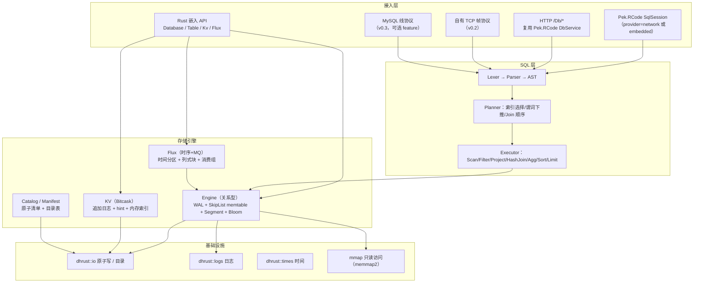
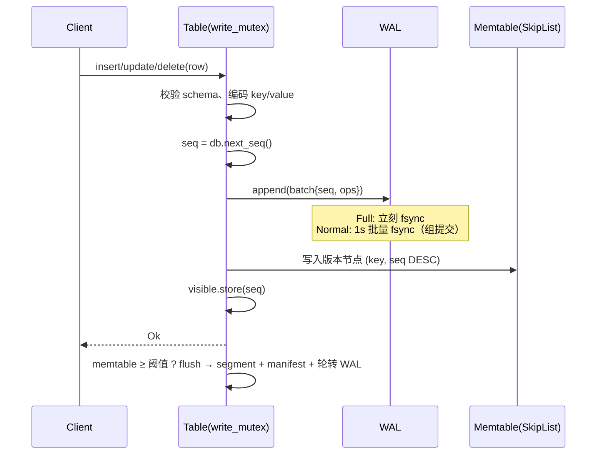
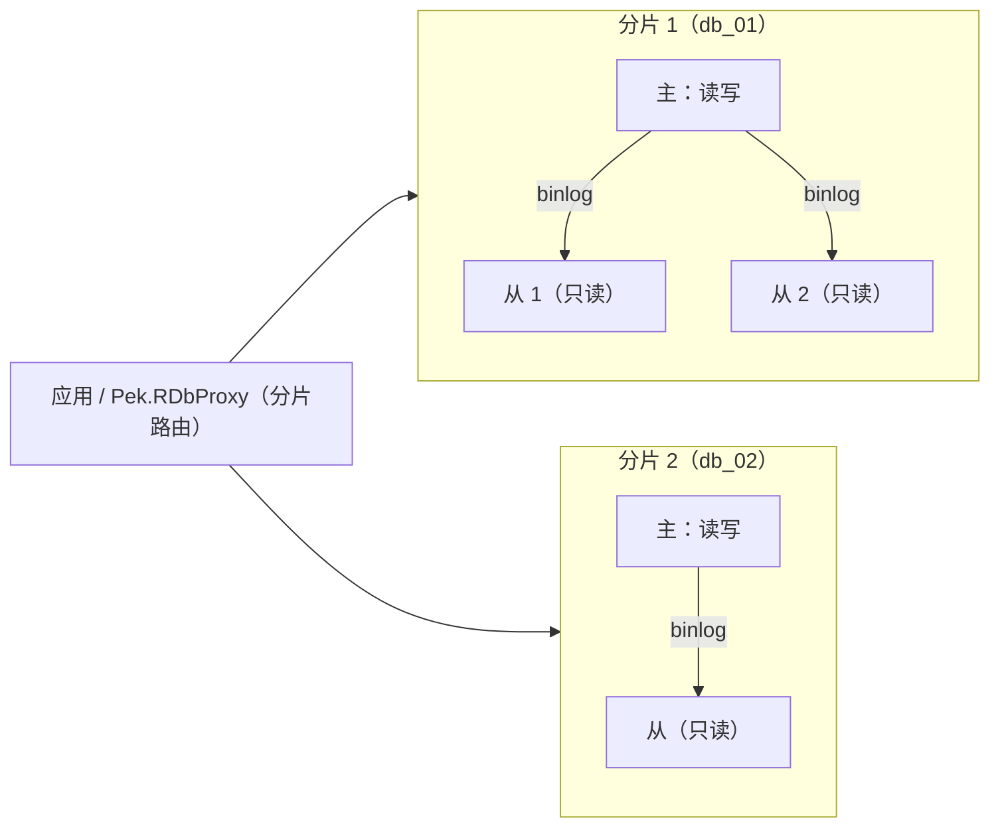
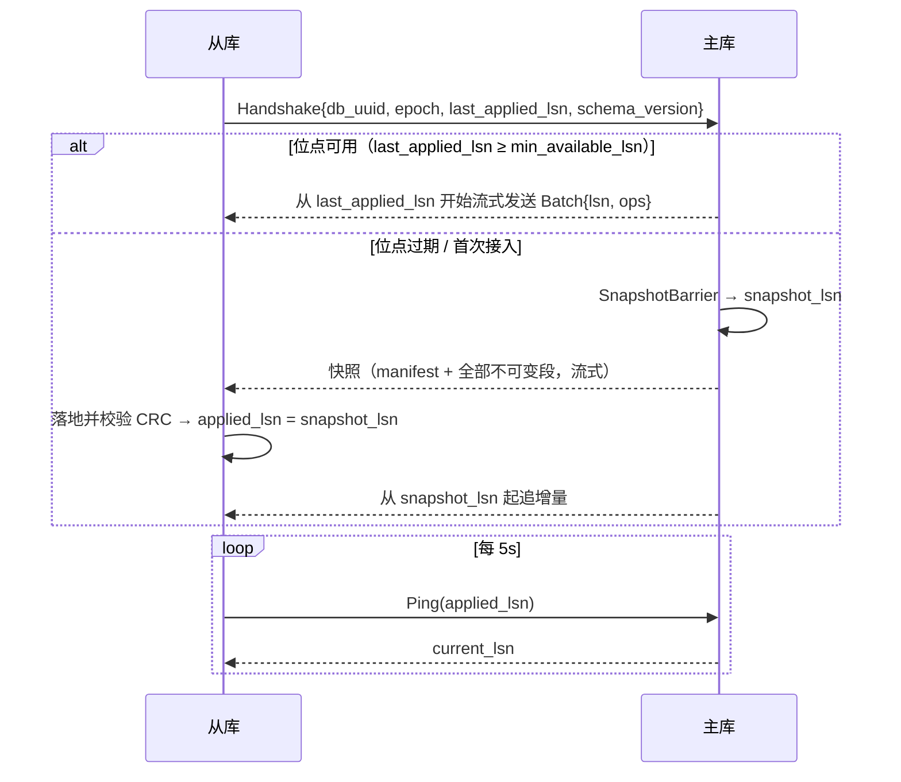

# Pek.RDB 架构设计（v0.1 草案）

> 本文是 Pek.RDB 的**唯一设计口径**：代码与文档冲突时以本文为准，改动设计需同步更新本文并在 `docs/决策记录.md` 追加一节（含用户原话）。
>
> 参考产品：NewLife.NovaDb（C#，嵌入/网络双模、四引擎融合）。**只借鉴能力边界，不照搬实现**；差异见 §2。

---

## 0. 一句话定位

用一个 Rust 进程/库，替代「SQLite（嵌入关系库）+ Redis（KV/队列）+ TDengine（时序）+ 部分 MySQL（网络多客户端）」的四类组件，
以**文件夹即数据库**、**裁剪冷门 SQL 能力**换取**更高读写性能**与**更低运维成本**。

## 1. 目标与非目标

### 1.1 目标

| 维度 | 目标 |
|---|---|
| 部署形态 | 嵌入（库）+ 网络（独立进程），同一套存储内核 |
| 数据规模 | 单表 10⁸ 行量级；总量受磁盘约束，逻辑无上限（按时间/哈希切分） |
| 读写性能 | 单机点查/点写 p99 目标见 §16；写路径 WAL 组提交 + 无随机写放大 |
| 运维成本 | 无外部依赖、无安装步骤；拷目录=迁移/备份；无 dump/restore |
| 生态集成 | Pek.RCode ORM 原生可用（实现 `SqlSession` / 复用 `DbService` 的 `/Db/*` 协议） |
| 依赖约束 | **纯 Rust 依赖，零 C/C++ 动态库**（可 zig 交叉编译 musl） |

### 1.2 非目标（明确裁剪，不做）

- 存储过程、触发器、视图、窗口函数、游标、UDF 插件、字符集/排序规则矩阵。
- 完整 SQL92；只做「业务 80% 常用子集」。
- 跨表强一致事务（MVCC 只保证**单表**事务；多表写事务列为远期可选项，不进 v0.x）。
- 复杂权限体系（网络模式只做「令牌 + 库名」白名单，权限交给上层 Pek.RPermissions）。
- 在线 DDL 的全部形态（v0.x 只支持 ADD COLUMN / CREATE|DROP INDEX / DROP TABLE）。

## 2. 相对 NovaDb 的关键差异（为什么不是照抄）

| 关注点 | NovaDb 做法 | Pek.RDB 做法 | 理由 |
|---|---|---|---|
| 索引结构 | 内存 SkipList **承载全表**，冷数据卸到 MMF 只留稀疏目录 | SkipList 只承载**内存表（memtable）**，落盘为**不可变有序段（segment）**，磁盘段只把稀疏索引 + Bloom 加载进内存 | 全表 SkipList 的指针开销 ≥ 24B/行，10⁸ 行即数 GB；段式布局让常驻内存与表规模解耦，且天然顺序写 |
| 更新模型 | 原地页更新风格 | **追加 + 后台 compaction**（LSM 思路，但按表隔离、段数受控） | 顺序写吞吐高、崩溃恢复简单（WAL 重放即可） |
| 冷热分离 | 「节点常驻内存、冷行卸 MMF」 | **数据永远在段文件**，内存只做「块缓存（LRU）+ 稀疏索引」，热=缓存命中 | 不需要"卸载"动作，无后台迁移抖动；内存占用可硬上限 |
| 时序编码 | 列式块 + 数值编码 + LZ4 | 同思路，但**编码在写入时按块统计自适应选择**（见 §9.3），并把压缩比落在 `_sys.flux_compression` | 自适应编码避免"错误编码反而变大" |
| 网络协议 | 自定义 TCP + RPC | ① 与 Pek.RCode 一致的 **HTTP `/Db/*`**（直接复用 `DbService`，ORM 零改动）；② 自有二进制帧协议（高吞吐、流式、复制通道）；③ MySQL 线协议（可选 feature，后置） | 生态优先：现有 C#/Rust 项目改连接串即可接入 |
| 事务隔离 | MVCC Read Committed | 同左，但**可见性水位按表维护**，避免全局提交锁 | 单表写入串行、跨表互不阻塞 |
| 依赖 | 纯托管 .NET | 纯 Rust（`crc32fast`/`memmap2`/`lz4_flex` 均为纯 Rust 或 syscall 封装） | 受限环境/交叉编译可用 |

## 3. 总体架构



分层原则：

1. **引擎层不依赖 SQL**：SQL 只是引擎的一个调用者；KV/Flux 有各自直连 API。
2. **引擎层不依赖网络**：网络模式只是把 SQL 字符串送进同一个执行器。
3. **所有落盘元数据走原子替换**（`dhrust::io::write_all_text_atomic`），任何时刻断电都不出现半写的 manifest。

## 4. 目录布局：「文件夹即数据库」

```text
mydb/                          # 数据根目录 = 一个数据库
├── PekRDB.toml                # 可选配置（缺省即全默认，零配置）
├── tables/
│   └── users/                 # 每表独立目录 = 独立文件组
│       ├── schema.json        # 表结构（原子写）
│       ├── manifest.json      # 段清单 / WAL 序号 / flushed_seq / 自增水位（原子写）
│       ├── seg/
│       │   ├── 000001.data    # 不可变有序段（数据块）
│       │   └── 000001.idx     # 稀疏索引 + Bloom + 元数据（打开表只读这个）
│       └── wal/
│           └── 000003.wal     # 当前追加日志
├── kv/
│   └── cache/                 # KV 表：000001.log + 000001.hint
├── flux/
│   └── metrics/               # 时序表：按时间分区目录
│       └── 20261031T00/
└── _sys/                      # 系统表：消费组位点、压缩比、慢查询
```

不变式：

- 一个表的所有状态都在这一个目录内 → **删除目录 = 删表；拷贝目录 = 迁移/备份**。
- 段文件写完后**永不修改**（immutable），更新只会产生新段；compaction 只产生新段并删除旧段。
- 任意时刻：`已落盘段` + `当前 WAL` = 完整数据；`manifest.json` 是二者的边界声明。

## 5. 磁盘格式规范（v1）

所有整数小端；CRC 一律 CRC32（IEEE，`crc32fast`）。

### 5.1 Segment `.data`

```text
┌ Header（64B） ────────────────────────────────────────────┐
│ 0..8    magic      "PEKRDBS1"                              │
│ 8..10   format u16 = 1                                     │
│ 10..12  reserved                                           │
│ 12..16  table_id u32                                       │
│ 16..24  run_id u64                                         │
│ 24..32  row_count u64                                      │
│ 32..40  min_seq u64                                        │
│ 40..48  max_seq u64                                        │
│ 48..56  created_ms u64                                     │
│ 56..60  header_crc u32（覆盖 0..56）                        │
│ 60..64  reserved                                           │
├ Block*（默认目标 64KiB） ─────────────────────────────────┤
│ 0..4    payload_len u32                                    │
│ 4..8    row_count u32                                      │
│ 8..12   payload_crc u32                                    │
│ 12..    payload = RowRecord*                               │
└───────────────────────────────────────────────────────────┘

RowRecord（payload 内，按 (key ASC, seq DESC) 排序）：
  key_len   : varint
  key       : bytes（见 §5.4 键编码）
  seq       : u64（提交序号）
  flags     : u8（bit0=墓碑/删除）
  value_len : varint
  value     : bytes（行编码，见 §5.5；墓碑时为空）
```

### 5.2 Segment 索引 `.idx`

```text
Header（64B）：magic "PEKRDBSX1" / version / table_id / run_id / row_count /
               min_seq / max_seq / created_ms / block_count
IndexEntry × block_count：
     first_key_len varint + first_key bytes
     block_offset  u64（.data 内偏移）
     block_len     u32
     row_count     u32（该块行数）
Bloom：bit_len u64 + k u8 + bits
Trailer：crc32（覆盖前面全部字节）
```

- **打开表只读 `.idx`**：稀疏索引 + Bloom 常驻内存，约为数据量的 1/64 ~ 1/32。
- 点查：Bloom 否定 → 直接跳过该段（无 IO）；否则稀疏索引二分定位块 → 读块 → 块内线性扫描。

### 5.3 WAL `.wal`

```text
Header（32B）：magic "PEKRDBWL1" / version / table_id / wal_id / created_ms
Record（一条 = 一个提交批次，原子）：
  crc32 u32（覆盖 len+payload）
  len   u32
  payload = seq u64 + op_count u32 + Op*
Op = flags u8 + key_len varint + key + value_len varint + value
```

- 恢复时按顺序读，遇到 **CRC 不匹配 / 长度越界 / 文件尾截断** 即停止，并把文件截断到最后一个完整记录（容忍断电撕裂）。
- `Full`：每批 `fsync`；`Normal`：每 1s 后台 `fsync`（默认）；`None`：不主动刷盘。

### 5.4 键编码（顺序保持，支持复合主键）

每个分量：原始字节中 `0x00` 转义为 `0x00 0xFF`，分量末尾追加 `0x00 0x01`。
字节序保证「短路前缀 > 任何带延续的串」，因此 `"a" < "a\0b"` 等语义与字符串字典序一致。
固定宽度类型先转大端（有符号整数翻转符号位、浮点做 order-preserving 变换）再走同一转义流程。

### 5.5 行编码

```text
null_bitmap（ceil(列数/8) 字节）+ 按列序拼接非 NULL 列值：
  Bool 1B | Int(i32) 4B | BigInt 8B | Float 4B | Double 8B | DateTime 8B(ms)
  Text/Bytes: varint len + bytes
```

类型来自 `schema.json`；段头记录 `schema 版本`，版本不匹配时拒绝打开（v0.x 不支持在线改列类型）。

### 5.6 manifest.json（每表）

```json
{
  "format": 1,
  "engine": "engine",
  "schema_version": 1,
  "next_run_id": 3,
  "wal_id": 3,
  "flushed_seq": 120,
  "next_identity": 1001,
  "runs": [
    {"id": 1, "rows": 5000, "min_seq": 1, "max_seq": 100},
    {"id": 2, "rows": 800,  "min_seq": 101, "max_seq": 120}
  ]
}
```

`runs` 顺序 = 从旧到新。恢复时：加载全部段 → 重放 `wal/` 中 `seq > flushed_seq` 的记录（`seq <= flushed_seq` 的在段里）。

## 6. Engine 读写路径

### 6.1 写路径（单表串行，跨表并行）



为什么单表串行：memtable 是内存 SkipList，多写者无锁插入实现复杂且收益有限（瓶颈通常在校验与编码）；**跨表完全并行**，
且刷盘/压缩在写锁外进行（读取不受影响）。

### 6.2 读路径

```text
get(key)：
  memtable（含未刷盘的最新版本）→ 各段从新到旧（Bloom 先判、稀疏索引二分）
  → 取 seq ≤ snapshot 的最大版本 → 墓碑则返回 None
scan(range)：
  memtable 有序迭代器 + 各段有序迭代器 → k 路归并 (key ASC, seq DESC)
  → 每个 key 取首个可见版本 → 去墓碑 → 产出
```

`snapshot` 取表级 `visible_seq`（Read Committed：每条语句取一次）。

### 6.3 Compaction

- 触发：段数 ≥ 8 或 墓碑比例 ≥ 20%。
- 策略：**Tiered（v0.x）**：把最旧的 N 个段 + 覆盖这些 key 的新段一起归并，输出新段；墓碑在「已无更旧段持有该 key」时丢弃。
- 全程后台线程、写新段不改旧段，完成后原子替换 manifest 再删除旧文件 → 失败只会留下垃圾段（下次启动清理）。

### 6.4 冷热分离与内存预算

| 常驻内存项 | 量级 | 说明 |
|---|---|---|
| memtable | `memtable_bytes`（默认 64MiB） | 超阈值即刷盘 |
| 段稀疏索引 | ~1/64 数据量 | 每块一个 first_key |
| Bloom | 10 bit/行 | 每段独立 |
| 块缓存 | `block_cache_bytes`（默认 64MiB） | LRU，热数据自然常驻 |

**1000 万行、只查最近 1 万行**：新段在内存（memtable），旧段只读稀疏索引 + 少量块 → 常驻内存 < 20MB。
（对比 NovaDb：全表 SkipList 常驻 → 同规模 ≥ 240MB。）

## 7. SQL 子集（v0.x）

### 7.1 方言基准：SQLite 子集（用户 2026-10-31 确认）

**语法基线 = SQLite**：嵌入场景对标 SQLite、Pek.RCode 已有 Sqlite 方言与占位符处理，直接复用可把迁移成本降到最低。

兼容（必须实现）：

| 类别 | 语法 |
|---|---|
| 类型 | `INTEGER` / `BIGINT` / `REAL` / `DOUBLE` / `TEXT` / `BLOB` / `BOOLEAN` / `DATETIME`（声明类型严格校验，不做 SQLite 的动态类型/亲和规则） |
| DDL | `CREATE TABLE [IF NOT EXISTS]`（列定义、`PRIMARY KEY`、`AUTOINCREMENT`、`NOT NULL`、`DEFAULT`）、`DROP TABLE`、`CREATE/DROP INDEX`、`ALTER TABLE ADD COLUMN` |
| DML | `INSERT [OR REPLACE] ... VALUES (...), (...)`、`UPDATE ... SET ... WHERE`、`DELETE ... WHERE`、`ON CONFLICT (...) DO UPDATE` |
| 查询 | `SELECT` 列/表达式/别名、`WHERE`、`ORDER BY`、`LIMIT/OFFSET`、`GROUP BY/HAVING`、`INNER/LEFT JOIN`、`IN/EXISTS` 子查询、`DISTINCT`、`LIKE/BETWEEN/IS NULL`、`||` |
| 参数 | `?`、`:name`、`@name`（与 Pek.RCode Sqlite 方言一致） |

**有意不兼容（裁剪）**：视图、触发器、存储过程、窗口函数、CTE（`WITH`）、`ATTACH`、虚拟表、自定义函数、`PRAGMA` 绝大多数项、`WITHOUT ROWID`。

**与 SQLite 的有意差异（必须在文档写明，不装作兼容）**：

1. 类型：按声明类型严格校验（`INTEGER` 列写字符串报错），不继承 SQLite 的动态类型/亲和性；
2. `NULL` 排序位置：显式规定（`ASC` 时 NULL 在前，与 SQLite 一致；`DESC` 时 NULL 在后）；
3. 除零：返回 `NULL`（与 SQLite 一致），而非报错；
4. 日期函数只做子集（`DATE`/`DATETIME`/`STRFTIME` 常用格式），不做 SQLite 全部修饰符；
5. `RETURNING` 首版不支持，后续按需补。

**验证方式**：以 SQLite 为“标准答案”做差分测试——同一 SQL 分别在 SQLite 与 Pek.RDB 执行，比对结果集与错误行为（v0.2 起）。

### 7.2 能力表

| 能力 | 支持 | 备注 |
|---|---|---|
| DDL | `CREATE TABLE`（含 PK/UNIQUE/自增/默认值）、`DROP TABLE`、`CREATE/DROP INDEX`、`TRUNCATE`、`ALTER TABLE ADD COLUMN` | 无视图/触发器/存储过程 |
| DML | `INSERT`（多行）、`UPDATE`、`DELETE`、`UPSERT`（`ON DUPLICATE KEY UPDATE`） | 参数化 `@p0`/`?` |
| 查询 | `SELECT` 列/表达式/别名、`WHERE`、`ORDER BY`、`LIMIT/OFFSET`、`GROUP BY`+`HAVING`、`INNER/LEFT JOIN`（等值走 HashJoin，非等值 NestedLoop）、`IN/EXISTS` 子查询、`DISTINCT` | 无窗口函数 |
| 聚合 | `COUNT/SUM/AVG/MIN/MAX`，时序表额外 `FIRST/LAST/SPREAD` | |
| 函数 | 字符串/数值/日期/转换/条件约 40 个（v0.2 起逐步补齐） | 与 C# 侧口径对齐 |
| 事务 | `BEGIN/COMMIT/ROLLBACK`（单表 MVCC，Read Committed） | 跨表事务：不做 |

执行器形态：**嵌套循环 + 谓词下推 + 索引选择**（v0.x）；HashJoin / HashAgg / 外部排序（超出内存转段文件）在 v0.2/v0.3 补齐。

## 8. 表达式求值

`Expr` → 编译为 `Vec<Instr>`（寄存器式字节码）后按行执行，避免递归 AST 解释的函数调用开销（参考 SQLite VDBE 思路，简化）。
常量折叠、列引用改下标；`WHERE` 中 `pk = 常量` 直接转点查，`pk BETWEEN` 转区间扫描。

## 9. Flux 引擎（时序 + 消息队列）

### 9.1 分区

- 分区键 = 时间戳截断到 `partition_span`（默认 1h，可配 1m~1d）。
- 每个分区 = 一个目录，内含 `data.flux`（追加）+ `meta.json`（行数/时间范围/封存状态）。
- 写入只追加；分区封存（sealed）后不再写，转为列式块。

### 9.2 列式块封存

- 每 4096 行或分区封存时，把行式缓冲转列式块：`列数 × 值流`，块头记录每列编码方式。
- 块内时间列必为递增（否则拒绝写入并报错，避免乱序破坏压缩率）。

### 9.3 类型感知编码（按块自适应）

| 列特征 | 编码 |
|---|---|
| 常量列 | RLE |
| 整数且单调 | Delta / Delta-of-Delta（二阶差分）、zigzag varint |
| 浮点 | Gorilla XOR（前值异或 + 前导/尾随零压缩） |
| 低基数字符串 | 字典编码（字典 + 索引位宽） |
| 随机数值 | 原始 + LZ4 块压缩 |
| 全空列 | 只记 NULL 位图 |

编码候选按块**采样估算**选择（取估算字节数最小者），压缩比与选择结果写入 `_sys.flux_compression`。

### 9.4 消费组（Redis Stream 风格）

```text
group: cg_name
  last_delivered_id      ← 组游标
  pending[msg_id] = {consumer, deliver_ts, delivery_count}
  consumer_last_ack
```

- `XADD` 等价：普通 INSERT（返回 message_id = `ts-seq`）。
- 读取：`SELECT ... WHERE timestamp > last_delivered AND _group='cg'`（内部 API，不进 SQL）。
- 投递即入 Pending；`ack` 后移除；`claim`（超时重投）与 `delivery_count` 上限 → 死信表。
- Pending 位点持久化在 `_sys/consumer_group.json`（原子写，秒级批量）。

### 9.5 TTL 与 Rollup

- TTL：分区级删除（整目录删除，O(1)），后台按分钟巡检；也可配「按容量保留」。
- Rollup：`CREATE ROLLUP ... INTERVAL 1m` 后台把封存块预聚合成 `avg/min/max/count/sum` 段；
  查询 `AVG(x)` 且粒度 ≥ rollup 粒度、时间范围完整覆盖时**自动路由**到 rollup 段（`EXPLAIN` 可见）。

## 10. KV 引擎（Bitcask）

- 日志：`kv/<table>/<shard>/000001.log`，记录 `crc|ts|expire_at|flags|klen|vlen|key|value`，只追加。
- **分片**：按 `hash(key) % N`（默认 16）分日志分片，各分片独立的锁 / 索引 / 日志 → **多核并行写**，
  这是与 Redis「单实例单线程」的结构性差异；`SCAN` 按分片轮询，不保证全局有序。
- 内存索引：`HashMap<Box<[u8]>, Entry>`，启动时从 `.hint` 顺序重建（无 hint 则重放日志）。
- **小值内联**：`value ≤ 64B` 直接随索引驻留内存（读**不落盘**）；大值才走磁盘 + 页缓存。
- 写：追加 + 更新索引；`sync` 策略与 WAL 一致（默认 `Normal` = 1s 批量 fsync）。
- 合并：旧值占比 > 50% 时后台重写（只保留每 key 最新值 + 未过期），重写不阻塞读写。
- 能力：`get/set/add/del/inc/ttl/expire/scan_prefix`，多表隔离，TTL 惰性 + 后台清理。
- 协议：可选 **RESP2 子集**（§11.5），现有 Redis 客户端可直连。

## 11. 嵌入与网络双模

### 11.1 嵌入（Rust 库）

```rust
let db = pek_rdb::Database::open("./mydb")?;
let users = db.create_table(Schema::builder("users")
    .column("id", DataType::Int, |c| c.primary_key().auto_increment())
    .column("name", DataType::Text, |c| c.not_null())
    .build())?;
users.insert(&[Value::Null, Value::Text("Alice".into())])?;
```

### 11.2 与 Pek.RCode 集成（两种姿势）

1. **嵌入**：`pek_rdb::provider::RdbSession` 实现 `pek_rcode::session::SqlSession`（`kind()` 返回 `DatabaseKind::Sqlite` 或新增枚举），
   ORM 的建表/CRUD 直接落在本引擎。
2. **网络**：服务端挂 `pek_rcode::db_service::DbService` 的 `/Db/*` 路由（连接串 `Server=http://host:port;Database=mydb;Password=token;provider=network`），
   返回 DbTable v3 二进制；**现有项目只改连接串**。

### 11.3 自有 TCP 协议（v0.2）

```text
Frame: len u32 | crc32 u32 | type u8 | req_id u64 | payload
type: 1=Login 2=Query 3=Execute 4=Begin 5=Commit 6=Rollback 7=Ping 8=Subscribe(binlog) 9=Ack
```

- 单连接多请求并发（req_id 复用），响应可乱序。
- 二进制参数/结果（列式批量返回），避免 JSON 往返。
- 复制通道复用同一协议（`Subscribe` + 位点续传）。

### 11.4 MySQL 线协议（可选 feature，v0.3）

只实现 `COM_QUERY` / `COM_PING` / `COM_QUIT` / 预处理语句骨架 + 文本/二进制结果集，
让现有 MySQL 驱动/客户端可直连；**不作为主推路径**（生态内主推 `/Db/*` 与自有协议）。

### 11.5 RESP2 子集（KV 模式，可选 feature，v0.3）

只实现键值语义，不做 Redis 全套：

| 命令 | 说明 |
|---|---|
| `PING` / `QUIT` / `INFO` | 连通性与摘要 |
| `GET` / `SET`（`EX`/`PX`/`NX`/`XX`）/ `DEL` / `EXISTS` | 基本读写 |
| `INCR` / `DECR` / `INCRBY` | 原子计数（分片内原子） |
| `TTL` / `PTTL` / `EXPIRE` | TTL |
| `MGET` / `MSET` | 批量（跨分片并发） |
| `SCAN`（游标） | 分片轮询 |

- 支持**流水线**（一次读多个命令、批量回包），这是吞吐的关键路径。
- 不做：`SUBSCRIBE`/`PSUBSCRIBE`、`EVAL`、`MULTI/EXEC`、`SELECT` 切库（多表用连接串/表名区分）、RESP3 全量。
- 目的：让现有 Redis 客户端与脚本**改端口即可用**，不要求业务改代码。

## 12. 集群：主从同步与分片（v0.4 起）

### 12.1 三种形态

| 形态 | 拓扑 | 解决什么 | 不解决什么 |
|---|---|---|---|
| **A. 单库一主多从** | 1 写 + N 只读 | 读扩展、容灾、备份不影响主库 | 单机写上限 |
| **B. 多库分片** | `db_01 … db_NN` 各自一主多从 | 数据量逻辑无上限、写扩展 | 跨分片 JOIN / 事务 |
| **C. A + B 组合** | 每分片各自一主多从 | 生产推荐形态 | 同上 |

引擎只实现「单库一主多从」；**分片是路由层的事**（`Pek.RDbProxy` 或应用侧），不用分布式事务换复杂度。



### 12.2 角色与硬规则

- **主（primary）**：唯一写入口；每批提交按「分配 `lsn` → 写 WAL → 写 binlog → 发布可见」顺序。
- **从（replica）**：只读；把 binlog 批次写本地副本 WAL → memtable；**默认拒绝一切写语句**（报 `ReplicaReadOnly`），
  不做"从库偷偷写"——否则主从分叉后无法自动收敛。
- **epoch（代数）**：主库每次被提升/重建 +1，单调递增；从库只接受 `epoch ≥ 自身` 的握手，旧主恢复后必须先 `demote`。

### 12.3 binlog 与 WAL 的区别（不要合并成一个文件）

| 项 | WAL | binlog |
|---|---|---|
| 用途 | 本地崩溃恢复 | 跨节点复制 / 断点续传 |
| 截断 | memtable 刷盘后即删 | 保留 `BinlogRetentionHours` / `BinlogMaxBytes`，可配置 |
| 序号 | `seq`（本地提交序） | `lsn`（全局复制序，主库分配） |
| 记录 | `[crc][len][seq][count][op*]` | `[crc][len][lsn][seq][table][count][op*]` |

- `lsn` 与 `seq` **在同一把写锁内分配**，保证复制流顺序 = 本地提交顺序。
- 落盘：`binlog/{first_lsn:012}-{last_lsn:012}.blog` 滚动文件 + `binlog.index`（lsn → 文件偏移）；
  按 `lsn` 二分定位，支持任意位点续传。
- 从库默认 `log_replica_updates = false`（不形成级联写放大）；需要级联复制时显式打开。

### 12.4 同步流程



要点：

1. **全量同步 = 拷贝不可变段**：段文件写后不改，主库可在继续服务的同时流式发送；
   `manifest` 原子切换后才发新段名，从库不会看到「半段」。
2. **快照与增量无缝衔接**：`SnapshotBarrier` 记录 `snapshot_lsn`，之后所有批次都进 binlog → 从库落地快照后直接从该 lsn 追。
3. **应用位点持久化**：从库每 N 批（默认 100 批或 1s）原子写 `replica.json`（`applied_lsn/epoch/master`）；
   崩溃后从该位点续传（幂等：同 `lsn` 重放覆盖同 `seq` 版本，不产生重复行）。
4. **校验**：每批 CRC 已在记录头；全量同步额外做「段文件 CRC + 大小」对账，不符即整段重传，绝不"跳过坏段"。

### 12.5 一致性语义（写清楚，不模糊）

> 口径已定（§18.1 #1）：**默认异步 + 可选 READ YOUR WRITES**；不做同步强一致。

| 级别 | 行为 | 代价 |
|---|---|---|
| **异步（默认）** | 主库返回成功即完事；从库 lag 秒级 | 主库宕机可能丢未复制批次 |
| **READ YOUR WRITES（可选）** | 写返回 `lsn`；客户端读从库带 `min_lsn`，从库未追上则**等待** `MaxWaitMs`，超时报 `ReplicaLagExceeded` | 读延迟抖动 |
| 同步强一致 | **不做**（无 quorum / 无 Raft） | — |

- 只读查询默认不等待；需要强读语义就走主库或带 `min_lsn` 读从库。
- `lag` 用两个数：`lag_lsn`（差值）与 `lag_ms`（按主库提交时间戳估算），都在 `_sys.replication` 可见。

### 12.6 故障转移（人工切主，禁止自动选主）

> 口径已定（§18.1 #2）：**人工脚本化切主**，不做自动选主。

标准步骤（脚本 `tools/cluster/promote.ps1`，v0.5）：

1. 主库停写（`SET READONLY` 或停进程）。
2. 等目标从库 `lag_lsn = 0`（否则先追平，追不上就明确报告"可能丢 N 批"，由人决定）。
3. `promote`：清除 `replica.json`、`role=primary`、`epoch+1`、分配新 `db_uuid` 分支。
4. 其余从库 `reconfigure --master <新主>`，握手校验 epoch。
5. 旧主恢复后必须 `demote --master <新主>`（会做一次全量对账），**否则拒绝写入**：
   报错写明「本节点 epoch=3 落后于集群 epoch=4，需先 demote 并全量对账」。

不做：自动选主、多主写入、跨分片两阶段提交。

### 12.7 分片约定（数据量无上限的落点）

> 口径已定（§18.1 #3）：**分片路由放 `Pek.RDbProxy`**，引擎只守「分片键必须在主键首位」的约束。

- 分片单位 = **一个数据库文件夹**（可独立备份/迁移/升级）。
- 分片键必须包含在主键首位（否则查询只能全分片广播）；路由层按 `hash(shard_key) % N` 或时间范围路由。
- 跨分片查询由路由层聚合（`UNION ALL` 各分片结果后排序/分页），引擎不实现分布式执行器。
- 扩容：新分片空库 + 双写回填 + 校验 + 切读（`tools/shard-rebalance`，v0.6）。
- 每个分片目录内仍是标准结构（§4），单分片可直接拷走或降级为嵌入模式使用。

### 12.8 配置样例

```toml
[Server]
Listen   = "0.0.0.0:5599"
Database = "Data/mydb"

[Replication]
Role   = "primary"        # primary | replica
Epoch  = 1
# —— 主库侧 ——
BinlogRetentionHours = 168
BinlogMaxBytes       = 10_737_418_240
MaxSyncMbps          = 200            # 全量同步限速，避免打满生产带宽
# —— 从库侧 ——
# Master        = "tcp://10.0.0.5:5599"
# Token         = "<令牌，不入明文配置，用环境变量或加密项>"
# MaxWaitMs     = 2000   # READ YOUR WRITES 最长等待
# AllowWrites   = false
```

### 12.9 观测与运维

- `_sys.replication` 一行一节点：`role / epoch / db_uuid / current_lsn / applied_lsn / lag_lsn / lag_ms / connected / last_error`。
- `-status` 输出：`role=replica epoch=4 lsn=123456 lag=0.3s peer=10.0.0.5`。
- 复制错误必须带上下文（哪条 lsn / 哪张表 / 失败原因），与 §13 日志规范一致。

### 12.10 带宽与资源预算（按全局惯例自检）

| 行为 | 频率 | 单次开销 |
|---|---|---|
| 增量复制 | 每批提交 | 批次原始字节（≤64KB/批），无额外封装膨胀 |
| 心跳 | 5s | < 100B |
| 全量对账 | 每次同步启动 | 段 CRC 抽样 + 大小比对 |
| 位点落盘 | 100 批 / 1s | 一次原子写（< 200B） |

空闲期不轮询整库、不做全量摘要；`lag` 计算是纯内存比对。

## 13. 可靠性与恢复

| 场景 | 行为 |
|---|---|
| 进程崩溃 | 重放当前 WAL，截断撕裂尾记录；已 flush 的段不动 |
| 断电（`Full`） | 已返回成功的提交不丢 |
| 断电（`Normal`/`None`） | 最多丢最近 1s / 全部未刷盘提交（文档必须写明） |
| 段 CRC 校验失败 | 拒绝打开该段并报出文件+偏移；不静默跳过（避免"少数据还正常启动"） |
| manifest 半写 | 原子替换保证不出现：写临时文件 → fsync → rename |
| 拷贝文件夹 | 需在停止写入（或 `checkpoint`）后拷贝；在线拷贝必须连 WAL 一起拷 |

## 14. 并发与背压

- 线程模型：**写路径同步、I/O 无 tokio 依赖**（嵌入模式可零运行时）；网络模式由 `dhrust::net::http` 的线程池驱动。
- 锁顺序：`write_mutex` → `state.write()` → `memtable.write()`；读只取 `state.read()` + `memtable.read()`，不持锁做 IO。
- 背压：memtable 达阈值时**写线程自己触发 flush**（简单可控）；后续改为「写线程标记 + 后台刷盘 + 写线程等待」，避免长尾。

## 15. 可观测性

- `_sys` 系统表：`_sys.flux_compression`（压缩比）、`_sys.consumer_group`（位点）、`_sys.stats`（每表行数/段数/内存占用/块缓存命中率）、`_sys.slow_query`。
- `-status` 子命令与面板接口输出一行摘要（复用 Pek 生态惯例：`dhrust::logs`、`Config/*.toml` 热重载）。

## 16. 性能目标（验收口径，必须实测）

| 场景 | 目标 | 测量方法 |
|---|---|---|
| 单表点写（WAL `Normal`，批量事务 100 行/批） | ≥ 50 万行/s（本机 NVMe） | `benches/engine_bench.rs` |
| 单表点查（10⁷ 行表，内存命中） | ≥ 100 万次/s 单线程 | 同上 |
| 范围扫描 1 万行 | ≤ 5ms（1000 万行表，冷缓存） | 同上 |
| 常驻内存（1000 万行，查最近 1 万行） | < 20MB | `-status` 输出 RSS |
| Flux 写入 1000 万点 | ≥ 200 万点/s，压缩比 ≥ 5× | `benches/flux_bench.rs` |
| 恢复 1GB WAL | ≤ 3s | `tests/recovery.rs` |

> 口径：**没有实测数字不写进 README**（用户 2026-10-29：「不能猜」）。

### 16.1 对比方法论：强项对强项（用户 2026-10-31 定调）

> 「对比比的就是各个库的强项。」

原则：

1. **每个对手只在它的强项上比，而且按它的最佳配置比**：
   SQLite = WAL + `synchronous=NORMAL` + 预编译语句、单线程；Redis = 全内存 + 典型流水线深度；
   TDengine = 单表高频写入 + 时间桶聚合；MySQL = 多连接并发 OLTP。
2. **不允许“避开对手主场”**：落后就写明落后多少、为什么、哪一版补上；用“不在对比范围”回避性能差距视为不合格。
3. 每组基准固定：同机同盘、同数据量、同并发、预热后取 p50/p99/吞吐；只提交脚本与 CSV，未实测不写数字。
4. **达标线（不达标就不算里程碑完成）**：

| 对手强项 | 达标线 | 何时 |
|---|---|---|
| SQLite：点查 / 点写 / 小事务 | ≥ **0.9×** | M1 调优后 |
| SQLite：事务内批量写 | ≥ **1.5×** | M1 |
| SQLite：随机原地 UPDATE | ≥ **0.9×** | M2（需 `in_place` 热表模式；之前如实报差距） |
| Redis：热值 GET（p99） | ≤ **1.2×** Redis | M3 |
| Redis：SET/GET 流水线吞吐 | ≥ **0.9×** | M3 |
| Redis：INCR 原子计数 | ≥ **0.9×** | M3 |
| TDengine：时序写入 / 时间桶聚合 | ≥ **0.8×** | M3 |
| MySQL：16 连接并发 OLTP | ≥ **1.0×** | M4 |

5. 达不到就改实现（块大小、块内二分、`in_place`、内联值、协议批量化），**不许沉默**；

### 16.1.1 已实测：并发扩展与超内存数据集（2026-10-31，含 SQLite 对照）

> 数据来源：`docs/实测数据/zig-2026-10-31-run{1..6}.csv`（6 轮）与 `sqlite-2026-10-31-run{1..3}.csv`（3 轮），
> 对比表由 `tools/compare-bench.ps1` 生成 → `docs/实测数据/对比-2026-10-31.md`。
> 写类指标受本机磁盘争用影响很大（min 与 max 差 5–15 倍），**以中位为准并同时记录 min–max**。

| 场景 | Pek.RDB 中位（min–max） | SQLite 中位（min–max） | 比值 | 达标线 |
|---|---|---|---|---|
| 并发写 1 线程（跨表） | 1,524,663 行/s | 427,319（SQLite 单事务） | **3.57×** | — |
| 并发写 2 线程 | 2,589,282 行/s | 1,431,377 | **1.81×** | — |
| 并发写 4 线程 | 3,691,311 行/s | 1,491,532（单事务） | **2.47×** | — |
| 并发写 4 线程（SQLite 逐行 auto） | 3,691,311 行/s | 56,456 | **65.38×** | — |
| 超内存写 200 万行 | 1,166,886 行/s | 1,126,222（单事务） | **1.04×** | — |
| 超内存点查（25 段） | 645,961 次/s | 112,626 | **5.74×** | ✅ ≥0.9× |
| 超内存范围扫描（仅 key，25 段） | 11,380,144 行/s | 10,147,133 | **1.12×** | — |
| 冷重开 100 万行 | 11.00 ms | 2.42 ms | **0.22×（慢 4.6 倍）** | ❗ 未列达标线，但如实记录 |
| 冷重开 200 万行 / 25 段 | 24.00 ms | 3.08 ms | **0.13×（慢 7.8 倍）** | ❗ 同上 |

**结论**：

- 达标线里与 SQLite 相关的几项（点查、点写、小事务、批量写）**全部达标**，且余量很大（1.04×~65×）。
- 并发扩展：4 线程 2.42×（相对自身 1 线程），对 SQLite 单事务形态仍是 2.47×。
- **明确的弱项是冷重开**（慢 4.6–7.8 倍）：200 万行要加载 25 个段的稀疏索引 + Bloom。
  下一步若要补，方向是「索引页懒加载 + 段 meta 合并成单文件」，但这属于 M6 运维面优化，不阻塞达标线。
- `MySQL 16 连接并发 ≥1.0×` 属 M4，尚未测。

   确实短期做不到的，文档写「差距 X%、原因、计划版本」。

### 16.2 与 SQLite 的对比口径（强项正面对标）

SQLite 的强项（WAL 点查 / 点写 / 小事务）**必须正面对标**，不接受“避开主场”：

- 目标：点查、点写 **≥0.9×**；事务批量写 **≥1.5×**；随机原地更新在 `in_place` 落地前**如实报落后倍数**。
- 数字以 `benches/` 与 `tools/bench-vs-sqlite/` 报告为准，**未实测不写 README**。

| 负载 | 预期 | 原因 / 必须做的事 |
|---|---|---|
| 批量追加写（单表、主键递增） | **优于**（目标 2–5×） | 追加段 + 批量 WAL，无 B-tree 页分裂；SQLite 每个脏页都要写 WAL frame |
| 多表并发写 | **优于**（目标 3–10×） | SQLite 全库一把写锁；我们按表串行、跨表并行 |
| 时序/日志型写入 | **远优于**（数量级） | 列式块 + 类型编码 + 压缩；SQLite 是行存 B-tree |
| 单表点查（热数据） | **≥0.9×，不达标就改到达标** | 稀疏索引二分 + 块读 + 块内二分；块大小/块内二分不调优就会输 |
| 随机 UPDATE / DELETE（原地） | **当前会落后；M2 用 `in_place` 热表模式追到 ≥0.9×** | LSM 写放大；没有 in_place 之前如实报倍数，不含糊 |
| 大表按主键范围扫描 | **持平** | 都是顺序读；我们不与页缓存竞争 |
| 大表 + 小热区内存占用 | **明显更好** | 稀疏索引 + Bloom + 块缓存可硬上限，不加载全表 |
| 崩溃恢复 | **更好** | 只重放 WAL；段不可变，无需回放大量 WAL frame |

要「不输」必须做到的 5 件事（写进 M1/M2 验收，不做就是"想当然"）：

1. **块内二分**：块内行头建 4 字节偏移表，随机点查不做线性扫描。
2. **块大小可配**：默认 16KiB；点查密集场景 8KiB（用基准选默认值）。
3. **稀疏索引紧凑化**：u32 相对偏移 + 共享 key 缓冲，避免大表打开时分配爆炸。
4. **点查零拷贝**：`Value` 借用解码，只在访问列时展开。
5. **组提交 + `Normal` 默认可配**；提供 `insert_batch`（一次 WAL 写一条批次记录）。

对比基准（`tools/bench-vs-sqlite/`，**独立 crate，不进引擎依赖树**，允许该工具本身用 rusqlite bundled）：
同机同盘、同数据量（10⁶ / 10⁷ 行两档）、预热后取 p50/p99；仓库只提交脚本与结果 CSV，不提交"结论性数字"到 README。

### 16.3 与 Redis 的对比口径（KV 模式，强项正面对标）

按同一原则：**Redis 的强项（全内存热值 GET/SET、流水线、INCR）必须正面对标**，不以“主场”回避。
list/hash/zset/pubsub/geo 属于**能力缺失**（不是性能差距），单列 N/A，用 Engine 或后续版本补，不参与性能结论。

| 维度 | 目标 / 预期 | 原因 |
|---|---|---|
| 热数据小值 `GET`（单连接） | **p99 ≤1.2× Redis、吞吐 ≥0.9×（达标线）** | 前提是**小值内联**进内存索引，读不落盘；否则必输 |
| 流水线批量 `GET/SET` | **≥0.9×，多核下目标 >1.5×** | 顺序追加 + 组提交；Redis 单线程逐命令执行 |
| `INCR` 原子计数 | **≥0.9×** | 分片内原子 + 组提交 |
| 多核并发写 | **更好** | KV 按 key 哈希分 16 个日志分片、各持独立锁；Redis 单实例单线程，只能靠集群扩展 |
| 数据量 > 物理内存 | **能跑 vs 跑不动** | Redis 依赖内存；我们冷值落盘（延迟升高但不崩） |
| 持久化开销 | **更好** | Redis 的 RDB fork / AOF rewrite 有内存与延迟尖刺；我们是后台重写不可变日志 |
| 单键随机读（冷值） | **更差，如实报倍数** | 需要磁盘 IO，p99 无法与“全内存”相比；这不是回避项，是必须汇报的差距 |
| 内存占用 | **更好** | 我们只驻留索引 + 可配页缓存；Redis 常驻全量 + 分配器开销 |
| 数据结构丰富度 | **更差** | 只有 KV/TTL/计数；复杂结构用 Engine（SQL）替代 |

结论：

- **强项上必须达标**：热值 GET/SET/INCR 按 §16.1 达标线验收；达不到就改实现（内联、分片、流水线、零拷贝），不改口径。
- **非强项如实标注**：超内存、持久化、多核扩展、成本/GB 我们占优；冷值随机读、复杂结构我们落后/缺失，逐条写明倍数或 N/A。
- 差异化价值在于「**SQL + KV + 时序一个进程**」省运维，但这不是性能落后的挡箭牌。

要「不输」必须做到的 6 件事：

1. **小值内联**：`value ≤ 64B` 直接驻留索引（读不落盘），大值才走磁盘。
2. **KV 分片锁**：按 key 哈希分 16 片，各片独立 WAL / 索引 / 锁 → 多核并行写。
3. **RESP2 子集 + 流水线**（§11.5）：现有 Redis 客户端改端口即可用。
4. **组提交**：默认 `Normal`（1s 批量 fsync），支持单命令 `sync`。
5. **零拷贝收发**：读缓冲复用 + `writev` 批量回包，避免每命令一次分配。
6. **索引紧凑**：`Box<[u8]>` key + 4/8 字节偏移，启动用 `.hint` 顺序加载（mmap），不重放全日志。

对比基准（`tools/bench-vs-redis/`，独立 crate）：同机、同客户端与流水线深度、同数据量（10⁵ / 10⁷ 键），
分别测「预热热数据」与「冷值」两档；只出 CSV，未实测不写数字。

### 16.4 语言选型对性能的影响（Rust vs Zig）

结论先说：**换 Zig 不会让达标线自动达成，也不会出现"同等/超越"的跃迁**。同样的算法与磁盘策略，
Rust 与 Zig 的机器码差距通常在 **±10%** 量级；而 SQLite/Redis 的强项来自二十年数据结构与缓存调优，不是语言。

| 维度 | Rust（当前） | Zig | 对性能/交付的影响 |
|---|---|---|---|
| 代码生成 | LLVM | LLVM | 基本持平 |
| 内存控制 | 所有权 + arena/bump 可做 | 显式分配器、arena 更自然 | Zig 热路径"零分配"更省心；Rust 用 arena 同样能做到 |
| 边界检查 | Release 保留（可 `get_unchecked`） | `ReleaseFast` 默认关闭 | 微基准 Zig 可能快 5–15%，真实负载常 <10% |
| SIMD | `std::arch` intrinsics | `@Vector` 更顺手 | 差异不大 |
| IO/异步 | tokio 或同步线程 | 直接 syscall / io_uring 更自然 | 若做 io_uring，Zig 少一层抽象；Rust 也能做 |
| **生态复用** | `dhrust`（io/logs/net/config）+ `Pek.RCode`（SqlSession/DbService）+ `serde`/`crc32fast`/`memmap2` | 需重写或绑 C（**违反"纯 Rust 依赖"约束**） | **决定性差距**：换语言等于放弃全部现有复用资产 |
| 安全与正确性 | 编译期防越界/悬垂/数据竞争 | 手工内存管理，错一处就是数据损坏 | 存储引擎层面风险极高 |
| 交叉编译 | `cargo-zigbuild`（已配） | `zig build` 原生 | 部署成本接近 |
| 语言成熟度 | 1.99 stable | 0.17，未 1.0，标准库仍变 | 长期维护风险 |
| 交付周期 | 设计与复用可直接落地 | M1~M4 基本重写，至少多 2–3 个里程碑 | 时间成本远大于语言收益 |

**什么情况下才重新评估 Zig**：

1. M1 在完成 §16.2 的 5 件硬事后，SQLite 点查仍 <0.9×；
2. `perf` 定位显示瓶颈是**语言级开销**（边界检查 / 分配器 / 代码布局），且 Rust 侧 `unsafe`/自定义分配器/`#[inline]` 都消除不了；
3. 此时只把该热模块重写为 Zig 并保持 C-ABI 边界，**不改整体技术栈**；同时需要先放宽“纯 Rust 依赖”约束并记录理由。

在此之前，达标路径是**算法与 IO 策略**（块内二分、块大小、`in_place`、小值内联、分片、组提交、协议批量化），不是换语言。

## 16.5 极小资源档（嵌入式设备）

> 用户 2026-10-31 原话：「这个要能用到资源特别特别小的嵌入式设备上，也要考虑对应的支持」

### 16.5.1 三条硬约束（是设计约束，不是事后优化）

1. **可裁剪**：任何能力（SQL 解析器、集群、网络、Flux、Bloom、压缩、mmap、二级索引、多线程）
   都必须能**编译期**关闭；关掉之后不产生任何代码与内存开销（`comptime`/`cfg` 分支，不是运行期 if）。
2. **可静态配置容量**：所有缓冲区（memtable、WAL 缓冲、块缓存、连接数、并发队列）容量必须是
   编译期或初始化期参数，**且允许为 0**；不允许「先分配一个默认 64MB」。
3. **无隐藏依赖**：不依赖 OS 线程、不依赖 mmap、不依赖系统堆（C 档用固定池）、不依赖 RTC；
   时间、随机数、IO 通过窄接口注入。

### 16.5.2 分档预算（**目标值，尚未实测**；实测后按下表留证并修正）

| 档 | 典型设备 | RAM | 常驻堆上限 | 栈 | 代码（ReleaseSmall） | 存储 | 能力 |
|---|---|---|---|---|---|---|---|
| A 小主机 | ARM Cortex-A / RISC-V，嵌入式 Linux | ≥64 MB | ≤8 MB | 64 KB | ≤4 MB | 文件系统 | 全功能（可关集群） |
| B 小设备 | Cortex-A7 / M7 + RTOS | ≥16 MB | ≤2 MB | 32 KB | ≤1 MB | 文件系统 / 裸 Flash | SQL 子集 + KV，单写线程 |
| C 极限 | Cortex-M4/M7，无 MMU，裸机或极小 RTOS | ≥128 KB | ≤48 KB（固定池） | 8 KB | ≤256 KB | 裸 Flash 扇区 / SD | 仅 KV + 定长记录，单线程 |

### 16.5.3 裁剪开关（编译期）

| 开关 | 关掉后省什么 | A | B | C |
|---|---|---|---|---|
| `sql` | lexer/parser/exec（约占 60% 代码） | 开 | 开 | 关 |
| `net` / `cluster` / `flux` | 网络与复制栈 | 可选 | 关 | 关 |
| `mmap` | 不映射地址空间，改 `read_at` + 可选块缓存 | 开 | 可选 | 关 |
| `bloom` | 段索引里的 Bloom 位图（10 bit/key） | 开 | 可选 | 关 |
| `compress` | LZ4 块压缩 | 可选 | 关 | 关 |
| `threads` | 后台 flush/compaction 线程改同步触发 | 开 | 可选 | 关 |
| `alloc` | 系统堆 → 固定大小 arena/slab | 开 | 开 | 关 |

### 16.5.4 为小资源做的具体设计决定

- **磁盘格式不分档**：同一份 `.data/.idx` 在任何档都可读，避免「小设备写的库大机器读不了」；
  C 档只要求按扇区（512B/4KB）对齐追加，不引入第二种格式。
- **索引步长可配**（默认 64 行）：C 档取 16~32 以降低解码跳数，A 档取 128 降低索引内存。
- **CRC32 查表可裁剪**：默认 1KB 全表；C 档用 16 项半字节表（约 64B ROM，慢 ~3×，可接受）。
- **WAL 组提交可退化**：无 `fsync` 能力的设备写完整条即返回，靠 CRC + 撕裂尾截断自愈。
- **零堆读路径（C 档）**：`get(key, buf)` 用调用方缓冲区；扫描走迭代器回调，不返回 owned 结果集。
- **无浮点**：C 档关掉 `real/double` 列，避免软浮点运行库（可省 4–8KB）。
- **错误不带字符串**：`error` 枚举 + 可选 `(file_id, offset)`，省掉格式化代码。

### 16.5.5 验收方式（必须实测，不许估）

- 构建：Zig 侧 `zig build -Dtarget=thumb-freestanding -Dcpu=cortex_m7 -Doptimize=ReleaseSmall`；
  Rust 侧 `cargo build --target thumbv7em-none-eabihf --no-default-features --features kv,no_alloc`。
- 度量：`zig build size` 输出 `.text/.rodata/.bss`；RAM 用 `@sizeOf` 静态断言 + 栈水位实测。
- 留证：`docs/实测数据/嵌入式-<日期>.csv`（构建参数、flash/RAM 字节数、跑通的功能项）。
- 达标线（初版目标，实测后调整）：C 档 `kv put/get` 最小固件 **flash ≤ 256KB、静态 RAM ≤ 48KB**；
  B 档 `sql` CRUD 最小固件 **flash ≤ 1MB、常驻堆 ≤ 2MB**。

### 16.5.6 里程碑

- **M8 极小资源档**：C 档 KV 固件 + B 档 SQL 子集固件 + size/RAM 实测报告。

### 16.5.7 8KB / RISC-V 可行性评估（**实测 + 算术，不含估算**）

> 用户 2026-10-31 追问：「这个有没有可能在 8KB 左右的嵌入式上面运行？」「这个能在 risc-v 小内存上面使用么？」

#### 已实测的事实

1. **riscv32 裸机可编译**：`zig build check -Dtarget=riscv32-freestanding -Doptimize=ReleaseSmall` → **通过**（`addObject`，不链接、不需要 entry）。
   说明内核**代码层面没有宿主 OS 的硬依赖**（真正的依赖在 `Table.open` 等运行期入口：`std.Io.Reader/Writer`、文件系统、mmap、线程）。
2. **结构体布局实测**（`zig build sizes`，`docs/实测数据/嵌入式-2026-10-31.csv`）：

| 类型 | 64 位 | 32 位（RISC-V / Cortex-M 同宽） |
|---|---|---|
| `skiplist.Node` | 80 | **80** |
| `table.Table` | 392 | **248** |
| `segment.Segment` | 208 | **136** |
| `segment.IndexEntry` | 24 | **16** |
| `wal.Wal` | 104 | **56** |
| `skiplist.Skiplist` | 144 | **104** |
| `sql.Value` | 24 | **16** |
| `codec.CRC_TABLE_BYTES` | 1024（**常量区，不占 RAM**） | 1024 |

> `Node` 在 32 位仍是 80B：`key(8) + value(8) + seq(8) + flags(1) + height(1) + 指针[12](48)` + 对齐。

#### 常驻 RAM 公式（由上面的实测值推得，属算术而非估算）

```text
RAM ≈ Table(248) + Wal(56) + Skiplist(104)
    + Σ Segment(136 每个)
    + 索引项 16B / 每 64 行（等于 0.25 B/key）
    + Bloom 10 bit/key（= 1.25 B/key，当前必开，M8 才可关）
    + memtable = 每 key [Node 80 + key 副本 + value 副本]
    + 栈(1~2KB) + 堆管理开销
```

**关键**：`flush_bytes` 可配（`table.Options`），所以 memtable 大小是**可调旋钮**——用更多段换更少内存。
但 **索引项 + Bloom 是「每 key 常数」，关不掉也降不下去**（1.5 B/key），这就是「小内存 + 大数据」的硬下限。

#### 结论（按档回答）

| RAM 预算 | 能否用当前引擎 | 依据 |
|---|---|---|
| **8 KB** | **不能** | 固定项已占 544B；`flush_bytes=4KB` 也只能放约 30~40 个 key（80B Node + 副本），再加索引/Bloom/栈/堆，超出 8KB。必须走 **M0 档重写**（无 memtable、无 Bloom、单页缓存） |
| **16–64 KB** | **能跑 KV-only**（需关 SQL/Bloom/线程，`flush_bytes≈4KB`，数据集几千条） | 固定 544B + 4KB memtable ≈ 30 key + 索引 <1KB |
| **128 KB–1 MB**（ESP32-C3 / CH32V307 等 riscv32 MCU） | **可用（C 档）** | 32KB memtable ≈ 250 key 常驻；更大数据集转段，每 key 只留 1.5B 索引+Bloom |
| **≥ 8 MB**（riscv32/riscv64 带 RTOS 或 Linux） | **B 档可用**（SQL 子集） | memtable 8MB ≈ 6 万 key；SQL 层另需 ~几十 KB 堆 |
| **≥ 64 MB**（riscv64 Linux 小主机） | **全功能可用**（当前代码直接跑） | 本机基准即 64 位；riscv64 需重编，无需改架构 |

#### RISC-V 特有的注意点（来自代码，非推测）

1. **无 MMU 的 riscv32（PM3/PMP）不能 mmap** → `Segment` 的 `std.Io.File.MemoryMap` 必须换成 `read_at` + 页缓存（M8 的 `mmap` 开关）。
2. **多核/线程**：`std.Io.Threaded` 需要 OS；裸机走单线程 + 同步 flush（`threads` 开关）。
3. **无原子指令的 riscv32e（rv32ec）**：需要 `-Dcpu=baseline_rv32` 并禁用 64 位原子；`u64` 的 seq/offset 在无原子保障下要单写者约束（当前 `Table` 已是单表串行，符合）。
4. **CRC32 常量表 1KB** 在 flash 里；8~64KB flash 的设备要换 16 项半字节表（64B，慢约 3×）。
5. **栈**：`Segment.get`/`decodeRow` 都是非递归、无大局部数组，1KB 栈可控（`sizes.zig` 无栈报告，属待实测项）。

#### 尚未实测（不许当结论用）

- **flash 字节数**：需要一次完整链接（带 `_start`）后解析 ELF 段大小；下一轮做 `mcu_probe.zig` + `tools/elf-size.py` 补上。
- **真实硬件上的栈水位与 heap 峰值**：需要 QEMU `riscv32` 或真板子跑一轮。

### 16.5.8 M0 档：8KB 级 KV 存储层（已实现 + 已实测）

> 用户 2026-10-31：「8KB 档需要另做 M0 档重写存储层 这个可以弄么？我能够用在各种嵌入式系统和低资源的设备中，最好是能通用复用的」

代码：`spike-zig/src/m0.zig`（`zig build test` 覆盖 5 个用例）。

#### 设计（为什么它能小到几百字节）

| 决定 | 省了什么 | 代价 |
|---|---|---|
| **键哈希分区 + 分区内追加日志** | 常驻 RAM **不存任何 key/索引** | `get` 要顺序读本分区的扇区（分区越小越快） |
| **零分配 API**：`open(dev, cfg, scratch)` / `put(k,v,scratch)` / `get(k,out,scratch)` | 不需要堆、不需要 allocator | 调用方给缓冲（1 个扇区 + 1 个记录缓冲） |
| **块设备 4 函数指针 + capacity/sector_size** | 不绑定任何 OS/文件系统 | 每个平台写 4 个函数（NOR/NAND/SD/EEPROM/RAM 盘） |
| **记录自带 CRC32 + 扇区不跨界** | 撕裂尾自愈、无需 WAL 二次确认 | 记录略大（头 4B + 尾 4B），扇区尾部可能有填充 |
| **配置全 comptime**（分区数、key/value 上限） | 无运行期参数校验开销与预留 | 改配置要重编 |

记录格式：`[op u8][klen u8][vlen u16][key][value][crc32 u32]`；`op=0x01 put / 0x02 del(墓碑)`。
扇区首字节 `0xFF` = 数据到此为止；扇区内出现填充/坏记录 = 该扇区剩余不可再写，追加点移到下一扇区边界
（NOR 只能 1→0，这条是 2026-10-31 实测暴露出来的：只回退到「最后一条合法记录末尾」会导致再次写入失败）。

#### 实测（riscv32-freestanding / ReleaseSmall / strip）

命令：`zig build mcu -Dtarget=riscv32-freestanding -Doptimize=ReleaseSmall` + `python tools/elf-size.py zig-out/bin/mcu-probe`

| 项 | 字节 | 说明 |
|---|---|---|
| `.text` | **1,540** | 引擎代码（store + blockdev + crc） |
| `.rodata` | **1,056** | 其中 1,024 是 CRC32 查表 |
| `.eh_frame` + `.eh_frame_hdr` | 408 | 可加 `-fno-unwind-tables` 去掉（待验证） |
| **flash 合计** | **3,004** | 整个 M0 探针（含 `_start` 与伪 Flash 驱动） |
| `m0.Store` | **96** | 常驻内存的结构体 |
| 调用方缓冲 | 512（扇区）+ 128（输出）+ 104（记录） | 由调用方提供 |
| 引擎自身静态 RAM | **640**（.bss 扣掉 16KB 伪 Flash） | 不含栈 |

> 结论：**8KB RAM 设备完全可用**，连 4KB RAM 也有余量；数据集上限由 Flash 容量与分区划分决定，
> 不再由 RAM 决定。这与「全功能档」的差别不是「能不能跑」，而是「有没有 SQL / 索引 / 多段」。

#### 尚未做（M0 后续）

1. ~~**压缩（compaction）**~~ —— **已做**（2026-10-31）：分区改为**环形追加日志**（`tail_at` 存活区起点 + 回卷），
   `compact(p, scratch)` 按环序从最旧扇区开始把「后面无同 key 更新」的记录搬到追加点，再擦掉旧扇区；
   `get` 按「距 tail 的距离」判新旧（回卷后仍正确）。代价实测：flash +366B（riscv32 1,610→1,976B）、
   RAM +8B/2 分区（TinyStore 32→40B）。搬家途中断电安全（搬的是副本，旧扇区未擦前原数据仍在）。
2. ~~**CRC 半字节表**~~ —— **已做**：`codec.crc32Nibble`（64B）/`crc32Bitwise`（0B），编译期选择。
3. **真实 NOR 驱动**：SPI Flash 的 `read/write/erase` 适配层 + 电源掉电实测。
4. **栈水位实测**：QEMU riscv32 或真板子。
5. **压缩代价（2026-10-31 已优化）**：原实现每条记录都要扫全分区判存活 → O(记录数 × 扇区数)。
   现改为**可选存活索引**：`scratch` 除 2 个扇区外再给一段索引区（每 16B 一个槽位：`key[8]+dist(u32)+klen+used`），
   一趟建立「每个 key 的最新环序距离」，之后每条记录 O(1) 判定 → **整体 O(记录数 + 扇区数)**。
   索引槽位不够 / `key_max > 8` 时**自动退回扫描路径**，两条路径结果一致（有用例对拖）。
   诊断：`m0.last_compact_indexed` 标识上一次走了哪条路。大分区再进一步需要按扇区的持久存活位图（M0-v2）。

### 16.5.9 极小档（M0-tiny）：百字节级 RAM（已实现 + 已实测）

> 用户 2026-10-31 追问：「那是不是也能支持很小很小字节数的」（并给出 4/8/16/32 位 MCU 的典型 RAM 表）

#### 三条把 RAM 压到百字节的手段（都已实现）

1. **容量编译期化**：`StoreType(max_parts, crc_kind)`。
   `Store = StoreType(8, .table)`（桌面/大 RAM）、`TinyStore = StoreType(2, .bitwise)`（MCU）。
   分区表 `append_at` 从 `[16]u32` 降到 `[2]u32` —— 这是结构体从 96B 降到 **32B** 的主因。
2. **CRC 编译期选择**：`table`（1KB 常量）/ `nibble`（64B）/ `bitwise`（0B）。
   **教训（实测打脸）**：第一版把 CRC 做成 `Config.crc` 运行期开关，结果三个实现连同 1KB 表**全被链进固件**
   （`.rodata` = 1,117B）。改成 comptime 参数后 `.rodata` 降到 **24B（riscv32）/ 52B（thumb）**。
   —— 这正是 §16.5.1 第 1 条「必须编译期关闭」的活证据。
3. **缓冲全由调用方给**：扇区缓冲可小到 32B（页访问器/EEPROM 页），记录缓冲 = `4 + key_max + value_max + 4`。

#### 实测（`zig build mcu -Dtarget=<t> -Doptimize=ReleaseSmall` + `tools/elf-size.py`）

| 目标 | `.text` | `.rodata` | flash 合计 | `.bss`（含探针的 512B 伪 Flash） |
|---|---|---|---|---|
| `riscv32-freestanding` | 1,620 | 24 | **1,976** | 544 |
| `thumb-freestanding`（Cortex-M0） | 1,638 | 52 | **1,810** | 552 |

结构体（`zig build sizes`，32 位）：`TinyStore` = **40B**、`BlockDevice` = 16B、`Config` = 4B。
**引擎自身 RAM ≈ 40（Store）+ 32（扇区）+ 24（记录）= 96B**（不含调用方栈；数字含环形日志的 `tail_at`）。

#### 多目标编译矩阵（`zig build check` = 只编译不链接）

| 目标 | 对象编译 | 完整链接 |
|---|---|---|
| `riscv32-freestanding` | ✅ | ✅ 1,610B |
| `thumb-freestanding`（Cortex-M0/M3） | ✅ | ✅ 1,370B |
| `avr-freestanding`（ATmega/ATtiny，8 位） | ✅ | ❌ `sub-compilation of compiler_rt failed` |
| `msp430-freestanding`（16 位） | ✅ | ❌ 同上 |

**结论（对照用户给的 RAM 分档表）**：

| 用户表中的档位 | 是否可用 | 依据 |
|---|---|---|
| 8 位 MCU 128B–2KB（ATmega8/ATtiny） | **代码层面可以**（88B RAM + 1.4KB flash），但**当前 Zig 0.17 链不了 AVR**（compiler_rt 不支持）→ 等 Zig 修复或用外部工具链 | 上表 |
| 16 位 1–8KB（MSP430） | 同上：能编译、暂不能链接 | 上表 |
| **低端 32 位 2–8KB（STM32F0/GD32E23x）** | **可以直接用**（thumb 实测 1,370B flash / 88B RAM） | 上表 |
| 中高端 16KB+ | 可用，且可开 8 分区 + 全表 CRC 提升读性能 | §16.5.8 |

> 注意：以上都是**编译期与静态布局实测**；真机运行、栈水位、掉电行为仍属「待实测」，不当结论用。

#### 尚未验证

- msp430 / avr 的**真实链接**（Zig 0.17 compiler_rt 限制，非本代码问题；`check` 全绿说明代码本身可移植）。
- 真机上的 `get` 延迟（与分区大小、扇区大小、SPI 时钟相关）。

### 16.5.10 M0 与主引擎的隔离（可审计证据）

> 用户 2026-10-31 追问：「当前这种嵌入式的实现不会影响到其他引擎的功能吧，比如前面在调的对比 sqlite 的功能和开发」

#### 依赖方向（单向，代码可验证）

```text
m0.zig / m0_spi.zig  ──import──▶  codec.zig（只用 crc）
        │                              ▲
        │                              │（只加不改）
        └──✗ 不得 import ──▶ table/segment/wal/skiplist/sql/exec/schema/engine
主引擎（table/segment/wal/…）──✗ 从不 import m0
```

- **M0 是叶子模块**：只依赖 `codec.zig`；反之主引擎源码里没有任何 `@import("m0.zig")`。
- `spike-bench`（SQLite 对比基准）不引用 M0，Zig 按需编译，所以 M0 的代码不会进基准二进制。

#### 差异证据（`git diff 6acc049..HEAD -- spike-zig/src`）

| 文件 | 改动 | 性质 |
|---|---|---|
| `table.zig` `segment.zig` `wal.zig` `sql.zig` `exec.zig` `schema.zig` `engine.zig` `catalog.zig` `main.zig` | **0 行** | 未触碰 |
| `codec.zig` | +42 行 | **纯新增**（`crc32Nibble` / `crc32Bitwise` / `CRC_NIBBLE_TABLE_BYTES`），原 `crc32` 一行未改 |
| `skiplist.zig` | 1 行 | `const Node` → `pub const Node`（只为 `@sizeOf` 可测，无行为变化） |
| `m0.zig` / `m0_spi.zig` / `mcu_probe.zig` / `sizes.zig` | 新增 | 全新文件 |

#### 回归实测（同一台机器，三轮取中位）

| 指标 | 记录值（2026-10-31 对比表） | M0 之后回归 | 差异 |
|---|---|---|---|
| `put` | 1,685,876 | 1,392,730 | −17% |
| `put_batch` | 1,979,202 | 1,876,604 | −5% |
| `get` | 1,393,359 | 1,262,763 | −9% |
| `scan`（含值） | 11,436,414 | 10,181,226 | −11% |
| `scan_refs` | 16,249,594 | 14,180,374 | −13% |
| `scan_refs_multi` | 11,429,878 | 11,607,661 | +2% |
| `recover` | 11 ms | 12 ms | +1 ms |
| `sql_put` | 1,185,254 | 1,095,439 | −8% |
| `sql_get` | 724,981 | 644,636 | −11% |

结论：波动全部落在**本机噪声带**内（这台机器上出现过同一指标 110K vs 1.17M、3.5M vs 11.5M 的抖动），
且**引擎源码零改动**（见上表），因此不存在由 M0 引入的性能回退。
原始数据：`docs/实测数据/zig-2026-10-31-regress-run{1,2,3}.csv`。

#### 硬性约束（写进项目规则）

1. `m0*.zig` **不得** import 引擎模块（`table`/`segment`/`wal`/`sql`/`exec`/`engine`/`catalog`）。
2. 引擎模块**不得** import `m0*.zig`；M0 只能通过新增文件演进。
3. 允许的共享面只有 `codec.zig`，且只能「新增函数」，不得改已有实现——
   改了必须跑 §16.1 的 SQLite 对比回归并在决策记录留证。

### 16.5.11 移植性与自检（让「兼容各种嵌入式」变成可执行的事）

> 用户 2026-10-31：「嵌入式的一定要考虑如何很方便的兼容到各个嵌入式系统」

- **接入面就只有 4 个函数**：`read` / `write` / `erase` / `sync` + `capacity` + `sector_size`（=**擦除粒度**）。
  没有堆、没有 OS、没有线程、没有 mmap。
- **已提供适配器**：`m0_spi.SpiNor`（通用 SPI NOR：`WREN`/`RDSR`/`READ`/`PP`/`SE`，按 256B 页自动切分、BUSY 轮询带超时）；
  `m0.RamDevice`（内存盘，测试用）；`m0_spi.SimNor`（模拟芯片，强制真实约束）。
- **上电自检**：`m0_diag.selfTest(dev, cfg, scratch)` 返回 `Report{passed, failed, last_error}`，
  检查 8 项（空白=0xFF、擦除、写入回读、覆盖写、删除、重开语义、写满→压缩→续写、参数合法性）。
  裸机上判 `r.ok()` 即可，不依赖日志。**它会破坏被测区域数据**。
- **自检本身也被回归**：`m0_diag_test.zig` 里用一个「空白读返回 0x00 的撒谎设备」验证自检**真能报错**，
  避免出现「永远绿」的假自检。
- **移植食谱与坑清单**：见 `docs/嵌入式移植指南.md`（STM32/ESP-IDF/Zephyr/Arduino/Linux/裸机，
  含页编程跨页、擦除粒度、CS 时序、BUSY、写保护位、4 字节地址、XIP、D-Cache、上电时间等清单）。


## 17. crate 结构与里程碑

```text
Pek.RDB/
├── Cargo.toml                 # crate: pek-rdb（lib + bin）
├── src/
│   ├── lib.rs
│   ├── error.rs               # 统一错误（带路径/偏移上下文）
│   ├── value.rs               # Value / DataType
│   ├── schema.rs              # 列定义 / 行编码 / 键编码校验
│   ├── key.rs                 # 顺序保持键编码
│   ├── codec.rs               # varint / crc / 位图
│   ├── bloom.rs               # 段级 Bloom
│   ├── memtable.rs            # Arena SkipList（(key, seq DESC) 排序）
│   ├── wal.rs                 # 追加日志 + 组提交 + 重放
│   ├── segment.rs             # 段写入/读取（mmap + 稀疏索引 + 块缓存）
│   ├── manifest.rs            # manifest.json 原子读写
│   ├── table.rs               # 表：CRUD / 扫描 / flush / compaction
│   ├── db.rs                  # Database：目录扫描 / 建表 / 全局序号
│   ├── sql/                   # lexer / parser / ast / plan / exec（v0.2）
│   ├── kv.rs                  # Bitcask（v0.3）
│   ├── flux/                  # 分区 / 列式块 / 编码 / 消费组（v0.4）
│   ├── server/                # /Db/* + 自有协议 + 复制（v0.4）
│   └── provider.rs            # Pek.RCode SqlSession 适配（v0.4）
├── tests/                     # 引擎 / 恢复 / SQL / 并发 回归
├── benches/
└── docs/
```

| 里程碑 | 内容 | 状态 |
|---|---|---|
| **M1 存储内核** | codec/key/schema/memtable/WAL/segment/manifest/table/db + 崩溃恢复回归 + `tools/bench-vs-sqlite` 跑点查/点写/批量写达标线（§16.1） | **本次交付** |
| M2 SQL 子集 | lexer/parser/executor（CRUD + WHERE/ORDER/LIMIT/GROUP/JOIN）+ 二级索引 + `in_place` 热表模式（随机更新达标）——**Zig 试验版已完成 CREATE/INSERT/SELECT/UPDATE/DELETE + catalog 落盘** | 下一步 |
| M3 KV + Flux | Bitcask（16 分片 + 小值内联 + `.hint`）、RESP2 子集、时间分区、列式编码、TTL、消费组 | |
| M4 双模服务 | `/Db/*`（复用 DbService）、自有 TCP、`SqlSession` provider、`-status` | |
| **M5 集群（详见 §12）** | ① binlog（lsn/滚动文件/索引）② 全量快照流式同步 ③ 增量续传 + `replica.json` 位点 ④ 从库只读门禁 ⑤ `epoch` 防脑裂 + 人工切主脚本 | |
| M6 运维面 | `_sys` 统计（含 `_sys.replication`）、compaction 调度、基准报告 | |
| M7 分片工具 | 分片路由约定落地（`Pek.RDbProxy` 或应用侧）、`shard-rebalance` 双写回填 | |
| **M8 极小资源档（§16.5）** | 编译期裁剪开关（`sql`/`net`/`mmap`/`bloom`/`threads`/`alloc`）+ 固定池 + 零堆读路径；C 档 KV 固件（目标 flash ≤256KB / RAM ≤48KB）、B 档 SQL 子集固件；size/RAM 实测留证 | |

## 18. 决策与待定

### 18.1 已定口径（2026-10-31，附推荐理由）

| # | 问题 | 决策 | 为什么这么选 |
|---|---|---|---|
| 1 | 集群一致性 | **默认异步；READ YOUR WRITES 做成可选能力**（写返回 `lsn`，读从库带 `min_lsn`，等待 ≤ `MaxWaitMs`，超时明确报 `ReplicaLagExceeded`） | 默认零成本；只有「写完立刻读从库」的调用方付等待代价。同步强一致要 quorum，与"低运维"目标冲突，不做 |
| 2 | 切主方式 | **人工脚本化切主，不做自动选主** | 选主/共识是另一个工程（Raft），且误判代价高；人工切主可审计、可回退，配 `epoch` 防脑裂已足够 |
| 3 | 分片路由 | **放 `Pek.RDbProxy`（多项目共用）**；引擎只暴露约束（分片键必须在主键首位）与库级元数据，应用也可自带路由 | 路由逻辑不复制到每个项目；代理侧已有 `/Db/*` 与连接管理，改动面最小 |
| 4 | 从库能否写 | **从库一律只读**（`AllowWrites=false` 默认，写请求报 `ReplicaReadOnly`） | 双向写/多主需要冲突合并，超出 v0.x 目标；只读从库语义清晰、无分叉 |

### 18.2 仍待定（不阻塞 M1/M2）

1. **库名/枚举**：`SqlSession::kind()` 目前没有本引擎类型；是新增 `DatabaseKind::PekRdb`，还是复用 `Sqlite` 方言（改动面更小）？
2. **目录命名**：`tables/` 内用表名直连（大小写敏感）还是统一小写 + 原始名映射？
3. **Flux 分区粒度默认值**：1 小时 vs 1 天（取决于目标写入速率）。
