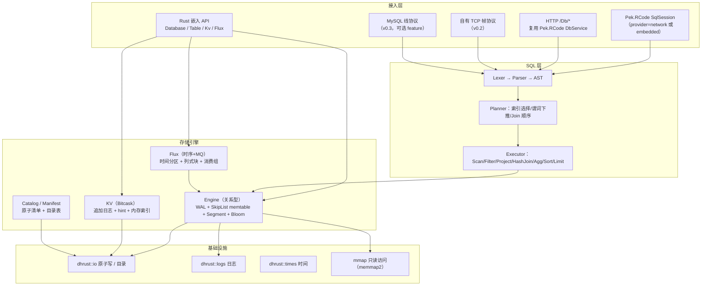
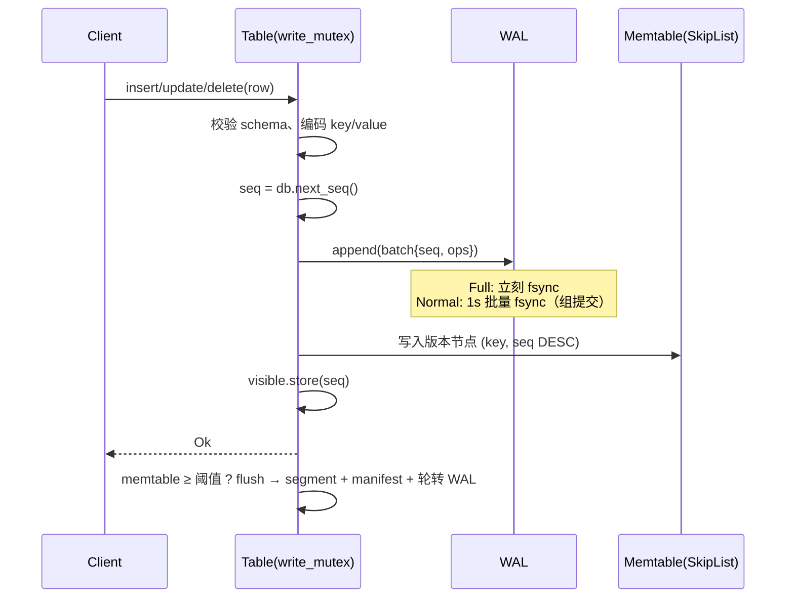
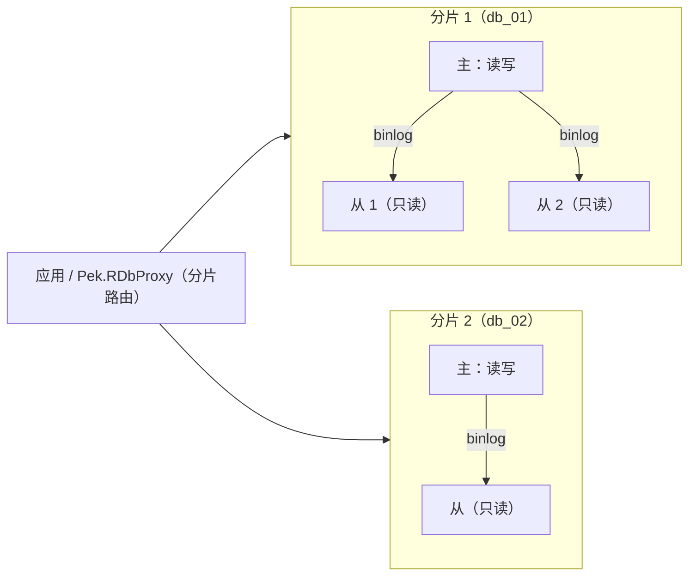
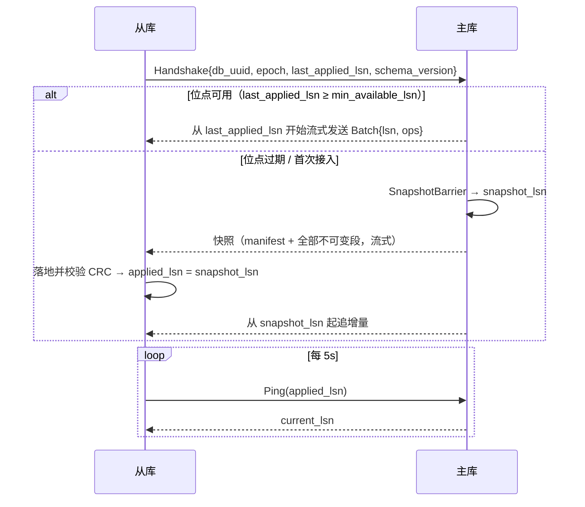

# Pek.RDB 架构设计（v0.1 草案）

> 本文是 Pek.RDB 的**唯一设计口径**：代码与文档冲突时以本文为准，改动设计需同步更新本文并在 `docs/决策记录.md` 追加一节（含用户原话）。
>
> 参考产品：NewLife.NovaDb（C#，嵌入/网络双模、四引擎融合）。**只借鉴能力边界，不照搬实现**；差异见 §2。

---

## 0. 一句话定位

用一个 Rust 进程/库，替代「SQLite（嵌入关系库）+ Redis（KV/队列）+ TDengine（时序）+ 部分 MySQL（网络多客户端）」的四类组件，
以**文件夹即数据库**、**裁剪冷门 SQL 能力**换取**更高读写性能**与**更低运维成本**。

## 1. 目标与非目标

### 1.1 目标

| 维度 | 目标 |
|---|---|
| 部署形态 | 嵌入（库）+ 网络（独立进程），同一套存储内核 |
| 数据规模 | 单表 10⁸ 行量级；总量受磁盘约束，逻辑无上限（按时间/哈希切分） |
| 读写性能 | 单机点查/点写 p99 目标见 §16；写路径 WAL 组提交 + 无随机写放大 |
| 运维成本 | 无外部依赖、无安装步骤；拷目录=迁移/备份；无 dump/restore |
| 生态集成 | Pek.RCode ORM 原生可用（实现 `SqlSession` / 复用 `DbService` 的 `/Db/*` 协议） |
| 依赖约束 | **纯 Rust 依赖，零 C/C++ 动态库**（可 zig 交叉编译 musl） |

### 1.2 非目标（明确裁剪，不做）

- 存储过程、触发器、视图、窗口函数、游标、UDF 插件、字符集/排序规则矩阵。
- 完整 SQL92；只做「业务 80% 常用子集」。
- 跨表强一致事务（MVCC 只保证**单表**事务；多表写事务列为远期可选项，不进 v0.x）。
- 复杂权限体系（网络模式只做「令牌 + 库名」白名单，权限交给上层 Pek.RPermissions）。
- 在线 DDL 的全部形态（v0.x 只支持 ADD COLUMN / CREATE|DROP INDEX / DROP TABLE）。

## 2. 相对 NovaDb 的关键差异（为什么不是照抄）

| 关注点 | NovaDb 做法 | Pek.RDB 做法 | 理由 |
|---|---|---|---|
| 索引结构 | 内存 SkipList **承载全表**，冷数据卸到 MMF 只留稀疏目录 | SkipList 只承载**内存表（memtable）**，落盘为**不可变有序段（segment）**，磁盘段只把稀疏索引 + Bloom 加载进内存 | 全表 SkipList 的指针开销 ≥ 24B/行，10⁸ 行即数 GB；段式布局让常驻内存与表规模解耦，且天然顺序写 |
| 更新模型 | 原地页更新风格 | **追加 + 后台 compaction**（LSM 思路，但按表隔离、段数受控） | 顺序写吞吐高、崩溃恢复简单（WAL 重放即可） |
| 冷热分离 | 「节点常驻内存、冷行卸 MMF」 | **数据永远在段文件**，内存只做「块缓存（LRU）+ 稀疏索引」，热=缓存命中 | 不需要"卸载"动作，无后台迁移抖动；内存占用可硬上限 |
| 时序编码 | 列式块 + 数值编码 + LZ4 | 同思路，但**编码在写入时按块统计自适应选择**（见 §9.3），并把压缩比落在 `_sys.flux_compression` | 自适应编码避免"错误编码反而变大" |
| 网络协议 | 自定义 TCP + RPC | ① 与 Pek.RCode 一致的 **HTTP `/Db/*`**（直接复用 `DbService`，ORM 零改动）；② 自有二进制帧协议（高吞吐、流式、复制通道）；③ MySQL 线协议（可选 feature，后置） | 生态优先：现有 C#/Rust 项目改连接串即可接入 |
| 事务隔离 | MVCC Read Committed | 同左，但**可见性水位按表维护**，避免全局提交锁 | 单表写入串行、跨表互不阻塞 |
| 依赖 | 纯托管 .NET | 纯 Rust（`crc32fast`/`memmap2`/`lz4_flex` 均为纯 Rust 或 syscall 封装） | 受限环境/交叉编译可用 |

## 3. 总体架构



分层原则：

1. **引擎层不依赖 SQL**：SQL 只是引擎的一个调用者；KV/Flux 有各自直连 API。
2. **引擎层不依赖网络**：网络模式只是把 SQL 字符串送进同一个执行器。
3. **所有落盘元数据走原子替换**（`dhrust::io::write_all_text_atomic`），任何时刻断电都不出现半写的 manifest。

## 4. 目录布局：「文件夹即数据库」

```text
mydb/                          # 数据根目录 = 一个数据库
├── PekRDB.toml                # 可选配置（缺省即全默认，零配置）
├── tables/
│   └── users/                 # 每表独立目录 = 独立文件组
│       ├── schema.json        # 表结构（原子写）
│       ├── manifest.json      # 段清单 / WAL 序号 / flushed_seq / 自增水位（原子写）
│       ├── seg/
│       │   ├── 000001.data    # 不可变有序段（数据块）
│       │   └── 000001.idx     # 稀疏索引 + Bloom + 元数据（打开表只读这个）
│       └── wal/
│           └── 000003.wal     # 当前追加日志
├── kv/
│   └── cache/                 # KV 表：000001.log + 000001.hint
├── flux/
│   └── metrics/               # 时序表：按时间分区目录
│       └── 20261031T00/
└── _sys/                      # 系统表：消费组位点、压缩比、慢查询
```

不变式：

- 一个表的所有状态都在这一个目录内 → **删除目录 = 删表；拷贝目录 = 迁移/备份**。
- 段文件写完后**永不修改**（immutable），更新只会产生新段；compaction 只产生新段并删除旧段。
- 任意时刻：`已落盘段` + `当前 WAL` = 完整数据；`manifest.json` 是二者的边界声明。

## 5. 磁盘格式规范（v1）

所有整数小端；CRC 一律 CRC32（IEEE，`crc32fast`）。

### 5.1 Segment `.data`

```text
┌ Header（64B） ────────────────────────────────────────────┐
│ 0..8    magic      "PEKRDBS1"                              │
│ 8..10   format u16 = 1                                     │
│ 10..12  reserved                                           │
│ 12..16  table_id u32                                       │
│ 16..24  run_id u64                                         │
│ 24..32  row_count u64                                      │
│ 32..40  min_seq u64                                        │
│ 40..48  max_seq u64                                        │
│ 48..56  created_ms u64                                     │
│ 56..60  header_crc u32（覆盖 0..56）                        │
│ 60..64  reserved                                           │
├ Block*（默认目标 64KiB） ─────────────────────────────────┤
│ 0..4    payload_len u32                                    │
│ 4..8    row_count u32                                      │
│ 8..12   payload_crc u32                                    │
│ 12..    payload = RowRecord*                               │
└───────────────────────────────────────────────────────────┘

RowRecord（payload 内，按 (key ASC, seq DESC) 排序）：
  key_len   : varint
  key       : bytes（见 §5.4 键编码）
  seq       : u64（提交序号）
  flags     : u8（bit0=墓碑/删除）
  value_len : varint
  value     : bytes（行编码，见 §5.5；墓碑时为空）
```

### 5.2 Segment 索引 `.idx`

```text
Header（64B）：magic "PEKRDBSX1" / version / table_id / run_id / row_count /
               min_seq / max_seq / created_ms / block_count
IndexEntry × block_count：
     first_key_len varint + first_key bytes
     block_offset  u64（.data 内偏移）
     block_len     u32
     row_count     u32（该块行数）
Bloom：bit_len u64 + k u8 + bits
Trailer：crc32（覆盖前面全部字节）
```

- **打开表只读 `.idx`**：稀疏索引 + Bloom 常驻内存，约为数据量的 1/64 ~ 1/32。
- 点查：Bloom 否定 → 直接跳过该段（无 IO）；否则稀疏索引二分定位块 → 读块 → 块内线性扫描。

### 5.3 WAL `.wal`

```text
Header（32B）：magic "PEKRDBWL1" / version / table_id / wal_id / created_ms
Record（一条 = 一个提交批次，原子）：
  crc32 u32（覆盖 len+payload）
  len   u32
  payload = seq u64 + op_count u32 + Op*
Op = flags u8 + key_len varint + key + value_len varint + value
```

- 恢复时按顺序读，遇到 **CRC 不匹配 / 长度越界 / 文件尾截断** 即停止，并把文件截断到最后一个完整记录（容忍断电撕裂）。
- `Full`：每批 `fsync`；`Normal`：每 1s 后台 `fsync`（默认）；`None`：不主动刷盘。

### 5.4 键编码（顺序保持，支持复合主键）

每个分量：原始字节中 `0x00` 转义为 `0x00 0xFF`，分量末尾追加 `0x00 0x01`。
字节序保证「短路前缀 > 任何带延续的串」，因此 `"a" < "a\0b"` 等语义与字符串字典序一致。
固定宽度类型先转大端（有符号整数翻转符号位、浮点做 order-preserving 变换）再走同一转义流程。

### 5.5 行编码

```text
null_bitmap（ceil(列数/8) 字节）+ 按列序拼接非 NULL 列值：
  Bool 1B | Int(i32) 4B | BigInt 8B | Float 4B | Double 8B | DateTime 8B(ms)
  Text/Bytes: varint len + bytes
```

类型来自 `schema.json`；段头记录 `schema 版本`，版本不匹配时拒绝打开（v0.x 不支持在线改列类型）。

### 5.6 manifest.json（每表）

```json
{
  "format": 1,
  "engine": "engine",
  "schema_version": 1,
  "next_run_id": 3,
  "wal_id": 3,
  "flushed_seq": 120,
  "next_identity": 1001,
  "runs": [
    {"id": 1, "rows": 5000, "min_seq": 1, "max_seq": 100},
    {"id": 2, "rows": 800,  "min_seq": 101, "max_seq": 120}
  ]
}
```

`runs` 顺序 = 从旧到新。恢复时：加载全部段 → 重放 `wal/` 中 `seq > flushed_seq` 的记录（`seq <= flushed_seq` 的在段里）。

## 6. Engine 读写路径

### 6.1 写路径（单表串行，跨表并行）



为什么单表串行：memtable 是内存 SkipList，多写者无锁插入实现复杂且收益有限（瓶颈通常在校验与编码）；**跨表完全并行**，
且刷盘/压缩在写锁外进行（读取不受影响）。

### 6.2 读路径

```text
get(key)：
  memtable（含未刷盘的最新版本）→ 各段从新到旧（Bloom 先判、稀疏索引二分）
  → 取 seq ≤ snapshot 的最大版本 → 墓碑则返回 None
scan(range)：
  memtable 有序迭代器 + 各段有序迭代器 → k 路归并 (key ASC, seq DESC)
  → 每个 key 取首个可见版本 → 去墓碑 → 产出
```

`snapshot` 取表级 `visible_seq`（Read Committed：每条语句取一次）。

### 6.3 Compaction

- 触发：段数 ≥ 8 或 墓碑比例 ≥ 20%。
- 策略：**Tiered（v0.x）**：把最旧的 N 个段 + 覆盖这些 key 的新段一起归并，输出新段；墓碑在「已无更旧段持有该 key」时丢弃。
- 全程后台线程、写新段不改旧段，完成后原子替换 manifest 再删除旧文件 → 失败只会留下垃圾段（下次启动清理）。

### 6.4 冷热分离与内存预算

| 常驻内存项 | 量级 | 说明 |
|---|---|---|
| memtable | `memtable_bytes`（默认 64MiB） | 超阈值即刷盘 |
| 段稀疏索引 | ~1/64 数据量 | 每块一个 first_key |
| Bloom | 10 bit/行 | 每段独立 |
| 块缓存 | `block_cache_bytes`（默认 64MiB） | LRU，热数据自然常驻 |

**1000 万行、只查最近 1 万行**：新段在内存（memtable），旧段只读稀疏索引 + 少量块 → 常驻内存 < 20MB。
（对比 NovaDb：全表 SkipList 常驻 → 同规模 ≥ 240MB。）

## 7. SQL 子集（v0.x）

| 能力 | 支持 | 备注 |
|---|---|---|
| DDL | `CREATE TABLE`（含 PK/UNIQUE/自增/默认值）、`DROP TABLE`、`CREATE/DROP INDEX`、`TRUNCATE`、`ALTER TABLE ADD COLUMN` | 无视图/触发器/存储过程 |
| DML | `INSERT`（多行）、`UPDATE`、`DELETE`、`UPSERT`（`ON DUPLICATE KEY UPDATE`） | 参数化 `@p0`/`?` |
| 查询 | `SELECT` 列/表达式/别名、`WHERE`、`ORDER BY`、`LIMIT/OFFSET`、`GROUP BY`+`HAVING`、`INNER/LEFT JOIN`（等值走 HashJoin，非等值 NestedLoop）、`IN/EXISTS` 子查询、`DISTINCT` | 无窗口函数 |
| 聚合 | `COUNT/SUM/AVG/MIN/MAX`，时序表额外 `FIRST/LAST/SPREAD` | |
| 函数 | 字符串/数值/日期/转换/条件约 40 个（v0.2 起逐步补齐） | 与 C# 侧口径对齐 |
| 事务 | `BEGIN/COMMIT/ROLLBACK`（单表 MVCC，Read Committed） | 跨表事务：不做 |

执行器形态：**嵌套循环 + 谓词下推 + 索引选择**（v0.x）；HashJoin / HashAgg / 外部排序（超出内存转段文件）在 v0.2/v0.3 补齐。

## 8. 表达式求值

`Expr` → 编译为 `Vec<Instr>`（寄存器式字节码）后按行执行，避免递归 AST 解释的函数调用开销（参考 SQLite VDBE 思路，简化）。
常量折叠、列引用改下标；`WHERE` 中 `pk = 常量` 直接转点查，`pk BETWEEN` 转区间扫描。

## 9. Flux 引擎（时序 + 消息队列）

### 9.1 分区

- 分区键 = 时间戳截断到 `partition_span`（默认 1h，可配 1m~1d）。
- 每个分区 = 一个目录，内含 `data.flux`（追加）+ `meta.json`（行数/时间范围/封存状态）。
- 写入只追加；分区封存（sealed）后不再写，转为列式块。

### 9.2 列式块封存

- 每 4096 行或分区封存时，把行式缓冲转列式块：`列数 × 值流`，块头记录每列编码方式。
- 块内时间列必为递增（否则拒绝写入并报错，避免乱序破坏压缩率）。

### 9.3 类型感知编码（按块自适应）

| 列特征 | 编码 |
|---|---|
| 常量列 | RLE |
| 整数且单调 | Delta / Delta-of-Delta（二阶差分）、zigzag varint |
| 浮点 | Gorilla XOR（前值异或 + 前导/尾随零压缩） |
| 低基数字符串 | 字典编码（字典 + 索引位宽） |
| 随机数值 | 原始 + LZ4 块压缩 |
| 全空列 | 只记 NULL 位图 |

编码候选按块**采样估算**选择（取估算字节数最小者），压缩比与选择结果写入 `_sys.flux_compression`。

### 9.4 消费组（Redis Stream 风格）

```text
group: cg_name
  last_delivered_id      ← 组游标
  pending[msg_id] = {consumer, deliver_ts, delivery_count}
  consumer_last_ack
```

- `XADD` 等价：普通 INSERT（返回 message_id = `ts-seq`）。
- 读取：`SELECT ... WHERE timestamp > last_delivered AND _group='cg'`（内部 API，不进 SQL）。
- 投递即入 Pending；`ack` 后移除；`claim`（超时重投）与 `delivery_count` 上限 → 死信表。
- Pending 位点持久化在 `_sys/consumer_group.json`（原子写，秒级批量）。

### 9.5 TTL 与 Rollup

- TTL：分区级删除（整目录删除，O(1)），后台按分钟巡检；也可配「按容量保留」。
- Rollup：`CREATE ROLLUP ... INTERVAL 1m` 后台把封存块预聚合成 `avg/min/max/count/sum` 段；
  查询 `AVG(x)` 且粒度 ≥ rollup 粒度、时间范围完整覆盖时**自动路由**到 rollup 段（`EXPLAIN` 可见）。

## 10. KV 引擎（Bitcask）

- 日志：`kv/<table>/000001.log`，记录 `crc|ts|expire_at|flags|klen|vlen|key|value`，只追加。
- 内存索引：`HashMap<key, (file_id, offset, len, expire_at)>`，启动时从 `.hint` 快速重建（无 hint 则重放日志）。
- 写：追加 + 更新索引；`sync` 策略与 WAL 一致。
- 合并：旧值占比 > 50% 时后台重写（只保留每 key 最新值 + 未过期）。
- 能力：`get/set/add/del/inc/ttl/scan_prefix`，多表隔离，TTL 惰性 + 后台清理。

## 11. 嵌入与网络双模

### 11.1 嵌入（Rust 库）

```rust
let db = pek_rdb::Database::open("./mydb")?;
let users = db.create_table(Schema::builder("users")
    .column("id", DataType::Int, |c| c.primary_key().auto_increment())
    .column("name", DataType::Text, |c| c.not_null())
    .build())?;
users.insert(&[Value::Null, Value::Text("Alice".into())])?;
```

### 11.2 与 Pek.RCode 集成（两种姿势）

1. **嵌入**：`pek_rdb::provider::RdbSession` 实现 `pek_rcode::session::SqlSession`（`kind()` 返回 `DatabaseKind::Sqlite` 或新增枚举），
   ORM 的建表/CRUD 直接落在本引擎。
2. **网络**：服务端挂 `pek_rcode::db_service::DbService` 的 `/Db/*` 路由（连接串 `Server=http://host:port;Database=mydb;Password=token;provider=network`），
   返回 DbTable v3 二进制；**现有项目只改连接串**。

### 11.3 自有 TCP 协议（v0.2）

```text
Frame: len u32 | crc32 u32 | type u8 | req_id u64 | payload
type: 1=Login 2=Query 3=Execute 4=Begin 5=Commit 6=Rollback 7=Ping 8=Subscribe(binlog) 9=Ack
```

- 单连接多请求并发（req_id 复用），响应可乱序。
- 二进制参数/结果（列式批量返回），避免 JSON 往返。
- 复制通道复用同一协议（`Subscribe` + 位点续传）。

### 11.4 MySQL 线协议（可选 feature，v0.3）

只实现 `COM_QUERY` / `COM_PING` / `COM_QUIT` / 预处理语句骨架 + 文本/二进制结果集，
让现有 MySQL 驱动/客户端可直连；**不作为主推路径**（生态内主推 `/Db/*` 与自有协议）。

## 12. 集群：主从同步与分片（v0.4 起）

### 12.1 三种形态

| 形态 | 拓扑 | 解决什么 | 不解决什么 |
|---|---|---|---|
| **A. 单库一主多从** | 1 写 + N 只读 | 读扩展、容灾、备份不影响主库 | 单机写上限 |
| **B. 多库分片** | `db_01 … db_NN` 各自一主多从 | 数据量逻辑无上限、写扩展 | 跨分片 JOIN / 事务 |
| **C. A + B 组合** | 每分片各自一主多从 | 生产推荐形态 | 同上 |

引擎只实现「单库一主多从」；**分片是路由层的事**（`Pek.RDbProxy` 或应用侧），不用分布式事务换复杂度。



### 12.2 角色与硬规则

- **主（primary）**：唯一写入口；每批提交按「分配 `lsn` → 写 WAL → 写 binlog → 发布可见」顺序。
- **从（replica）**：只读；把 binlog 批次写本地副本 WAL → memtable；**默认拒绝一切写语句**（报 `ReplicaReadOnly`），
  不做"从库偷偷写"——否则主从分叉后无法自动收敛。
- **epoch（代数）**：主库每次被提升/重建 +1，单调递增；从库只接受 `epoch ≥ 自身` 的握手，旧主恢复后必须先 `demote`。

### 12.3 binlog 与 WAL 的区别（不要合并成一个文件）

| 项 | WAL | binlog |
|---|---|---|
| 用途 | 本地崩溃恢复 | 跨节点复制 / 断点续传 |
| 截断 | memtable 刷盘后即删 | 保留 `BinlogRetentionHours` / `BinlogMaxBytes`，可配置 |
| 序号 | `seq`（本地提交序） | `lsn`（全局复制序，主库分配） |
| 记录 | `[crc][len][seq][count][op*]` | `[crc][len][lsn][seq][table][count][op*]` |

- `lsn` 与 `seq` **在同一把写锁内分配**，保证复制流顺序 = 本地提交顺序。
- 落盘：`binlog/{first_lsn:012}-{last_lsn:012}.blog` 滚动文件 + `binlog.index`（lsn → 文件偏移）；
  按 `lsn` 二分定位，支持任意位点续传。
- 从库默认 `log_replica_updates = false`（不形成级联写放大）；需要级联复制时显式打开。

### 12.4 同步流程



要点：

1. **全量同步 = 拷贝不可变段**：段文件写后不改，主库可在继续服务的同时流式发送；
   `manifest` 原子切换后才发新段名，从库不会看到「半段」。
2. **快照与增量无缝衔接**：`SnapshotBarrier` 记录 `snapshot_lsn`，之后所有批次都进 binlog → 从库落地快照后直接从该 lsn 追。
3. **应用位点持久化**：从库每 N 批（默认 100 批或 1s）原子写 `replica.json`（`applied_lsn/epoch/master`）；
   崩溃后从该位点续传（幂等：同 `lsn` 重放覆盖同 `seq` 版本，不产生重复行）。
4. **校验**：每批 CRC 已在记录头；全量同步额外做「段文件 CRC + 大小」对账，不符即整段重传，绝不"跳过坏段"。

### 12.5 一致性语义（写清楚，不模糊）

| 级别 | 行为 | 代价 |
|---|---|---|
| **异步（默认）** | 主库返回成功即完事；从库 lag 秒级 | 主库宕机可能丢未复制批次 |
| **READ YOUR WRITES（可选）** | 写返回 `lsn`；客户端读从库带 `min_lsn`，从库未追上则**等待** `MaxWaitMs`，超时报 `ReplicaLagExceeded` | 读延迟抖动 |
| 同步强一致 | **不做**（无 quorum / 无 Raft） | — |

- 只读查询默认不等待；需要强读语义就走主库或带 `min_lsn` 读从库。
- `lag` 用两个数：`lag_lsn`（差值）与 `lag_ms`（按主库提交时间戳估算），都在 `_sys.replication` 可见。

### 12.6 故障转移（人工切主，禁止自动选主）

标准步骤（脚本 `tools/cluster/promote.ps1`，v0.5）：

1. 主库停写（`SET READONLY` 或停进程）。
2. 等目标从库 `lag_lsn = 0`（否则先追平，追不上就明确报告"可能丢 N 批"，由人决定）。
3. `promote`：清除 `replica.json`、`role=primary`、`epoch+1`、分配新 `db_uuid` 分支。
4. 其余从库 `reconfigure --master <新主>`，握手校验 epoch。
5. 旧主恢复后必须 `demote --master <新主>`（会做一次全量对账），**否则拒绝写入**：
   报错写明「本节点 epoch=3 落后于集群 epoch=4，需先 demote 并全量对账」。

不做：自动选主、多主写入、跨分片两阶段提交。

### 12.7 分片约定（数据量无上限的落点）

- 分片单位 = **一个数据库文件夹**（可独立备份/迁移/升级）。
- 分片键必须包含在主键首位（否则查询只能全分片广播）；路由层按 `hash(shard_key) % N` 或时间范围路由。
- 跨分片查询由路由层聚合（`UNION ALL` 各分片结果后排序/分页），引擎不实现分布式执行器。
- 扩容：新分片空库 + 双写回填 + 校验 + 切读（`tools/shard-rebalance`，v0.6）。
- 每个分片目录内仍是标准结构（§4），单分片可直接拷走或降级为嵌入模式使用。

### 12.8 配置样例

```toml
[Server]
Listen   = "0.0.0.0:5599"
Database = "Data/mydb"

[Replication]
Role   = "primary"        # primary | replica
Epoch  = 1
# —— 主库侧 ——
BinlogRetentionHours = 168
BinlogMaxBytes       = 10_737_418_240
MaxSyncMbps          = 200            # 全量同步限速，避免打满生产带宽
# —— 从库侧 ——
# Master        = "tcp://10.0.0.5:5599"
# Token         = "<令牌，不入明文配置，用环境变量或加密项>"
# MaxWaitMs     = 2000   # READ YOUR WRITES 最长等待
# AllowWrites   = false
```

### 12.9 观测与运维

- `_sys.replication` 一行一节点：`role / epoch / db_uuid / current_lsn / applied_lsn / lag_lsn / lag_ms / connected / last_error`。
- `-status` 输出：`role=replica epoch=4 lsn=123456 lag=0.3s peer=10.0.0.5`。
- 复制错误必须带上下文（哪条 lsn / 哪张表 / 失败原因），与 §13 日志规范一致。

### 12.10 带宽与资源预算（按全局惯例自检）

| 行为 | 频率 | 单次开销 |
|---|---|---|
| 增量复制 | 每批提交 | 批次原始字节（≤64KB/批），无额外封装膨胀 |
| 心跳 | 5s | < 100B |
| 全量对账 | 每次同步启动 | 段 CRC 抽样 + 大小比对 |
| 位点落盘 | 100 批 / 1s | 一次原子写（< 200B） |

空闲期不轮询整库、不做全量摘要；`lag` 计算是纯内存比对。

## 13. 可靠性与恢复

| 场景 | 行为 |
|---|---|
| 进程崩溃 | 重放当前 WAL，截断撕裂尾记录；已 flush 的段不动 |
| 断电（`Full`） | 已返回成功的提交不丢 |
| 断电（`Normal`/`None`） | 最多丢最近 1s / 全部未刷盘提交（文档必须写明） |
| 段 CRC 校验失败 | 拒绝打开该段并报出文件+偏移；不静默跳过（避免"少数据还正常启动"） |
| manifest 半写 | 原子替换保证不出现：写临时文件 → fsync → rename |
| 拷贝文件夹 | 需在停止写入（或 `checkpoint`）后拷贝；在线拷贝必须连 WAL 一起拷 |

## 14. 并发与背压

- 线程模型：**写路径同步、I/O 无 tokio 依赖**（嵌入模式可零运行时）；网络模式由 `dhrust::net::http` 的线程池驱动。
- 锁顺序：`write_mutex` → `state.write()` → `memtable.write()`；读只取 `state.read()` + `memtable.read()`，不持锁做 IO。
- 背压：memtable 达阈值时**写线程自己触发 flush**（简单可控）；后续改为「写线程标记 + 后台刷盘 + 写线程等待」，避免长尾。

## 15. 可观测性

- `_sys` 系统表：`_sys.flux_compression`（压缩比）、`_sys.consumer_group`（位点）、`_sys.stats`（每表行数/段数/内存占用/块缓存命中率）、`_sys.slow_query`。
- `-status` 子命令与面板接口输出一行摘要（复用 Pek 生态惯例：`dhrust::logs`、`Config/*.toml` 热重载）。

## 16. 性能目标（验收口径，必须实测）

| 场景 | 目标 | 测量方法 |
|---|---|---|
| 单表点写（WAL `Normal`，批量事务 100 行/批） | ≥ 50 万行/s（本机 NVMe） | `benches/engine_bench.rs` |
| 单表点查（10⁷ 行表，内存命中） | ≥ 100 万次/s 单线程 | 同上 |
| 范围扫描 1 万行 | ≤ 5ms（1000 万行表，冷缓存） | 同上 |
| 常驻内存（1000 万行，查最近 1 万行） | < 20MB | `-status` 输出 RSS |
| Flux 写入 1000 万点 | ≥ 200 万点/s，压缩比 ≥ 5× | `benches/flux_bench.rs` |
| 恢复 1GB WAL | ≤ 3s | `tests/recovery.rs` |

> 口径：**没有实测数字不写进 README**（用户 2026-10-29：「不能猜」）。

## 17. crate 结构与里程碑

```text
Pek.RDB/
├── Cargo.toml                 # crate: pek-rdb（lib + bin）
├── src/
│   ├── lib.rs
│   ├── error.rs               # 统一错误（带路径/偏移上下文）
│   ├── value.rs               # Value / DataType
│   ├── schema.rs              # 列定义 / 行编码 / 键编码校验
│   ├── key.rs                 # 顺序保持键编码
│   ├── codec.rs               # varint / crc / 位图
│   ├── bloom.rs               # 段级 Bloom
│   ├── memtable.rs            # Arena SkipList（(key, seq DESC) 排序）
│   ├── wal.rs                 # 追加日志 + 组提交 + 重放
│   ├── segment.rs             # 段写入/读取（mmap + 稀疏索引 + 块缓存）
│   ├── manifest.rs            # manifest.json 原子读写
│   ├── table.rs               # 表：CRUD / 扫描 / flush / compaction
│   ├── db.rs                  # Database：目录扫描 / 建表 / 全局序号
│   ├── sql/                   # lexer / parser / ast / plan / exec（v0.2）
│   ├── kv.rs                  # Bitcask（v0.3）
│   ├── flux/                  # 分区 / 列式块 / 编码 / 消费组（v0.4）
│   ├── server/                # /Db/* + 自有协议 + 复制（v0.4）
│   └── provider.rs            # Pek.RCode SqlSession 适配（v0.4）
├── tests/                     # 引擎 / 恢复 / SQL / 并发 回归
├── benches/
└── docs/
```

| 里程碑 | 内容 | 状态 |
|---|---|---|
| **M1 存储内核** | codec/key/schema/memtable/WAL/segment/manifest/table/db + 崩溃恢复回归 | **本次交付** |
| M2 SQL 子集 | lexer/parser/executor（CRUD + WHERE/ORDER/LIMIT/GROUP/JOIN）+ 二级索引 | 下一步 |
| M3 KV + Flux | Bitcask、时间分区、列式编码、TTL、消费组 | |
| M4 双模服务 | `/Db/*`（复用 DbService）、自有 TCP、`SqlSession` provider、`-status` | |
| **M5 集群（详见 §12）** | ① binlog（lsn/滚动文件/索引）② 全量快照流式同步 ③ 增量续传 + `replica.json` 位点 ④ 从库只读门禁 ⑤ `epoch` 防脑裂 + 人工切主脚本 | |
| M6 运维面 | `_sys` 统计（含 `_sys.replication`）、compaction 调度、基准报告 | |
| M7 分片工具 | 分片路由约定落地（`Pek.RDbProxy` 或应用侧）、`shard-rebalance` 双写回填 | |

## 18. 待定问题（需拍板）

1. **库名/枚举**：`SqlSession::kind()` 目前只有既有数据库类型；是新增 `DatabaseKind::PekRdb`，还是复用 `Sqlite` 方言（改动面更小）？
2. **目录命名**：`tables/` 内用表名直连（大小写敏感）还是统一小写 + 原始名映射？
3. **集群事务语义**：是否需要 READ YOUR WRITES（写返回 `lsn`，读从库带 `min_lsn` 等待）？默认异步复制是否够用？
   （从库一律只读，不讨论双向写。）
4. **切主方式**：人工切主（脚本化）是否够用，还是需要引入共识/自动选主？（当前设计：**不做自动选主**）
5. **分片路由归属**：分片键路由放 `Pek.RDbProxy`（多项目共用），还是各应用自带？
6. **Flux 分区粒度默认值**：1 小时 vs 1 天（取决于目标写入速率）。
